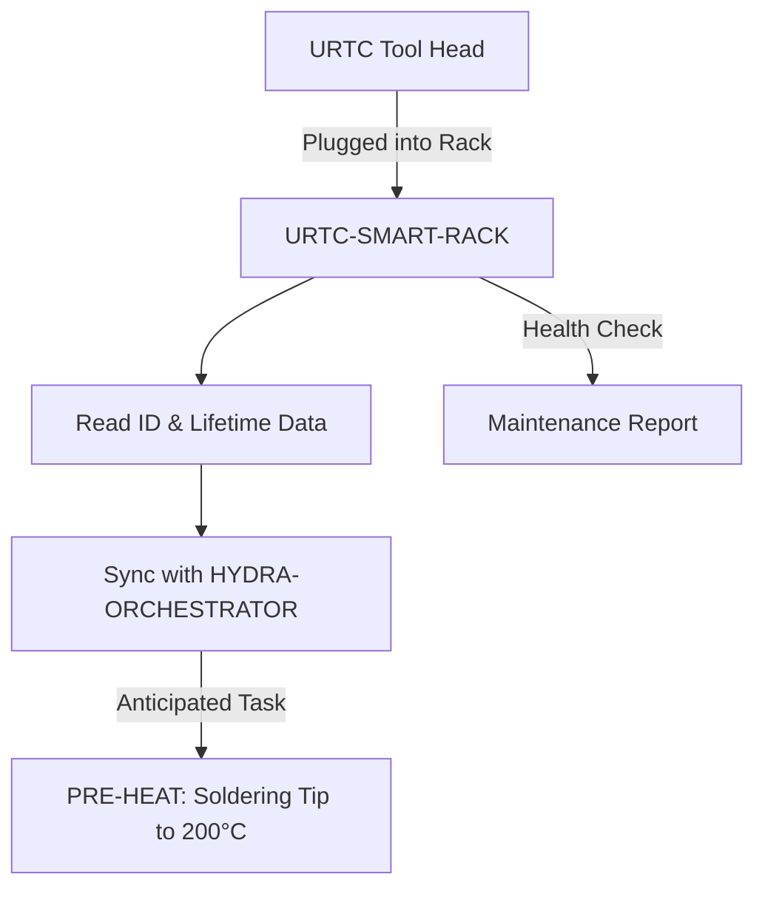

<p align="center">
  
</p>

# 🗄️ URTC-SMART-RACK

<p align="center">🇺🇸 <b>English</b> | <a href="README_spa.md">🇪🇸 Español</a> | <a href="README_fra.md">🇫🇷 Français</a> | <a href="README_ita.md">🇮🇹 Italiano</a> | <a href="README_deu.md">🇩🇪 Deutsch</a> | <a href="README_zho.md">🇨🇳 简体中文</a> | <a href="README_jpn.md">🇯🇵 日本語</a> | <a href="README_por.md">🇵🇹 Português</a></p>

### 🤖 Intelligent End-Effector Management with Lifecycle & Thermal Tracking

<p align="center">
  
  
  
  
</p>

**Honesty check - what actually runs today:** `tool_id.c`, `lifecycle.c`, `preheat.c`, `protocol.c`, `rack_command.c`, `link_watchdog.c`, `tool_limits.c`, `rack_app.c`, `rack_link.c`, `rack_deframer.c`, `rack_can.c`, `preheat_limit.c` and `rack_inventory.c` are real, pure C, backed by 467 passing `TEST_ASSERT` checks (`tests/test_*.c`, compiled and run against the host's own C compiler, not `arm-none-eabi-gcc`) - confirmed by compiling and running that exact host test suite. That covers ID decoding, usage/lifecycle tracking, pre-heat activation and target temperature, CRC8-framed protocol parsing, command range validation, link-timeout/idempotency handling, and multi-slot tool inventory tracking (which tool is racked where, one physical tool never in two slots at once) - all of it logic, none of it hardware. As the README's own intro already says: no PCB/schematic exists for this board yet, so nothing here has ever driven a real GPIO pin, F-RAM chip, heater, or CAN transceiver - `main.c`/`startup_stm32g4_minimal.c` only prove the Cortex-M4F cross-compile and link succeed against a placeholder linker script, not that any of this runs on real silicon. See `CHANGELOG.md` for exactly what has shipped so far. The serial line is tested too: 19 streams of bytes with the time each piece arrived (a frame in pieces, noise, a bad CRC, a version or a length that does not fit, a silence at the limit of the timeout, a wrap of the millisecond clock) go through the real deframer, and the frames that come out and its counters are those of the model of URTC-COMMON.

---

> **Safety and security status:** this ecosystem is not a certified safety system, and no populated URTC board exists yet. The bootloaders check firmware images with CRC32 and a shared-key HMAC-SHA256, not with an asymmetric signature (planned); the published application images are signed with the public development key (`signing_key_kind: dev`), so anyone can produce an image the bootloader accepts; nothing has been transmitted to a real board. Read the [security baseline](https://github.com/JuanenRac/URTC-DOCS/blob/main/docs/SECURITY_BASELINE.md) and the [threat model](https://github.com/JuanenRac/URTC-DOCS/blob/main/docs/THREAT_MODEL.md) before relying on any statement here for the safety of a person.

## 📋 At a glance

| | |
|---|---|
| Version | `0.2.1` |
| Maturity | Functional |
| Stack | C / STM32G4 / arm-none-eabi-gcc |
| Target | A microcontroller board (the firmware); built on a PC |
| On real hardware | Not yet: no run on real hardware is recorded for this version |

<!-- urtc-section:status_smart_rack -->
## 🚦 Project status

🟢 done and verified · 🟡 works, with known limits · 🟠 half done or not verified · 🔴 not done or not working. Nothing is green if it never ran on real hardware.

| Part | Status | What the repository can show |
| --- | :---: | --- |
| Software | 🟡 | Works on a PC and against the simulator; never run against a real board. |
| Tests | 🟢 | The test suite passes in the CI on every push. |
| Real hardware | 🟠 | No run on a real board yet: the bench test is still pending. |
| Documentation | 🟡 | README in eight languages and reference documents; the translations were not reviewed by native speakers. |

<!-- /urtc-section:status_smart_rack -->

## 1. 🛠️ TECHNICAL OVERVIEW

**URTC-SMART-RACK** is an intelligent storage system for end-effectors within the HYDRA-UMC ecosystem. Based on the STM32G4 microcontroller, it monitors and prepares tools while they are not attached to a robot.

It enables "Smart Idle" modes, such as pre-heating T12 soldering tips just before a tool swap, and tracks the electronic ID and total usage cycles of every URTC head (reading each head's firmware version is planned, not implemented), ensuring optimal maintenance and zero-second deployment.

No PCB/schematic exists for this board yet (see `hardware/`), so nothing below can drive real GPIO/F-RAM/CAN hardware - but the *logic* those features boil down to (decoding an ID, tracking usage, deciding when to pre-heat and to what temperature) is real, pure C, unit-tested today.

### Key Features:
* ✅ **Real v0 - tool ID, lifecycle & pre-heat logic:** `tool_id.c` decodes a raw 5-bit ID reading into a tool identity; `lifecycle.c` tracks usage cycles/time and flags maintenance due; `preheat.c` decides when Smart Idle pre-heating should start and to what target temperature. 467 test assertions on the host's own C compiler - no PCB, GPIO driver, or F-RAM needed to run or test any of it. Also real: a stream deframer for the serial link (`rack_deframer.c`: finds the start byte, resynchronises after a lost byte and drops a half frame after a timeout), the CAN form of the command (`rack_can.c`: eight data bytes, big-endian temperature; no board carries it yet) and a limit on how long a pre-heat may run without a tool swap (`preheat_limit.c`: 10 minutes by default, configurable).
* ✅ **Heads as units, thermal check and predictive pre-heat (host-tested):** `rack_inventory.c` can key a slot by the type plus the serial number of the head, and `rack_units.c` keeps the use, the heater time and the thermal faults of each physical head (from its own counters, `0x1AA` / `0x1AB`), so wear follows the head and not the type; `slot_verify.c` says what a thermal reading of a slot means for the pre-heat that was ordered (reached, too slow, overshoot, a heater on in an empty slot); `preheat_plan.c` turns the job queue into pre-heat orders, switched off by default. The reading and the queue come from other programs, nothing here has run on a board, and the heating times are estimates.
* 🗄️ **Tool Tracking** — automatic identification of URTC heads via 5-bit ID jumpers or F-RAM. *(the ID-decoding logic itself is real - see above; reading real jumpers/F-RAM needs the PCB.)*
* 🗂️ **Multi-Slot Inventory** — `rack_inventory.c` tracks which tool is physically racked in which slot, keeps a real tool in exactly one slot at a time (re-racking it elsewhere clears its old slot instead of claiming it's in two places at once), and a per-slot pre-heat target reached by tool identity. On boot, `rack_inventory_reconcile()` checks it against one presence sensor per slot: a tool pulled while the rack was off is cleared (pre-heat target included) and a tool dropped in by hand is flagged for identification. *(the inventory logic itself is real - see above; wiring it to real per-slot presence sensors needs the PCB.)*
* 🌡️ **Pre-Heating Logic** — intelligent thermal management for soldering and hot-air tools. *(the activation decision and target temperatures are real - see above; driving a real heater needs the PCB.)*
* 📈 **Lifecycle Logs** — records total actuation cycles and hours of use into the tool's F-RAM. *(the counters and maintenance-due logic are real - see above; persisting them to real F-RAM needs the PCB.)*
* 📡 **CAN Integration** — meant to communicate with the HYDRA-UMC Kinematic Brain for coordinated ATC (Auto Tool Change); this has never run, because no CAN driver or board exists. *(the wire protocol itself - framing, CRC, command validation - is real and host-tested, see below; a real CAN transceiver to actually carry it is still needed.)*
* 🔒 **Protocol Range Checks** — versioned framing with a CRC8 checksum, actuation-range validation and a link-timeout/idempotency watchdog with a defined safe state. Frame version 2: every multi-byte value is big-endian, like the bus, and a version 1 frame is refused. *(implemented as pure C and tested on a PC only; never run on a board, and not a certified safety function)*
* ✅ **Cortex-M4F firmware toolchain** — a real bare-metal image (startup + linker + `main.c`) that cross-compiles and links with `arm-none-eabi-gcc`, the same toolchain sibling repo URTC uses. *(implemented — see BUILD below)*

---

## 2. 🔄 SMART RACK WORKFLOW



---

## 3. 🧱 ARCHITECTURE & DESIGN DECISIONS

* **Why this board has no real pinout/hardware ID defined yet.** There is no PCB for this board yet - `src/firmware_common.h` carries a version identity with no hardware ID, and the startup/linker files are hand-written placeholders standing in for ST's own CMSIS/HAL startup until a real STM32G4 part is pinned down.
* **Why it isn't a child of URTC itself.** URTC-SMART-RACK is a Complementary Tool, not a URTC-family child - it's a separate physical board (a tool storage rack, not a tool head) that happens to share URTC's own tool ID space and firmware conventions, not its integration hierarchy.
* **Why `bump_version.py` is a straight copy of URTC's own.** Same odometer versioning rule, same firmware-header format - reusing the exact script rather than reinventing it keeps the two in lockstep by construction.
* **Why `tool_id.c`/`lifecycle.c`/`preheat.c` ship before any GPIO/F-RAM/CAN driver.** Decoding an ID, accumulating usage, and deciding when to pre-heat are pure functions of data already in hand - they need no PCB to write or test, so v0 lands that logic first, host-tested with the machine's own C compiler rather than `arm-none-eabi-gcc`. The drivers that would actually source that data from real hardware come once the PCB exists.
* **How this fits the rest of the ecosystem.** Uses URTC's own tool ecosystem (the same tool IDs; the rack's frames are not CAN frames yet, see `docs/OPERATIONS.md`), and is a natural pairing with HYDRA-UMC-DETECTION-HEF for visually recognizing which tool is actually racked.
* **Why the protocol, command validation, and link watchdog are three separate modules.** `protocol.c` only knows about bytes, framing and a CRC - it has no idea what a "safe" temperature is. `rack_command.c` owns that judgment, decoding and range-checking a real command without caring how it arrived on the wire. `link_watchdog.c` tracks timeout/idempotency independently of both - a corrupted frame must never even reach it (see `test_rack_link_scenarios.c`'s own real assertion that a bad-CRC frame never revives the watchdog). Keeping these separate is what makes each one host-testable on its own, and keeps a future CAN receive handler thin - it calls each layer in order, it doesn't reimplement any of their judgment itself.
* **Command rate limiter.** A flood of commands for one tool is held back by a minimum interval between accepted commands (default 20 ms, 0 turns it off; `link_watchdog_set_command_interval()`). A held command changes nothing and gets no acknowledgement, but still counts as a live link; a safe state or a retransmission is never held back. The interval can be adjusted in the simulated rack bench of URTC-WEB-STUDIO.
* **Why an unproven link is treated exactly like a dead one.** `link_watchdog_is_link_lost()` is true both after a real timeout AND before the very first frame has ever arrived - the diagnosis notes' own "estado seguro al arrancar". A rack that powers on with no host yet connected must start in the safe state, not silently assume "fine" until proven otherwise.

---

## 📂 DIRECTORY STRUCTURE

```text
URTC-SMART-RACK/
├── src/                            # Firmware source
│   ├── firmware_common.h           # FIRMWARE_VERSION_MAJOR/MINOR/PATCH
│   ├── tool_id.h / .c              # Real: 5-bit raw reading -> tool ID decoding
│   ├── lifecycle.h / .c            # Real: usage-cycle/time tracking, maintenance-due check
│   ├── preheat.h / .c              # Real: Smart Idle activation + target temperature + safe-state target
│   ├── protocol.h / .c             # Real: versioned frame format + CRC8 parse/encode
│   ├── urtc_crc8.h                 # Real: CRC-8 shared with the vision sensor link (copied from URTC-COMMON)
│   ├── urtc_frame.h                # Real: frame layer (start byte, version, length, CRC) shared with the vision sensor link (copied from URTC-COMMON)
│   ├── urtc_rate_limiter.h         # Real: minimum-interval limiter of the commands of a tool (copied from URTC-COMMON)
│   ├── urtc_common.lock.json       # Lock of the files copied from URTC-COMMON
│   ├── rack_command.h / .c         # Real: command decode + actuation-limit validation
│   ├── link_watchdog.h / .c        # Real: link timeout + command idempotency
│   ├── rack_link.h / .c            # Real: frame-dispatch decision (rack_link_decide) tying protocol/rack_command/link_watchdog/preheat together
│   ├── rack_inventory.h / .c       # Real: multi-slot tool inventory - which tool is racked where, one tool never in two slots at once
│   ├── tool_limits.h / .c          # Real: highest pre-heat target per tool profile (0 = no heater)
│   ├── rack_app.h / .c             # Real: applies the receive-path decision to the inventory; safe state while the link is lost
│   ├── rack_deframer.h / .c        # Real: finds the frames in the byte stream of the serial link (resynchronisation, silence timeout)
│   ├── rack_can.h / .c             # Real: how the rack command will travel on CAN once a board with a transceiver exists
│   ├── preheat_limit.h / .c        # Real: the longest pre-heat without a tool swap
│   ├── preheat_plan.h / .c         # Real: predictive pre-heat from the job queue
│   ├── slot_verify.h / .c          # Real: what a thermal reading of a slot says about it
│   ├── rack_units.h / .c           # Real: identity and wear of each physical tool head
│   ├── main.c                      # Minimal entry point (proof-of-life heartbeat loop)
│   ├── startup_stm32g4_minimal.c   # Vector table + Reset_Handler (no ST HAL yet, see file header)
│   └── STM32G4_MINIMAL.ld          # Placeholder linker script (128K FLASH / 32K RAM floor)
├── tests/                          # Real host-native test harness (tool_id, tool limits, lifecycle, preheat, protocol, rack_command, link_watchdog, rack link scenarios, rack inventory, robustness, rack_app) and Python checks that the build scripts and the published test count agree
├── docs/                           # Operations guide (docs/OPERATIONS.md): what the logic does, refuses and leaves unverified
├── hardware/                       # Hardware notes (README.md) - no design files yet (no schematic, no PCB)
├── firmware/                       # Build output (.bin/.elf/.hex), git-ignored - published only as assets of the GitHub release
├── build/                          # Intermediate build objects (gitignored)
├── images/                         # Media and diagrams
├── tools/
│   ├── build_test.py               # Non-versioning build/compile check
│   ├── gcov_floor.py               # Fails when the host tests run less of src/ than a floor (gcov)
│   ├── publish_release_assets.py   # Lists the release assets to attach and prints the gh command
│   ├── ci_validate.py              # Manifest/CHANGELOG/docs validation used by CI
│   └── _doc_policy.py / _readme_parity.py / _tracked_names.py # Shared checks used by ci_validate.py
├── bump.py                         # Explicit version bump command (building never bumps)
├── bump_version.py                 # Odometer-style version bump (generic, shared with URTC), called by bump.py
├── bump_manifest_version.py        # Syncs urtc.project.json's version to the native one (--sync)
├── build_firmware.sh / .bat        # Real build: host tests + compile + link + publish (never changes the version)
├── build-test.sh / .bat            # Non-versioning build/compile check
└── README.md
```

---

## 4. ⚙️ BUILD

Requires the ARM GNU Toolchain (`arm-none-eabi-gcc`, `arm-none-eabi-objcopy`, `arm-none-eabi-size`) and Python 3.

```bash
# Linux/macOS
chmod +x build_firmware.sh   # one-time
./build_firmware.sh

# Windows
build_firmware.bat
```

The build first compiles and runs `tests/` against the *host's own* C compiler (never `arm-none-eabi-gcc` - these are pure-logic tests, no MCU registers touched) and fails the whole build if any assertion fails. Only then does it bump `src/firmware_common.h`'s version (odometer rule, same as the rest of the ecosystem), compile `main.c` and `startup_stm32g4_minimal.c` for Cortex-M4F, link them against the placeholder `STM32G4_MINIMAL.ld` memory map, and publish versioned `.elf`/`.bin`/`.hex` files to `firmware/`.

Every module under `src/` is also compiled for Cortex-M4F, and all of them are linked together as a check (no C library is available on the target), even though the image only contains `main.c` and the start-up file today. If the build fails after the version was raised, the version, manifest and changelog are put back as they were. With `URTC_CI=1` nothing tracked is touched.

The firmware images (`.bin`, `.hex`, `.elf`) are not versioned in git: a release build writes `firmware/URTC_SMART_RACK_FIRMWARE_v<version>.*` (git-ignored; `build/firmware` in CI mode, `URTC_CI=1`) and they are published only as assets of the GitHub release of each version. `python tools/publish_release_assets.py` checks the files, writes the missing `.sha256` sidecar and prints the exact `gh release create` command with the files to attach.

There is nothing to flash to real hardware yet — no PCB exists to confirm the target STM32G4 part, pinout, or its real flash/RAM sizes. The linker script's memory map is a conservative placeholder (documented in its own header comment) that will be replaced once real hardware exists, the same point at which `startup_stm32g4_minimal.c`'s hand-written vector table gets replaced by ST's own CMSIS/HAL startup code (mirroring sibling repo URTC's `src/F303-master/` for its STM32F303 boards).

Real example - the host-side tests run standalone too, useful to check the logic without a full firmware build:

```bash
cc -std=c11 -Wall -Wextra -Isrc -Itests -o build/host_tests \
  tests/test_main.c tests/test_tool_id.c tests/test_lifecycle.c tests/test_preheat.c \
  tests/test_protocol.c tests/test_rack_command.c tests/test_link_watchdog.c tests/test_rack_link_scenarios.c \
  tests/test_rack_inventory.c tests/test_robustness.c tests/test_rack_app.c \
  tests/test_rack_deframer.c tests/test_rack_can.c tests/test_preheat_limit.c \
  src/tool_id.c src/tool_limits.c src/lifecycle.c src/preheat.c src/protocol.c src/rack_command.c src/link_watchdog.c src/rack_link.c \
  src/rack_inventory.c src/rack_app.c src/rack_deframer.c src/rack_can.c src/preheat_limit.c
./build/host_tests
# All tests passed.
```

---

## 5. 📋 CHANGELOG

See [`CHANGELOG.md`](CHANGELOG.md) for the full version history — `python bump.py` raises `src/firmware_common.h`'s version by one odometer step (building never does), and each bump gets its own entry there.

---

## 🔗 Related Projects

This project is part of the HYDRA-UMC robotics ecosystem by the same author (JuanenRac / Electro Hobby 3D). Worth knowing about, since a request might actually be about one of these rather than this repository.

**Directly Related**
- **[URTC](https://github.com/JuanenRac/URTC)** — firmware for the physical Universal Robot Tool Controller PCB, 25+ tool profiles over CAN bus — the same tool ecosystem, over the same CAN bus.
- **[HYDRA-UMC-DETECTION-HEF](https://github.com/JuanenRac/HYDRA-UMC-DETECTION-HEF)** — real compiled-model registry with Hailo-architecture/checksum safe-load verification — provides the visual recognition of the tools this rack stores.

**Also Part of the Ecosystem**

*Core Hardware & Platform*
- **[HYDRA-UMC](https://github.com/JuanenRac/HYDRA-UMC)** — the robot-arm motherboard design: CM5 host + dual-core STM32H745, meant to orchestrate up to 8 tool arms over CAN-OTA/SPI-OTA (firmware at an early stage; no populated board yet).
- **[HYDRA-UMC-OS](https://github.com/JuanenRac/HYDRA-UMC-OS)** — reproducible Raspberry Pi OS product layer for the CM5: read-only agent, validated config/profiles, WiFi first-contact provisioning.
- **[HYDRA-UMC-SDK](https://github.com/JuanenRac/HYDRA-UMC-SDK)** — the shared JSON-Schema contract and software job-gate boundary every bridge validates its commands against (not a certified safety function).
- **[HYDRA-UMC-CONNECTOR-HUB](https://github.com/JuanenRac/HYDRA-UMC-CONNECTOR-HUB)** — declarative adapter-manifest registry and validator for external-machine connectors; extends the SDK's own contract idea to external machines without replacing the industrial-gateway projects.

*Core Backend & Clients*
- **[HYDRA-UMC-SERVER](https://github.com/JuanenRac/HYDRA-UMC-SERVER)** — the real headless backend (REST/WebSocket) every control client actually talks to.
- **[HYDRA-UMC-STUDIO](https://github.com/JuanenRac/HYDRA-UMC-STUDIO)** — web control dashboard with real-time multi-robot 3D visualization.
- **[HYDRA-UMC-SUITE](https://github.com/JuanenRac/HYDRA-UMC-SUITE)** — desktop (PySide6) swarm command center for multiple servers at once, packaged as a standalone executable.
- **[HYDRA-UMC-ANDROID-CONTROL](https://github.com/JuanenRac/HYDRA-UMC-ANDROID-CONTROL)** — native Android control app with biometric login and a paired Wear OS companion.
- **[HYDRA-UMC-IOS-CONTROL](https://github.com/JuanenRac/HYDRA-UMC-IOS-CONTROL)** — iOS/iPadOS control app (Flutter) with real-time WebSocket sync.
- **[HYDRA-UMC-DSI](https://github.com/JuanenRac/HYDRA-UMC-DSI)** — native touch UI for the onboard 7" DSI touchscreen, embedded on the CM5 itself.
- **[HYDRA-UMC-EDITOR-URDF](https://github.com/JuanenRac/HYDRA-UMC-EDITOR-URDF)** — desktop graphical URDF creator/editor that pushes finished models into STUDIO's own catalog.
- **[HYDRA-UMC-EDITOR-STL](https://github.com/JuanenRac/HYDRA-UMC-EDITOR-STL)** — desktop STL model editor, transforming/replacing/removing/adding real parts in the same model catalog HYDRA-UMC-EDITOR-URDF also edits.
- **[HYDRA-UMC-BRIDGE-AMR](https://github.com/JuanenRac/HYDRA-UMC-BRIDGE-AMR)** — coordination boundary for AGV/AMR fleets via a VDA 5050 MQTT publisher (tested against an emulated fleet only).
- **[HYDRA-UMC-BRIDGE-CNC](https://github.com/JuanenRac/HYDRA-UMC-BRIDGE-CNC)** — high-level CNC-cell coordinator with GRBL status/control-byte access (tested against an emulator only).
- **[HYDRA-UMC-BRIDGE-DROIDS](https://github.com/JuanenRac/HYDRA-UMC-BRIDGE-DROIDS)** — coordination boundary for legged/humanoid droids, with a Boston Dynamics Spot command sender (tested against an emulator only).
- **[HYDRA-UMC-BRIDGE-LASER](https://github.com/JuanenRac/HYDRA-UMC-BRIDGE-LASER)** — laser-cell coordinator reading 3 key/enclosure/interlock GPIO signals (tested against a fake chip only; it cannot arm or fire a laser).
- **[HYDRA-UMC-BRIDGE-OPENPNP](https://github.com/JuanenRac/HYDRA-UMC-BRIDGE-OPENPNP)** — safe high-level board-flow coordinator for OpenPnP pick-and-place.
- **[HYDRA-UMC-BRIDGE-PRINTER3D](https://github.com/JuanenRac/HYDRA-UMC-BRIDGE-PRINTER3D)** — safe coordination boundary for Moonraker/Klipper 3D printers, with real gated job commands.
- **[HYDRA-UMC-BRIDGE-ROS2](https://github.com/JuanenRac/HYDRA-UMC-BRIDGE-ROS2)** — coordinator with a lazily imported rclpy ROS 2 transport (not yet run against a ROS 2 installation).
- **[HYDRA-UMC-BRIDGE-UAV](https://github.com/JuanenRac/HYDRA-UMC-BRIDGE-UAV)** — coordination boundary for camera-equipped UAVs, with a MAVLink command sender (tested against an emulator only).

*URTC Tool Platform*
- **[URTC-FLASHER](https://github.com/JuanenRac/URTC-FLASHER)** — desktop GUI flashing tool for URTC boards, CAN-OTA plus full-chip SWD/JTAG.
- **[URTC-COMMON](https://github.com/JuanenRac/URTC-COMMON)** — the CAN protocol written once as data (specification, generated tables, conformance vectors) and the code the programs share; this repository carries copies of the parts it uses.
- **[URTC-GATEWAY](https://github.com/JuanenRac/URTC-GATEWAY)** — a gateway in front of the CAN bus that lets only listed identifiers through, limits their rate and asks for a session key.
- **[URTC-TESTER](https://github.com/JuanenRac/URTC-TESTER)** — desktop live CAN-bus diagnostic tool for URTC boards, one panel per tool profile.
- **[URTC-WEB-STUDIO](https://github.com/JuanenRac/URTC-WEB-STUDIO)** — browser-based alternative to URTC-TESTER via the Web Serial API, no local install needed.

*Vision AI Node (Hailo-8)*
- **[HYDRA-UMC-VISION-NODE](https://github.com/JuanenRac/HYDRA-UMC-VISION-NODE)** — integration hub for the Hailo-8 vision pipeline, with a real per-stage hardware-readiness check.
- **[HYDRA-UMC-VISION-STREAMER](https://github.com/JuanenRac/HYDRA-UMC-VISION-STREAMER)** — real GStreamer pipeline + MediaMTX config generator with a real HailoRT integration boundary.
- **[HYDRA-UMC-VISUAL-SERVOING-API](https://github.com/JuanenRac/HYDRA-UMC-VISUAL-SERVOING-API)** — Position-Based Visual Servoing correction law with authorisation gated on the zone state; no camera pose estimation yet.
- **[HYDRA-UMC-SAFETY-ZONES](https://github.com/JuanenRac/HYDRA-UMC-SAFETY-ZONES)** — v0 zone-breach, calibration-freshness and E-STOP-request logic that takes object positions from a file; no detector feeds it and no physical E-STOP is wired to it yet.

*Cognitive AI Node (Hailo-10)*
- **[HYDRA-UMC-COGNITIVE-NODE](https://github.com/JuanenRac/HYDRA-UMC-COGNITIVE-NODE)** — integration hub for the Hailo-10 cognitive pipeline (LLM/VLA/voice orchestration).
- **[HYDRA-UMC-VLA-ENGINE](https://github.com/JuanenRac/HYDRA-UMC-VLA-ENGINE)** — real action-token encoding/decoding and trajectory generation for a Vision-Language-Action model.
- **[HYDRA-UMC-VOICE-UI](https://github.com/JuanenRac/HYDRA-UMC-VOICE-UI)** — real voice front-end (VAD + intent parser) with a bounded, confirmation-gated Watch relay.
- **[HYDRA-UMC-SEMANTIC-PLANNER](https://github.com/JuanenRac/HYDRA-UMC-SEMANTIC-PLANNER)** — real rule-based task decomposition and semantic error recovery over MCU error codes.
- **[HYDRA-UMC-DOCS-QA](https://github.com/JuanenRac/HYDRA-UMC-DOCS-QA)** — real stdlib-only TF-IDF document search over this ecosystem's own Markdown docs.
- **[HYDRA-UMC-LOCAL-TECHNICIAN](https://github.com/JuanenRac/HYDRA-UMC-LOCAL-TECHNICIAN)** — local, policy-gated AI maintenance technician for the ecosystem itself - observes, diagnoses and proposes fixes; the two highest risk levels are deliberately not implemented yet.

*Orchestration & Swarm*
- **[HYDRA-UMC-ORCHESTRATOR](https://github.com/JuanenRac/HYDRA-UMC-ORCHESTRATOR)** — integration hub with a real gRPC/Protobuf health-report contract and mission state machine.
- **[HYDRA-UMC-JOB-DISPATCHER](https://github.com/JuanenRac/HYDRA-UMC-JOB-DISPATCHER)** — real priority-based job queue with deduplication, over a real HTTP API.
- **[HYDRA-UMC-NODE-HEALING](https://github.com/JuanenRac/HYDRA-UMC-NODE-HEALING)** — real gRPC-based fleet health watchdog with retry/backoff and identity-mismatch detection.
- **[HYDRA-UMC-PATH-PLANNER-3D](https://github.com/JuanenRac/HYDRA-UMC-PATH-PLANNER-3D)** — real RRT-based 3D path planner with real obstacle/workspace collision validation.
- **[HYDRA-UMC-SWARM-SYNC](https://github.com/JuanenRac/HYDRA-UMC-SWARM-SYNC)** — real CRDT LWW-Element-Map state sync, property-tested for multi-cell convergence.

*Digital Twin & Simulation*
- **[HYDRA-UMC-TWIN](https://github.com/JuanenRac/HYDRA-UMC-TWIN)** — integration hub for the digital-twin engine, with a real version-compatibility sync contract.
- **[HYDRA-UMC-HIL-BRIDGE](https://github.com/JuanenRac/HYDRA-UMC-HIL-BRIDGE)** — hardware-in-the-loop router with a software collision interlock between simulation and real hardware (tested without real hardware).
- **[HYDRA-UMC-PHYSICS-REPLICA](https://github.com/JuanenRac/HYDRA-UMC-PHYSICS-REPLICA)** — real forward kinematics and joint-limit validation over a real URDF subset.
- **[HYDRA-UMC-SYNTHETIC-DATA-GEN](https://github.com/JuanenRac/HYDRA-UMC-SYNTHETIC-DATA-GEN)** — real procedural 2D scene generator with YOLO/COCO annotation export.

*Data & Analytics*
- **[HYDRA-UMC-DATALAKE](https://github.com/JuanenRac/HYDRA-UMC-DATALAKE)** — real sqlite3-backed time-series store with a real ingest/query HTTP API.
- **[HYDRA-UMC-ANOMALY-DETECTOR](https://github.com/JuanenRac/HYDRA-UMC-ANOMALY-DETECTOR)** — real FFT + statistical baseline anomaly detector with drift monitoring.
- **[HYDRA-UMC-PRODUCTION-REPORTS](https://github.com/JuanenRac/HYDRA-UMC-PRODUCTION-REPORTS)** — real OEE/availability calculation over DATALAKE history, with reproducible CSV export.
- **[HYDRA-UMC-TELEMETRY-COLLECTOR](https://github.com/JuanenRac/HYDRA-UMC-TELEMETRY-COLLECTOR)** — real CAN/WebSocket ingestion pipeline into DATALAKE, with sequence deduplication.

*Industrial Gateway*
- **[HYDRA-UMC-GATEWAY-INDUSTRIAL](https://github.com/JuanenRac/HYDRA-UMC-GATEWAY-INDUSTRIAL)** — integration hub relaying to industrial protocols, with a real command allowlist/backpressure layer.
- **[HYDRA-UMC-OPCUA-SERVER](https://github.com/JuanenRac/HYDRA-UMC-OPCUA-SERVER)** — real OPC-UA address space, verified with a real binary-protocol client session.
- **[HYDRA-UMC-MQTT-BROKER](https://github.com/JuanenRac/HYDRA-UMC-MQTT-BROKER)** — real MQTT broker with optional per-client authentication and topic ACLs.
- **[HYDRA-UMC-MTCONNECT-ADAPTER](https://github.com/JuanenRac/HYDRA-UMC-MTCONNECT-ADAPTER)** — real MTConnect `/probe` and `/current` XML endpoints with degraded-mode output.

*Complementary Tools & Ecosystem Operations*
- **[HYDRA-UMC-DASHBOARD-AI](https://github.com/JuanenRac/HYDRA-UMC-DASHBOARD-AI)** — Smart Summaries and Anomaly Highlighting panels over DATALAKE/ANOMALY-DETECTOR, with an honest statistical fallback.
- **[HYDRA-UMC-TOOL-CLI](https://github.com/JuanenRac/HYDRA-UMC-TOOL-CLI)** — fleet CLI with a real, stable exit-code contract, a genuine live client of HYDRA-UMC-SERVER's own API.
- **[HYDRA-UMC-WATCH](https://github.com/JuanenRac/HYDRA-UMC-WATCH)** — WearOS companion app with haptic alert patterns and a paired-phone voice relay (not yet run on a physical watch).
- **[URTC-VISION-TOOL](https://github.com/JuanenRac/URTC-VISION-TOOL)** — firmware plus a real Python vision companion for a thermal/RGB inspection tool head.
- **[URTC-UPDATER](https://github.com/JuanenRac/URTC-UPDATER)** — desktop tool that detects, installs and updates the repositories of the URTC family, one explicit action at a time.
- **[HYDRA-UMC-UPDATER](https://github.com/JuanenRac/HYDRA-UMC-UPDATER)** — administrative desktop tool that discovers, clones and updates every repo in this ecosystem.
- **[HYDRA-UMC-OS-REBUILDER](https://github.com/JuanenRac/HYDRA-UMC-OS-REBUILDER)** — Windows/Linux desktop tool that builds a ready-to-flash CM5 image pre-loaded with the ecosystem's most current versions, with Raspberry-Pi-Imager-style first-boot Wi-Fi/user/SSH configuration.
- **[HYDRA-UMC-OPS-AGENT](https://github.com/JuanenRac/HYDRA-UMC-OPS-AGENT)** — maintenance-incident coordinator: a low-privilege edge role collects a sanitized inventory/health snapshot, a control-plane role renders it read-only and asks an AI provider to suggest a diagnosis - never applies a patch or deploys anything.
- **[HYDRA-UMC-DEV-SERVER](https://github.com/JuanenRac/HYDRA-UMC-DEV-SERVER)** — reproducible development host (Raspberry Pi 5 / CM5) that stores the ecosystem's source and runs bounded build/test tasks under a durable queue; a dedicated dev role, explicitly not an operational CM5.


---

## 📚 Documentation & Community

- **[CONTRIBUTING.md](CONTRIBUTING.md)** — tech stack and coding guidelines for a pull request.
- **[CODE_OF_CONDUCT.md](CODE_OF_CONDUCT.md)** — the standards of behavior expected in this community.
- **[SECURITY.md](SECURITY.md)** — how to report a vulnerability, and this project's own real security focus areas.
- **[SUPPORT.md](SUPPORT.md)** — where to ask questions and report bugs.
- **[LICENSE.md](LICENSE.md)** — this project's own license.

## 👤 AUTHOR
**JuanenRac** (Electro Hobby 3D)
📧 electrohobby3d@gmail.com
📺 [youtube.com/@electrohobby3d](https://youtube.com/@electrohobby3d)

<!-- urtc-section:compatibility -->
## 🧩 Compatibility

Which versions of the URTC programs work together, and which protocol version each one speaks, is listed in the compatibility table that URTC-COMMON generates: [docs/COMPATIBILITY.md](https://github.com/JuanenRac/URTC/blob/main/docs/COMPATIBILITY.md).
<!-- /urtc-section:compatibility -->

## 📜 LICENSE
GPL-3.0-or-later - See LICENSE for details.
