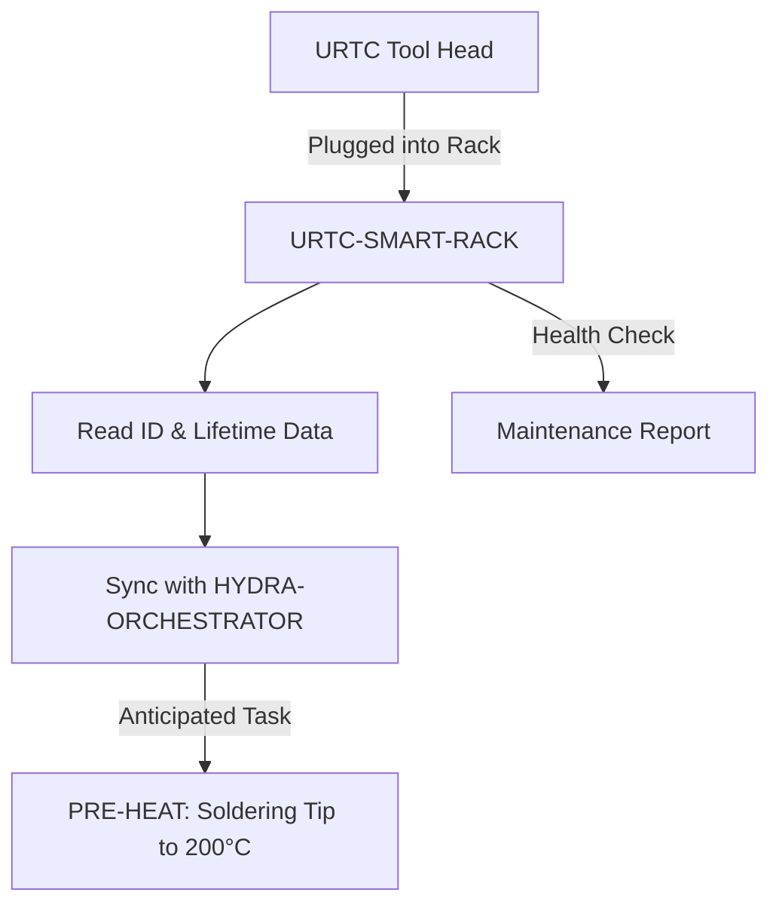

<p align="center">
  
</p>

# 🗄️ URTC-SMART-RACK

<p align="center">🇺🇸 <b>English</b> | <a href="README_spa.md">🇪🇸 Español</a> | <a href="README_fra.md">🇫🇷 Français</a> | <a href="README_ita.md">🇮🇹 Italiano</a> | <a href="README_deu.md">🇩🇪 Deutsch</a> | <a href="README_zho.md">🇨🇳 简体中文</a> | <a href="README_jpn.md">🇯🇵 日本語</a> | <a href="README_por.md">🇵🇹 Português</a></p>

### 🤖 Intelligent End-Effector Management with Lifecycle & Thermal Tracking

<p align="center">
  
  
  
  
  
</p>

---

**Honesty check - what actually runs today:** `tool_id.c`, `lifecycle.c`, `preheat.c`, `protocol.c`, `rack_command.c`, `link_watchdog.c`, `tool_limits.c`, `rack_app.c`, `rack_link.c`, `rack_deframer.c`, `rack_can.c`, `preheat_limit.c` and `rack_inventory.c` are real, pure C, backed by 531 passing `TEST_ASSERT` checks (`tests/test_*.c`, compiled and run against the host's own C compiler, not `arm-none-eabi-gcc`) - confirmed by compiling and running that exact host test suite. That covers ID decoding, usage/lifecycle tracking, pre-heat activation and target temperature, CRC8-framed protocol parsing, command range validation, link-timeout/idempotency handling, and multi-slot tool inventory tracking (which tool is racked where, one physical tool never in two slots at once) - all of it logic, none of it hardware. As the README's own intro already says: no PCB/schematic exists for this board yet, so nothing here has ever driven a real GPIO pin, F-RAM chip, heater, or CAN transceiver - `main.c`/`startup_stm32g4_minimal.c` only prove the Cortex-M4F cross-compile and link succeed against a placeholder linker script, not that any of this runs on real silicon. See `CHANGELOG.md` for exactly what has shipped so far. The serial line is tested too: 19 streams of bytes with the time each piece arrived (a frame in pieces, noise, a bad CRC, a version or a length that does not fit, a silence at the limit of the timeout, a wrap of the millisecond clock) go through the real deframer, and the frames that come out and its counters are those of the model of URTC-COMMON.

---

> **Safety and security status:** this ecosystem is not a certified safety system, and no populated URTC board exists yet. The bootloaders check firmware images with CRC32 and a shared-key HMAC-SHA256, not with an asymmetric signature (planned); the published application images are signed with the public development key (`signing_key_kind: dev`), so anyone can produce an image the bootloader accepts; nothing has been transmitted to a real board. Read the [security baseline](https://github.com/JuanenRac/URTC-DOCS/blob/main/docs/SECURITY_BASELINE.md) and the [threat model](https://github.com/JuanenRac/URTC-DOCS/blob/main/docs/THREAT_MODEL.md) before relying on any statement here for the safety of a person.

## 📋 At a glance

| | |
|---|---|
| Version | `0.2.1` |
| Maturity | Functional |
| Tests | 531 |
| Stack | C / STM32G4 / arm-none-eabi-gcc |
| Target | A microcontroller board (the firmware); built on a PC |
| On real hardware | Not yet: no run on real hardware is recorded for this version |

**Jump to:** [Overview](#-overview) · [Architecture](#-architecture) · [Security](#-security--safety) · [Interfaces](#-interfaces) · [Quick start](#-quick-start) · [Testing](#-testing) · [Structure](#-repository-structure) · [Related](#-related-projects)

<!-- urtc-section:status_smart_rack -->
## 🚦 Project status

🟢 done and verified · 🟡 works, with known limits · 🟠 half done or not verified · 🔴 not done or not working. Nothing is green if it never ran on real hardware.

| Part | Status | What the repository can show |
| --- | :---: | --- |
| Software | 🟡 | Works on a PC and against the simulator; never run against a real board. |
| Tests | 🟢 | The test suite passes in the CI on every push. |
| Real hardware | 🟠 | No run on a real board yet: the bench test is still pending. |
| Documentation | 🟡 | README in eight languages and reference documents; the translations were not reviewed by native speakers. |

<!-- /urtc-section:status_smart_rack -->

## 🎯 Overview

**URTC-SMART-RACK** is an intelligent storage system for end-effectors in the URTC ecosystem. Based on the STM32G4 microcontroller, it monitors and prepares tools while they are not attached to a robot.

It enables "Smart Idle" modes, such as pre-heating T12 soldering tips just before a tool swap, and tracks the electronic ID and total usage cycles of every URTC head (reading each head's firmware version is planned, not implemented), ensuring optimal maintenance and zero-second deployment.

No PCB/schematic exists for this board yet (see `hardware/`), so nothing below can drive real GPIO/F-RAM/CAN hardware - but the *logic* those features boil down to (decoding an ID, tracking usage, deciding when to pre-heat and to what temperature) is real, pure C, unit-tested today.

### Key Features:
* ✅ **Real v0 - tool ID, lifecycle & pre-heat logic:** `tool_id.c` decodes a raw 5-bit ID reading into a tool identity; `lifecycle.c` tracks usage cycles/time and flags maintenance due; `preheat.c` decides when Smart Idle pre-heating should start and to what target temperature. 531 test assertions on the host's own C compiler - no PCB, GPIO driver, or F-RAM needed to run or test any of it. Also real: a stream deframer for the serial link (`rack_deframer.c`: finds the start byte, resynchronises after a lost byte and drops a half frame after a timeout), the CAN form of the command (`rack_can.c`: eight data bytes, big-endian temperature; no board carries it yet) and a limit on how long a pre-heat may run without a tool swap (`preheat_limit.c`: 10 minutes by default, configurable).
* ✅ **Heads as units, thermal check and predictive pre-heat (host-tested):** `rack_inventory.c` can key a slot by the type plus the serial number of the head, and `rack_units.c` keeps the use, the heater time and the thermal faults of each physical head (from its own counters, `0x1AA` / `0x1AB`), so wear follows the head and not the type; `slot_verify.c` says what a thermal reading of a slot means for the pre-heat that was ordered (reached, too slow, overshoot, a heater on in an empty slot); `preheat_plan.c` turns the job queue into pre-heat orders, switched off by default. The reading and the queue come from other programs, nothing here has run on a board, and the heating times are estimates.
* 🗄️ **Tool Tracking** — automatic identification of URTC heads via 5-bit ID jumpers or F-RAM. *(the ID-decoding logic itself is real - see above; reading real jumpers/F-RAM needs the PCB.)*
* 🗂️ **Multi-Slot Inventory** — `rack_inventory.c` tracks which tool is physically racked in which slot, keeps a real tool in exactly one slot at a time (re-racking it elsewhere clears its old slot instead of claiming it's in two places at once), and a per-slot pre-heat target reached by tool identity. On boot, `rack_inventory_reconcile()` checks it against one presence sensor per slot: a tool pulled while the rack was off is cleared (pre-heat target included) and a tool dropped in by hand is flagged for identification. *(the inventory logic itself is real - see above; wiring it to real per-slot presence sensors needs the PCB.)*
* 🌡️ **Pre-Heating Logic** — intelligent thermal management for soldering and hot-air tools. *(the activation decision and target temperatures are real - see above; driving a real heater needs the PCB.)*
* 📈 **Lifecycle Logs** — records total actuation cycles and hours of use into the tool's F-RAM. *(the counters and maintenance-due logic are real - see above; persisting them to real F-RAM needs the PCB.)*
* 📡 **CAN Integration** — meant to communicate with the HYDRA-UMC Kinematic Brain for coordinated ATC (Auto Tool Change); this has never run, because no CAN driver or board exists. *(the wire protocol itself - framing, CRC, command validation - is real and host-tested, see below; a real CAN transceiver to actually carry it is still needed.)*
* 🔒 **Protocol Range Checks** — versioned framing with a CRC8 checksum, actuation-range validation and a link-timeout/idempotency watchdog with a defined safe state. Frame version 2: every multi-byte value is big-endian, like the bus, and a version 1 frame is refused. *(implemented as pure C and tested on a PC only; never run on a board, and not a certified safety function)*
* ✅ **Cortex-M4F firmware toolchain** — a real bare-metal image (startup + linker + `main.c`) that cross-compiles and links with `arm-none-eabi-gcc`, the same toolchain sibling repo URTC uses. *(implemented — see BUILD below)*

## 🧩 Role in URTC

URTC-SMART-RACK is the board that stores the tool heads, not a tool head: a rack that identifies each head it holds (the 5-bit tool ID that URTC uses), keeps the use and the thermal faults of each physical head, knows which tool is in which slot, and pre-heats a soldering or hot-air tool just before a tool change (Smart Idle). It shares URTC's tool IDs and firmware conventions but is a complementary tool, not a child of URTC, and it is meant to be driven by the HYDRA-UMC robot controller. No board exists yet: what is real today is the logic and the rack protocol, tested on a computer.

## 🏛️ Architecture

<p align="center">
  
</p>

How the parts of this repository fit together: who uses it, what it holds and what it depends on. The picture is drawn from `docs/architecture.json` and checked against the code.

<details>
<summary>Text version of the diagram (Mermaid)</summary>



</details>

### ARCHITECTURE & DESIGN DECISIONS

* **Why this board has no real pinout/hardware ID defined yet.** There is no PCB for this board yet - `src/firmware_common.h` carries a version identity with no hardware ID, and the startup/linker files are hand-written placeholders standing in for ST's own CMSIS/HAL startup until a real STM32G4 part is pinned down.
* **Why it isn't a child of URTC itself.** URTC-SMART-RACK is a Complementary Tool, not a URTC-family child - it's a separate physical board (a tool storage rack, not a tool head) that happens to share URTC's own tool ID space and firmware conventions, not its integration hierarchy.
* **Why `bump_version.py` is a straight copy of URTC's own.** Same firmware-header format - reusing the exact script rather than reinventing it keeps the two in lockstep by construction.
* **Why `tool_id.c`/`lifecycle.c`/`preheat.c` ship before any GPIO/F-RAM/CAN driver.** Decoding an ID, accumulating usage, and deciding when to pre-heat are pure functions of data already in hand - they need no PCB to write or test, so v0 lands that logic first, host-tested with the machine's own C compiler rather than `arm-none-eabi-gcc`. The drivers that would actually source that data from real hardware come once the PCB exists.
* **How this fits the rest of the ecosystem.** Uses URTC's own tool ecosystem (the same tool IDs; the rack's frames are not CAN frames yet, see `docs/OPERATIONS.md`), and is a natural pairing with HYDRA-UMC-DETECTION-HEF for visually recognizing which tool is actually racked.
* **Why the protocol, command validation, and link watchdog are three separate modules.** `protocol.c` only knows about bytes, framing and a CRC - it has no idea what a "safe" temperature is. `rack_command.c` owns that judgment, decoding and range-checking a real command without caring how it arrived on the wire. `link_watchdog.c` tracks timeout/idempotency independently of both - a corrupted frame must never even reach it (see `test_rack_link_scenarios.c`'s own real assertion that a bad-CRC frame never revives the watchdog). Keeping these separate is what makes each one host-testable on its own, and keeps a future CAN receive handler thin - it calls each layer in order, it doesn't reimplement any of their judgment itself.
* **Command rate limiter.** A flood of commands for one tool is held back by a minimum interval between accepted commands (default 20 ms, 0 turns it off; `link_watchdog_set_command_interval()`). A held command changes nothing and gets no acknowledgement, but still counts as a live link; a safe state or a retransmission is never held back. The interval can be adjusted in the simulated rack bench of URTC-WEB-STUDIO.
* **Why an unproven link is treated exactly like a dead one.** `link_watchdog_is_link_lost()` is true both after a real timeout AND before the very first frame has ever arrived - the diagnosis notes' own "estado seguro al arrancar". A rack that powers on with no host yet connected must start in the safe state, not silently assume "fine" until proven otherwise.

## 🔒 Security & Safety

| Threat | Defence |
|---|---|
| An out-of-range order to a tool | `rack_command.c` decodes and range-checks every order without caring how it arrived; `protocol.c` only knows bytes, framing and a CRC; `tool_limits.c` holds the limit of each tool profile |
| A corrupted or old frame | A versioned frame with a CRC-8; in version 2 every multi-byte value is big-endian like the bus and a version 1 frame is refused |
| A flood of commands | A minimum interval between accepted commands (20 ms by default, 0 turns it off); a held command changes nothing and gets no acknowledgement, but counts as a live link; a safe state or a retransmission is never held back |
| A lost or unproven link | `link_watchdog_is_link_lost()` is true after a real timeout and also before the first frame ever arrives: a rack that powers on with no host starts in the safe state |
| Pre-heating too long or too hot | `preheat_limit.c` limits how long a pre-heat may run without a tool swap (10 minutes by default, configurable) and `tool_limits.c` the highest target per tool profile |
| One tool in two slots | `rack_inventory.c` keeps a real tool in exactly one slot; racking it elsewhere clears its old slot |

All of this is pure C tested on a computer; it has never run on a board and is not a certified safety function.

## 🔌 Interfaces

* **The serial frame of the rack:** version 2, big-endian like the bus, with the CRC-8 that URTC-COMMON provides (`src/urtc_crc8.h`, `src/urtc_frame.h`); `protocol.c` parses and encodes it, `rack_deframer.c` finds frames in a byte stream (resynchronisation after a lost byte, a half frame dropped after a timeout) and `rack_link.c` decides what to do with each frame. The formats are in [docs/OPERATIONS.md](docs/OPERATIONS.md).
* **The CAN form of the command:** `rack_can.c` (eight data bytes, big-endian temperature). No board carries it yet: the frames of the rack are not CAN frames yet.
* **Shared with URTC:** the 5-bit tool ID (`tool_id.c`) and the counters `0x1AA` / `0x1AB` that keep the use of each physical head (`rack_units.c`). The vectors that the frame layer must reproduce are those of URTC-COMMON (`conformance/rack_vectors.json`).

## 🚀 Quick start

Requires the ARM GNU Toolchain (`arm-none-eabi-gcc`, `arm-none-eabi-objcopy`, `arm-none-eabi-size`) and Python 3.

```bash
# Linux/macOS
chmod +x build_firmware.sh   # one-time
./build_firmware.sh

# Windows
build_firmware.bat
```

Real example - the host-side tests run standalone too, useful to check the logic without a full firmware build:

```bash
cc -std=c11 -Wall -Wextra -Isrc -Itests -o build/host_tests \
  tests/test_main.c tests/test_tool_id.c tests/test_lifecycle.c tests/test_preheat.c \
  tests/test_protocol.c tests/test_rack_command.c tests/test_link_watchdog.c tests/test_rack_link_scenarios.c \
  tests/test_rack_inventory.c tests/test_robustness.c tests/test_rack_app.c \
  tests/test_rack_deframer.c tests/test_rack_can.c tests/test_preheat_limit.c \
  src/tool_id.c src/tool_limits.c src/lifecycle.c src/preheat.c src/protocol.c src/rack_command.c src/link_watchdog.c src/rack_link.c \
  src/rack_inventory.c src/rack_app.c src/rack_deframer.c src/rack_can.c src/preheat_limit.c
./build/host_tests
# All tests passed.
```

<!-- urtc-section:compatibility -->
### Requirements & compatibility

Which versions of the URTC programs work together, and which protocol version each one speaks, is listed in the compatibility table that URTC-COMMON generates: [docs/COMPATIBILITY.md](https://github.com/JuanenRac/URTC/blob/main/docs/COMPATIBILITY.md).
<!-- /urtc-section:compatibility -->

## 🧪 Testing

The host tests are C programs in `tests/` (531 `TEST_ASSERT` checks in 18 files) compiled and run with the computer's own C compiler, never `arm-none-eabi-gcc`: tool ID, tool limits, lifecycle, pre-heat, the frame, the command check, the link watchdog, whole link scenarios, the inventory, robustness against bad input, the application layer, the deframer (19 byte streams with the time each piece arrived: a frame in pieces, noise, a bad CRC, a wrong version or length, a silence at the limit of the timeout, a wrap of the millisecond clock), the CAN form, the pre-heat limit and the units of each head; the vectors are those of URTC-COMMON. Five Python test files (25 tests) check that the build scripts, the release assets, the version files and the published test count agree. CI builds the C tests with AddressSanitizer and UBSan and fails below a coverage floor of the executed lines of `src/` (`tools/gcov_floor.py`). `bash build_firmware.sh` runs them before cross-compiling and fails the build when one assertion fails. The byte ring that a receive interrupt fills (`rack_ring.c`) and the two-copy storage of the lifecycle and the inventory (`rack_persist.c`, tested with a power cut at every byte of a save) are pure logic too; the memory chip behind the storage is not chosen yet.

## 🏗️ Build & Release

The build first compiles and runs `tests/` against the *host's own* C compiler (never `arm-none-eabi-gcc`: these are pure-logic tests, no MCU registers touched) and fails the whole build if any assertion fails. Only then does it compile `main.c` and `startup_stm32g4_minimal.c` for Cortex-M4F, link them against the placeholder `STM32G4_MINIMAL.ld` memory map, and publish versioned `.elf`/`.bin`/`.hex` files to `firmware/`. Building never changes the version.

Every module under `src/` is also compiled for Cortex-M4F, and all of them are linked together as a check (no C library is available on the target), even though the image only contains `main.c` and the start-up file today. With `URTC_CI=1` nothing tracked is touched.

The firmware images (`.bin`, `.hex`, `.elf`) are not versioned in git: a release build writes `firmware/URTC_SMART_RACK_FIRMWARE_v<version>.*` (git-ignored; `build/firmware` in CI mode, `URTC_CI=1`) and they are published only as assets of the GitHub release of each version. `python tools/publish_release_assets.py` checks the files, writes the missing `.sha256` sidecar and prints the exact `gh release create` command with the files to attach.

There is nothing to flash to real hardware yet — no PCB exists to confirm the target STM32G4 part, pinout, or its real flash/RAM sizes. The linker script's memory map is a conservative placeholder (documented in its own header comment) that will be replaced once real hardware exists, the same point at which `startup_stm32g4_minimal.c`'s hand-written vector table gets replaced by ST's own CMSIS/HAL startup code (mirroring sibling repo URTC's `src/F303-master/` for its STM32F303 boards).

See [`CHANGELOG.md`](CHANGELOG.md) for the full version history; each version has its own entry there.

## 📂 Repository Structure

<p align="center">
  
</p>

<details>
<summary>Text version of the tree</summary>

```text
URTC-SMART-RACK/
├── src/                                               the firmware: pure C logic, the checked copies of URTC-COMMON, the entry point and the placeholder linker script
├── tests/                                             host C tests (531 checks) and Python checks of the build scripts
├── docs/                                              what the logic does and refuses
├── hardware/                                          no schematic or PCB yet
├── tools/                                             build, coverage, release tools
├── images/                                            banner and the pictures of this README
├── .github/                                           CI workflow, issue and pull-request templates
├── build-test.sh build-test.bat                       build and test scripts that change nothing in the repository
├── test.sh test.bat                                   run the tests
├── urtc.project.json                                  manifest: version, role, maturity and build command
├── CHANGELOG.md                                       what changed in each version
├── SECURITY.md SUPPORT.md LICENSE                     security policy, support and license
├── CONTRIBUTING.md CODE_OF_CONDUCT.md                 how to contribute and the code of conduct
├── .gitattributes .gitignore                          Git settings
├── build_firmware.sh build_firmware.bat               host tests, cross-compile, publish
├── bump.py bump_version.py bump_manifest_version.py   scripts that raise the version
└── LICENSE.md ruff.toml                               documentation license and lint settings
```

</details>

The annotated list of every source file, one line each, is in [docs/SOURCE_MAP.md](docs/SOURCE_MAP.md).

## 🗺️ Roadmap & Known limits

**Known limits today**

* No PCB or schematic exists for this board yet (see `hardware/`): nothing here has ever driven a real GPIO pin, F-RAM chip, heater or CAN transceiver. `main.c` and the start-up file only prove that the Cortex-M4F cross-compile and link succeed against a placeholder linker script.
* Reading the firmware version of each head is planned, not implemented.
* The CAN form of the command has never run: no CAN driver or board exists, and the frames of the rack are not CAN frames yet.
* The heating times of the predictive pre-heat are estimates, and its switch is off by default.

**Next**

* Design the board, pin the STM32G4 part and replace the placeholder linker script and start-up file by ST's own; write the GPIO, F-RAM and CAN drivers that source the logic's data.

## 🌍 Languages

README and texts exist in English, Spanish, French, Italian, German, Chinese, Japanese and European Portuguese.

## 🔗 Related Projects

URTC is made of independent repositories, each with its own version, tests and README. This is the family, by group:

* **URTC Tool Platform:**
  * [URTC](https://github.com/JuanenRac/URTC) - firmware of the tool-head board (25 tool profiles, CAN bootloader) and the CAN protocol reference.
  * [URTC-COMMON](https://github.com/JuanenRac/URTC-COMMON) - the CAN protocol written once as data (specification, generated tables, conformance vectors) and the code the programs share.
  * [URTC-FLASHER](https://github.com/JuanenRac/URTC-FLASHER) - desktop tool that updates the board firmware over CAN or over SWD/JTAG.
  * [URTC-GATEWAY](https://github.com/JuanenRac/URTC-GATEWAY) - gateway in front of the CAN bus: lets only listed identifiers through, limits their rate and asks for a session key.
  * **URTC-SMART-RACK** (this repository) - hardware-independent C logic and command protocol for a tool rack with pre-heating and lifecycle tracking.
  * [URTC-TESTER](https://github.com/JuanenRac/URTC-TESTER) - desktop live CAN-bus tester that shows the controls and telemetry of the tool profile a board reports.
  * [URTC-VISION-TOOL](https://github.com/JuanenRac/URTC-VISION-TOOL) - sensor-frame protocol in C and a Python thermal/RGB companion for an inspection tool head.
  * [URTC-WEB-STUDIO](https://github.com/JuanenRac/URTC-WEB-STUDIO) - browser app that flashes and tests the board over Web Serial and SLCAN, with nothing to install.
* **Ecosystem Operations:**
  * [URTC-DOCS](https://github.com/JuanenRac/URTC-DOCS) - architecture, interfaces, security baseline and generated catalogue of the ecosystem, plus the tools that compare all repositories.
  * [URTC-UPDATER](https://github.com/JuanenRac/URTC-UPDATER) - desktop tool that detects, installs and updates the repositories of the URTC family, one explicit action at a time.

**Sister projects (independent, with the same base and tools):**

* **[HYDRA-UMC-DOCS](https://github.com/JuanenRac/HYDRA-UMC-DOCS)** - sister project: the documentation hub of HYDRA-UMC, an independent ecosystem that shares this one's base and tools
* **[ARMOR-DOCS](https://github.com/JuanenRac/ARMOR-DOCS)** - sister project: the documentation hub of A.R.M.O.R., the security ecosystem, also independent and on the same base
* **[JuanenRac](https://github.com/JuanenRac/JuanenRac)** - the profile and the status dashboard of all the ecosystems

## 📚 Documentation

- **[CONTRIBUTING.md](CONTRIBUTING.md)** — tech stack and coding guidelines for a pull request.
- **[CODE_OF_CONDUCT.md](CODE_OF_CONDUCT.md)** — the standards of behavior expected in this community.
- **[SECURITY.md](SECURITY.md)** — how to report a vulnerability, and this project's own real security focus areas.
- **[SUPPORT.md](SUPPORT.md)** — where to ask questions and report bugs.
- **[LICENSE.md](LICENSE.md)** — this project's own license.

## 🤝 Contributing & Community

* Before a pull request run `URTC_CI=1 python tools/ci_validate.py`: it must pass. See [CONTRIBUTING.md](CONTRIBUTING.md) and the [code of conduct](CODE_OF_CONDUCT.md).
* The README exists in eight languages: a change to the text is made in all eight files, and the sections shared with other repositories are written by `tools/readme_sections.py` of URTC-COMMON.
* A change to the CAN protocol starts in URTC-COMMON (`spec/can_protocol.json`) and reaches this repository through the checked copy.
* Do not describe as working on a board what has only been built.
* Report a vulnerability privately: [SECURITY.md](SECURITY.md). Questions, ideas and reports: electrohobby3d@gmail.com ([SUPPORT.md](SUPPORT.md)).

## 👤 AUTHOR

**JuanenRac** (Electro Hobby 3D)
📧 electrohobby3d@gmail.com
📺 [youtube.com/@electrohobby3d](https://youtube.com/@electrohobby3d)

## 📜 LICENSE

GPL-3.0-or-later - See LICENSE for details.
