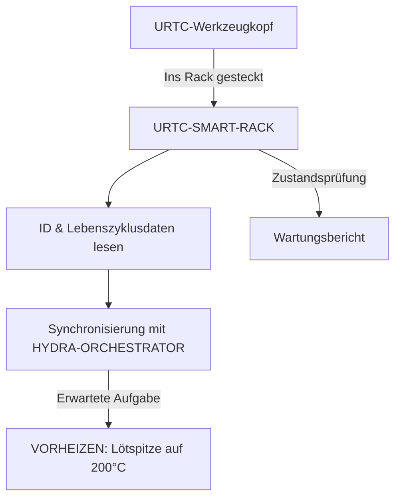

<p align="center">
  
</p>

# 🗄️ URTC-SMART-RACK

<p align="center"><a href="README.md">🇺🇸 English</a> | <a href="README_spa.md">🇪🇸 Español</a> | <a href="README_fra.md">🇫🇷 Français</a> | <a href="README_ita.md">🇮🇹 Italiano</a> | 🇩🇪 <b>Deutsch</b> | <a href="README_zho.md">🇨🇳 简体中文</a> | <a href="README_jpn.md">🇯🇵 日本語</a> | <a href="README_por.md">🇵🇹 Português</a></p>

### 🤖 Intelligentes Werkzeugkopf-Management mit Lebenszyklus- und Temperaturüberwachung

<p align="center">
  
  
  
  
  
</p>

---

**Ehrlichkeitscheck - was heute wirklich funktioniert:** `tool_id.c`, `lifecycle.c`, `preheat.c`, `protocol.c`, `rack_command.c`, `link_watchdog.c`, `tool_limits.c`, `rack_app.c`, `rack_link.c`, `rack_deframer.c`, `rack_can.c`, `preheat_limit.c` und `rack_inventory.c` sind echtes, reines C, abgesichert durch 639 bestandene `TEST_ASSERT`-Prüfungen (`tests/test_*.c`, kompiliert und ausgeführt mit dem eigenen C-Compiler des Hosts, nicht `arm-none-eabi-gcc`) - bestätigt durch Kompilieren und Ausführen genau dieser Host-Testsuite. Das deckt ID-Dekodierung, Nutzungs-/Lebenszyklus-Tracking, Vorheiz-Aktivierung und Zieltemperatur, CRC8-gerahmtes Protokoll-Parsing, Befehlsbereichsvalidierung, Link-Timeout-/Idempotenz-Handling und die Verwaltung des Mehrplatz-Werkzeuginventars (welches Werkzeug wo eingelagert ist, ein echtes Werkzeug nie gleichzeitig in zwei Plätzen) ab - alles Logik, nichts Hardware. Wie die Einleitung des READMEs bereits sagt: für diese Platine existiert noch keine PCB/kein Schaltplan, also hat nichts hier je einen echten GPIO-Pin, F-RAM-Chip, Heizer oder CAN-Transceiver angesteuert - `main.c`/`startup_stm32g4_minimal.c` beweisen nur, dass die Cross-Kompilierung und das Linken für Cortex-M4F gegen ein Platzhalter-Linker-Skript gelingen, nicht dass irgendetwas davon auf echtem Silizium läuft. Siehe `CHANGELOG.md` für das, was bisher genau ausgeliefert wurde. Auch die serielle Leitung wird geprüft: 19 Byteströme mit dem Zeitpunkt jedes Stücks (ein Frame in Teilen, Rauschen, ein falscher CRC, eine Version oder Länge, die nicht passt, eine Pause genau an der Grenze des Timeouts, ein Überlauf des Millisekundentakts) laufen durch den echten Deframer, und die Frames, die herauskommen, und seine Zähler sind die des Modells von URTC-COMMON.

---

> **Stand von Sicherheit (Safety) und Security:** Dieses Ökosystem ist kein zertifiziertes Sicherheitssystem, und es existiert noch keine bestückte URTC-Platine. Die Bootloader prüfen Firmware-Images mit CRC32 und einem HMAC-SHA256 mit gemeinsamem Schlüssel, nicht mit einer asymmetrischen Signatur (geplant); die veröffentlichten Anwendungs-Images sind mit dem öffentlichen Entwicklungsschlüssel signiert (`signing_key_kind: dev`), sodass jeder ein vom Bootloader akzeptiertes Image erzeugen kann; an eine echte Platine wurde noch nichts gesendet. Lesen Sie die [Sicherheitsbasis](https://github.com/JuanenRac/URTC-DOCS/blob/main/docs/SECURITY_BASELINE.md) und das [Bedrohungsmodell](https://github.com/JuanenRac/URTC-DOCS/blob/main/docs/THREAT_MODEL.md), bevor Sie sich für die Sicherheit einer Person auf eine Aussage hier verlassen.

## 📋 Auf einen Blick

| | |
|---|---|
| Version | `0.2.3` |
| Reifegrad | Funktionsfähig |
| Tests | 639 |
| Technik | C / STM32G4 / arm-none-eabi-gcc |
| Ziel | Eine Mikrocontroller-Platine (die Firmware); wird auf einem PC gebaut |
| Auf echter Hardware | Noch nicht: für diese Version ist kein Lauf auf echter Hardware vermerkt |

**Springe zu:** [Überblick](#-überblick) · [Architektur](#-architektur) · [Sicherheit](#-sicherheit-und-schutz) · [Schnittstellen](#-schnittstellen) · [Schnellstart](#-schnellstart) · [Tests](#-tests) · [Struktur](#-struktur-des-repositorys) · [Verwandte](#-verwandte-projekte)

<!-- urtc-section:status_smart_rack -->
## 🚦 Projektstatus

🟢 fertig und überprüft · 🟡 funktioniert, mit bekannten Grenzen · 🟠 halb fertig oder nicht überprüft · 🔴 nicht gemacht oder funktioniert nicht. Nichts ist grün, wenn es nie auf echter Hardware lief.

| Teil | Status | Was das Repository belegen kann |
| --- | :---: | --- |
| Software | 🟡 | Läuft am PC und gegen den Simulator; nie an einer echten Platine ausgeführt. |
| Tests | 🟢 | Die Testsuite besteht bei jedem Push in der CI. |
| Echte Hardware | 🟠 | Noch kein Lauf an einer echten Platine: der Bankversuch steht noch aus. |
| Dokumentation | 🟡 | README in acht Sprachen und Referenzdokumente; die Übersetzungen wurden nicht von Muttersprachlern geprüft. |

<!-- /urtc-section:status_smart_rack -->

## 🎯 Überblick

**URTC-SMART-RACK** ist ein intelligentes Lagersystem für Werkzeugköpfe innerhalb des URTC-Ökosystems. Basierend auf dem STM32G4-Mikrocontroller überwacht und bereitet es Werkzeuge vor, während sie nicht an einem Roboter angebracht sind.

Es ermöglicht "Smart Idle"-Modi, etwa das Vorheizen von T12-Lötspitzen kurz vor einem Werkzeugwechsel, und verfolgt die elektronische ID und die Gesamtzahl der Nutzungszyklen jedes URTC-Kopfes (das Auslesen der Firmware-Version jedes Kopfes ist geplant, nicht implementiert), was optimale Wartung und einen Einsatz in null Sekunden gewährleistet.

Für diese Platine existiert noch keine PCB/kein Schaltplan (siehe `hardware/`), also kann nichts davon echte GPIO/F-RAM/CAN-Hardware ansteuern - aber die *Logik*, auf die sich diese Funktionen reduzieren (eine ID dekodieren, die Nutzung verfolgen, entscheiden, wann und auf welche Temperatur vorgeheizt werden soll), ist real, reines C, heute unit-getestet.

### Hauptmerkmale:
* ✅ **Echtes v0 - ID-, Lebenszyklus- & Vorheiz-Logik:** `tool_id.c` dekodiert eine rohe 5-Bit-ID-Ablesung in eine Werkzeugidentität; `lifecycle.c` verfolgt Nutzungszyklen/-zeit und markiert fällige Wartung; `preheat.c` entscheidet, wann das Smart-Idle-Vorheizen starten soll und auf welche Zieltemperatur. 639 Test-Assertions mit dem eigenen C-Compiler des Hosts - keine PCB, kein GPIO-Treiber, kein F-RAM nötig, um all das auszuführen oder zu testen. Ebenfalls echt: ein Strom-Deframer für die serielle Verbindung (`rack_deframer.c`: sucht das Startbyte, synchronisiert sich nach einem verlorenen Byte neu und verwirft einen halben Frame nach einem Timeout), die CAN-Form des Befehls (`rack_can.c`: acht Datenbytes, Temperatur im Big-Endian; noch keine Platine trägt sie) und eine Grenze, wie lange ein Vorheizen ohne Werkzeugwechsel laufen darf (`preheat_limit.c`: standardmäßig 10 Minuten, konfigurierbar).
* ✅ **Köpfe als Einheiten, thermische Prüfung und vorausschauendes Vorheizen (auf dem Host getestet):** `rack_inventory.c` kann einen Platz über den Typ plus die Seriennummer des Kopfes kennzeichnen, und `rack_units.c` führt Nutzung, Heizzeit und thermische Fehler jedes physischen Kopfes (aus seinen eigenen Zählern, `0x1AA` / `0x1AB`), sodass der Verschleiß dem Kopf folgt und nicht dem Typ; `slot_verify.c` sagt, was eine thermische Messung eines Platzes für das bestellte Vorheizen bedeutet (erreicht, zu langsam, Überschwingen, eine Heizung an in einem leeren Platz); `preheat_plan.c` macht aus der Auftragswarteschlange Vorheizbefehle, standardmäßig ausgeschaltet. Messung und Warteschlange kommen von anderen Programmen, nichts davon lief auf einer Platine, und die Aufheizzeiten sind Schätzungen.
* 🗄️ **Werkzeugverfolgung** — automatische Identifikation von URTC-Köpfen über 5-Bit-ID-Jumper oder F-RAM. *(die ID-Dekodierlogik selbst ist real - siehe oben; echte Jumper/F-RAM auszulesen benötigt die PCB.)*
* 🗂️ **Mehrplatz-Inventar** — `rack_inventory.c` verfolgt, welches Werkzeug in welchem Platz eingelagert ist, hält ein echtes Werkzeug immer in genau einem Platz (ein Umlagern löscht seinen alten Platz, statt zu behaupten, es sei an zwei Orten zugleich) und ein Vorheiz-Ziel pro Platz, adressiert über die Werkzeugidentität. Beim Start gleicht `rack_inventory_reconcile()` es mit einem Anwesenheitssensor pro Platz ab: ein bei ausgeschaltetem Rack entnommenes Werkzeug wird gelöscht (samt Vorheizziel) und ein von Hand eingesetztes zur Identifizierung markiert. *(die Inventarlogik selbst ist real - siehe oben; das Verdrahten mit echten Platzsensoren benötigt die PCB.)*
* 🧭 **Köpfe mit freier Konfiguration (auf dem Host getestet):** Ein Kopf, dessen ID-Jumper `0x1F` lesen, gilt nicht als „kein Werkzeug“: `free_tool.c` fragt ihn ab (`0x1A3`), akzeptiert nur eine Antwort, die ein Werkzeug nennt (`0x1F` und eine Auswahl von 1 bis 25), und gibt dem Platz diese Identität wie einem per Jumper gelesenen Kopf; bis dahin hält der Platz kein Werkzeug, es gibt also weder ein Ziel noch einen Vorheiz-Auftrag. Zeitlimit, Versuche, Wartezeit und Auffrischung sind Konfigurationswerte, keine Logik, und ein anderes Werkzeug in einer späteren Antwort ist ein Werkzeugwechsel. Gegen die gemeinsamen Vektoren abgespielt; die Abfragen sind nie auf einem Bus gelaufen, und der Kopf liest sein F-RAM-Register beim Start, eine Änderung erfordert also einen Neustart des Kopfes.
* 🌡️ **Vorheiz-Logik** — intelligentes Temperaturmanagement für Löt- und Heißluftwerkzeuge. *(die Aktivierungsentscheidung und Zieltemperaturen sind real - siehe oben; einen echten Heizer anzusteuern benötigt die PCB.)*
* 📈 **Lebenszyklus-Protokolle** — zeichnet die Gesamtzahl der Betätigungszyklen und Betriebsstunden im F-RAM des Werkzeugs auf. *(die Zähler und die Logik für fällige Wartung sind real - siehe oben; sie in echtem F-RAM zu persistieren benötigt die PCB.)*
* 📡 **CAN-Integration** — soll mit dem HYDRA-UMC-Kinematik-Gehirn für koordinierten ATC (automatischen Werkzeugwechsel) kommunizieren; das lief nie, da weder ein CAN-Treiber noch eine Platine existiert. *(das Drahtprotokoll selbst - Framing, CRC, Befehlsvalidierung - ist real und auf dem Host getestet, siehe unten; ein echter CAN-Transceiver, um es tatsächlich zu übertragen, wird noch benötigt.)*
* 🔒 **Protokoll-Bereichsprüfungen** — versioniertes Framing mit einer CRC8-Prüfsumme, Aktuierungsbereichs-Validierung und ein Link-Timeout-/Idempotenz-Watchdog mit einem definierten sicheren Zustand. Rahmenversion 2: Jeder Mehrbytewert ist Big-Endian wie beim Bus, und ein Rahmen der Version 1 wird abgelehnt. *(als reines C implementiert und nur auf einem PC getestet; nie auf einer Platine ausgeführt und keine zertifizierte Sicherheitsfunktion)*
* ✅ **Cortex-M4F-Firmware-Toolchain** — ein echtes Bare-Metal-Image (Startup + Linker + `main.c`), das mit `arm-none-eabi-gcc` wirklich kompiliert und gelinkt wird, derselben Toolchain, die auch das Schwester-Repository URTC nutzt. *(implementiert — siehe BUILD unten)*

## 🧩 Rolle in URTC

URTC-SMART-RACK ist die Platine, die die Werkzeugköpfe aufbewahrt, kein Werkzeugkopf: ein Ständer, der jeden aufgenommenen Kopf erkennt (die 5-Bit-Werkzeug-ID, die URTC verwendet), Nutzung und thermische Fehler jedes physischen Kopfes führt, weiß, welches Werkzeug in welchem Fach liegt, und ein Löt- oder Heißluftwerkzeug kurz vor einem Werkzeugwechsel vorheizt (Smart Idle). Er teilt die Werkzeug-IDs und Firmware-Konventionen von URTC, ist aber ein ergänzendes Werkzeug und kein Kind von URTC und soll vom Robotersteuerung HYDRA-UMC angesteuert werden. Eine Platine gibt es noch nicht: Real ist heute die Logik und das Rack-Protokoll, auf einem Computer getestet.

## 🏛️ Architektur

<p align="center">
  
</p>

Wie die Teile dieses Repositorys zusammenpassen: wer es nutzt, was es enthält und wovon es abhängt. Das Bild wird aus `docs/architecture.json` gezeichnet und gegen den Code geprüft.

<details>
<summary>Textversion des Diagramms (Mermaid)</summary>



</details>

### ARCHITEKTUR & DESIGNENTSCHEIDUNGEN

* **Warum diese Platine noch kein echtes Pinout/keine echte Hardware-ID definiert hat.** Es gibt noch keine PCB für diese Platine - `src/firmware_common.h` trägt eine Versionsidentität ohne Hardware-ID, und die Startup-/Linker-Dateien sind handgeschriebene Platzhalter, die den eigenen CMSIS/HAL-Start von ST ersetzen, bis ein echtes STM32G4-Bauteil feststeht.
* **Warum es kein Kind von URTC selbst ist.** URTC-SMART-RACK ist ein ergänzendes Werkzeug, kein Kind der URTC-Familie - es ist eine separate physische Platine (ein Werkzeug-Lagerregal, kein Werkzeugkopf), die den eigenen Werkzeug-ID-Raum und die Firmware-Konventionen von URTC teilt, nicht dessen Integrationshierarchie.
* **Warum `bump_version.py` eine unveränderte Kopie des Skripts von URTC ist.** Dasselbe Firmware-Header-Format - das genaue Skript wiederzuverwenden statt es neu zu erfinden, hält beide von Natur aus im Gleichschritt.
* **Warum `tool_id.c`/`lifecycle.c`/`preheat.c` vor jedem GPIO/F-RAM/CAN-Treiber kommen.** Eine ID zu dekodieren, Nutzung zu akkumulieren und zu entscheiden, wann vorgeheizt werden soll, sind reine Funktionen bereits vorhandener Daten - sie brauchen keine PCB, um geschrieben oder getestet zu werden, also liefert v0 diese Logik zuerst, host-getestet mit dem eigenen C-Compiler der Maschine statt `arm-none-eabi-gcc`. Die Treiber, die diese Daten tatsächlich von echter Hardware beziehen würden, kommen, sobald die PCB existiert.
* **Wie sich das ins restliche Ökosystem einfügt.** Nutzt das Werkzeug-Ökosystem von URTC (dieselben Werkzeug-IDs; die Frames des Racks sind noch keine CAN-Frames, siehe `docs/OPERATIONS.md`) und bildet ein natürliches Paar mit HYDRA-UMC-DETECTION-HEF, um visuell zu erkennen, welches Werkzeug tatsächlich eingelagert ist.
* **Warum Protokoll, Befehlsvalidierung und Link-Watchdog drei getrennte Module sind.** `protocol.c` kennt nur Bytes, Framing und eine CRC - es hat keine Ahnung, was eine "sichere" Temperatur ist. `rack_command.c` besitzt dieses Urteil, dekodiert und prüft den Bereich eines echten Befehls, ohne sich darum zu kümmern, wie er auf der Leitung ankam. `link_watchdog.c` verfolgt Timeout/Idempotenz unabhängig von beiden - ein beschädigter Frame darf ihn niemals überhaupt erreichen (siehe die eigene echte Assertion von `test_rack_link_scenarios.c`, dass ein Frame mit falscher CRC den Watchdog niemals wiederbelebt). Sie getrennt zu halten macht jedes einzeln host-testbar und hält einen künftigen CAN-Empfangshandler schlank - er ruft jede Schicht der Reihe nach auf, er implementiert das Urteil keiner von ihnen neu.
* **Ratenbegrenzer für Befehle.** Eine Flut von Befehlen für ein Werkzeug wird durch einen Mindestabstand zwischen angenommenen Befehlen gebremst (Standard 20 ms, 0 schaltet ihn ab; `link_watchdog_set_command_interval()`). Ein zurückgehaltener Befehl ändert nichts und wird mit einer Ablehnung (`HELD_RATE`) beantwortet, nicht quittiert, zählt aber als lebendige Verbindung; ein sicherer Zustand oder eine Wiederholung wird nie zurückgehalten. Der Abstand lässt sich in der simulierten Rack-Werkbank von URTC-WEB-STUDIO einstellen.
* **Warum eine unbewiesene Verbindung genau wie eine tote behandelt wird.** `link_watchdog_is_link_lost()` ist sowohl nach einem echten Timeout wahr ALS AUCH bevor der allererste Frame überhaupt angekommen ist - die Diagnosenotizen selbst nennen es "estado seguro al arrancar". Ein Rack, das ohne bereits verbundenen Host hochfährt, muss im sicheren Zustand starten, statt stillschweigend "alles in Ordnung" anzunehmen, bis das Gegenteil bewiesen ist.

## 🔒 Sicherheit und Schutz

| Bedrohung | Abwehr |
|---|---|
| Ein Befehl außerhalb des Bereichs an ein Werkzeug | `rack_command.c` dekodiert und prüft jeden Befehl, ohne zu wissen, wie er ankam; `protocol.c` kennt nur Bytes, Rahmen und eine CRC; `tool_limits.c` hält die Grenze jedes Werkzeugprofils |
| Ein beschädigter oder alter Frame | Ein versionierter Frame mit CRC-8; in Version 2 ist jeder Mehrbytewert Big-Endian wie der Bus, ein Frame der Version 1 wird abgelehnt |
| Eine Flut von Befehlen | Ein Mindestabstand zwischen angenommenen Befehlen (standardmäßig 20 ms, 0 schaltet ihn ab); ein zurückgehaltener Befehl ändert nichts und wird mit einer Ablehnung (`HELD_RATE`) beantwortet, nicht bestätigt, zählt aber als lebendige Verbindung; ein sicherer Zustand oder eine Wiederholung wird nie zurückgehalten |
| Eine verlorene oder unbewiesene Verbindung | `link_watchdog_is_link_lost()` ist nach einem echten Timeout und auch vor dem ersten Frame wahr: Ein Rack, das ohne Host einschaltet, startet im sicheren Zustand |
| Zu langes oder zu heißes Vorheizen | `preheat_limit.c` begrenzt, wie lange ein Vorheizen ohne Werkzeugwechsel laufen darf (standardmäßig 10 Minuten, einstellbar), und `tool_limits.c` das höchste Ziel je Werkzeugprofil |
| Ein Werkzeug in zwei Fächern | `rack_inventory.c` hält ein echtes Werkzeug in genau einem Fach; legt man es woanders ab, wird das alte Fach geleert |

All das ist reines C, auf einem Computer getestet; es lief nie auf einer Platine und ist keine zertifizierte Sicherheitsfunktion.

## 🔌 Schnittstellen

* **Der serielle Frame des Racks:** Version 2, Big-Endian wie der Bus, mit der CRC-8 aus URTC-COMMON (`src/urtc_crc8.h`, `src/urtc_frame.h`); `protocol.c` liest und schreibt ihn, `rack_deframer.c` findet Frames in einem Byte-Strom (Resynchronisierung nach einem verlorenen Byte, ein halber Frame wird nach einem Timeout verworfen) und `rack_link.c` entscheidet, was mit jedem Frame geschieht. Die Formate stehen in [docs/OPERATIONS.md](docs/OPERATIONS.md).
* **Die CAN-Form des Befehls:** `rack_can.c` (acht Datenbytes, Temperatur Big-Endian). Noch keine Platine trägt sie: Die Frames des Racks sind noch keine CAN-Frames.
* **Mit URTC geteilt:** die 5-Bit-Werkzeug-ID (`tool_id.c`) und die Zähler `0x1AA` / `0x1AB`, die die Nutzung jedes physischen Kopfes führen (`rack_units.c`). Die Vektoren, die die Frame-Schicht reproduzieren muss, sind die von URTC-COMMON (`conformance/rack_vectors.json`).
* **Die Antwort auf einen Befehl:** Jeder wohlgeformte Frame erhält einen Antwortframe, eine Quittung oder eine Ablehnung mit ihrem Grund in einem Byte (falsche Länge, kein Werkzeug im Steckplatz, Temperatur über dem Grenzwert, ungültiges Werkzeug, keine Heizung, zu früh zurückgehalten, unbekannter Befehl); `rack_reply_encode()` schreibt ihn, und die Host-Tests vergleichen ihn Byte für Byte mit den gemeinsamen Vektoren von URTC-COMMON, sodass Firmware und Modell der Programme nicht auseinanderlaufen können. Die simulierten Rack-Werkbänke von URTC-TESTER und URTC-WEB-STUDIO lesen ihn; auf einer Platine sendet ihn noch kein Transport. Ein Hotend eines 3D-Druckers wird nur vorgeheizt, wenn `printer_target_c` in der Konfiguration des Plans gesetzt ist (standardmäßig 0, begrenzt auf die 310-Grad-Obergrenze des Werkzeugs).

## 🚀 Schnellstart

Erfordert die ARM-GNU-Toolchain (`arm-none-eabi-gcc`, `arm-none-eabi-objcopy`, `arm-none-eabi-size`) und Python 3.

```bash
# Linux/macOS
chmod +x build_firmware.sh   # einmalig
./build_firmware.sh

# Windows
build_firmware.bat
```

Echtes Beispiel - die Host-seitigen Tests laufen auch eigenständig, nützlich um die Logik ohne vollständigen Firmware-Build zu prüfen:

```bash
cc -std=c11 -Wall -Wextra -Isrc -Itests -o build/host_tests \
  tests/test_main.c tests/test_tool_id.c tests/test_lifecycle.c tests/test_preheat.c \
  tests/test_protocol.c tests/test_rack_command.c tests/test_link_watchdog.c tests/test_rack_link_scenarios.c \
  tests/test_rack_inventory.c tests/test_robustness.c tests/test_rack_app.c \
  tests/test_rack_deframer.c tests/test_rack_can.c tests/test_preheat_limit.c \
  src/tool_id.c src/tool_limits.c src/lifecycle.c src/preheat.c src/protocol.c src/rack_command.c src/link_watchdog.c src/rack_link.c \
  src/rack_inventory.c src/rack_app.c src/rack_deframer.c src/rack_can.c src/preheat_limit.c
./build/host_tests
# All tests passed.
```

<!-- urtc-section:compatibility -->
### Voraussetzungen und Kompatibilität

Welche Versionen der URTC-Programme zusammenarbeiten und welche Protokollversion jede spricht, steht in der Kompatibilitätstabelle, die URTC-COMMON erzeugt: [docs/COMPATIBILITY.md](https://github.com/JuanenRac/URTC/blob/main/docs/COMPATIBILITY.md). Die Notizen einer Version der Repositories, die `tools/changelog_section.py` mitführen (die Firmware, der Flasher, der Tester und der Updater), sind der Abschnitt des CHANGELOG dieser Version, gefolgt von dieser Tabelle: `python tools/changelog_section.py VERSION --compat`.
<!-- /urtc-section:compatibility -->

## 🧪 Tests

Die Host-Tests sind C-Programme in `tests/` (639 `TEST_ASSERT`-Prüfungen in 19 Dateien), kompiliert und ausgeführt mit dem C-Compiler des Rechners selbst, nie mit `arm-none-eabi-gcc`: Werkzeug-ID, Werkzeuggrenzen, Lebenszyklus, Vorheizen, der Frame, die Befehlsprüfung, der Verbindungs-Watchdog, ganze Verbindungsszenarien, das Inventar, Robustheit gegen fehlerhafte Eingaben, die Anwendungsschicht, der Deframer (19 Byte-Ströme mit der Ankunftszeit jedes Stücks: ein Frame in Stücken, Rauschen, eine falsche CRC, eine falsche Version oder Länge, eine Stille an der Grenze des Timeouts, ein Überlauf der Millisekundenuhr), die CAN-Form, die Vorheizgrenze und die Einheiten jedes Kopfes; die Vektoren sind die von URTC-COMMON. Fünf Python-Testdateien (25 Tests) prüfen, dass Build-Skripte, Release-Dateien, Versionsdateien und die veröffentlichte Testzahl übereinstimmen. Die CI baut die C-Tests mit AddressSanitizer und UBSan und schlägt unter einer Abdeckungsschwelle der ausgeführten Zeilen von `src/` fehl (`tools/gcov_floor.py`). `bash build_firmware.sh` führt sie vor dem Cross-Kompilieren aus und bricht den Build ab, wenn eine Prüfung fehlschlägt. Der Byte-Ring, den ein Empfangs-Interrupt füllt (`rack_ring.c`), und die Zwei-Kopien-Speicherung von Lebenszyklus und Inventar (`rack_persist.c`, getestet mit einem Stromausfall bei jedem Byte eines Speichervorgangs) sind ebenfalls reine Logik; der Speicherchip dahinter ist noch nicht gewählt.

## 🏗️ Build und Veröffentlichung

Der Build kompiliert und führt zuerst `tests/` mit dem C-Compiler *des Rechners selbst* aus (nie `arm-none-eabi-gcc`: Es sind reine Logiktests ohne MCU-Register) und bricht ganz ab, wenn eine Prüfung fehlschlägt. Erst danach kompiliert er `main.c` und `startup_stm32g4_minimal.c` für Cortex-M4F, linkt sie gegen die vorläufige Speicherkarte `STM32G4_MINIMAL.ld` und legt versionierte `.elf`/`.bin`/`.hex`-Dateien in `firmware/` ab. Das Bauen ändert nie die Version.

Jedes Modul unter `src/` wird auch für Cortex-M4F kompiliert und alle werden als Prüfung zusammengelinkt (auf dem Ziel gibt es keine C-Bibliothek), obwohl das Image heute nur `main.c` und die Startdatei enthält. Mit `URTC_CI=1` wird keine versionierte Datei angefasst.

Die Firmware-Images (`.bin`, `.hex`, `.elf`) werden nicht in git versioniert: ein Release-Build schreibt `firmware/URTC_SMART_RACK_FIRMWARE_v<Version>.*` (von git ignoriert; `build/firmware` im CI-Modus, `URTC_CI=1`), und sie werden nur als Assets des GitHub-Releases der jeweiligen Version veröffentlicht. `python tools/publish_release_assets.py` prüft die Dateien, schreibt die fehlende `.sha256`-Datei und gibt den genauen `gh release create`-Befehl mit den anzuhängenden Dateien aus.

Es gibt noch nichts, was auf echte Hardware geflasht werden könnte - es existiert keine PCB, die das Ziel-STM32G4-Modell, das Pinout oder die realen Flash-/RAM-Größen bestätigt. Die Speicherkarte des Linkerskripts ist ein konservativer Platzhalter (in seinem eigenen Header dokumentiert), der ersetzt wird, sobald echte Hardware existiert - zu demselben Zeitpunkt, an dem die handgeschriebene Vektortabelle von `startup_stm32g4_minimal.c` durch STs eigenen CMSIS/HAL-Startupcode ersetzt wird (nach dem Muster des Schwester-Repos URTC in `src/F303-master/` für dessen STM32F303-Platinen).

Den vollständigen Versionsverlauf findest du in [`CHANGELOG.md`](CHANGELOG.md); jede Version hat dort ihren eigenen Eintrag.

## 📂 Struktur des Repositorys

<p align="center">
  
</p>

<details>
<summary>Textversion des Baums</summary>

```text
URTC-SMART-RACK/
├── src/                                               die Firmware: reine C-Logik, die geprüften Kopien von URTC-COMMON, der Einstiegspunkt und das vorläufige Linker-Skript
├── tests/                                             C-Host-Tests (639 Prüfungen) und Python-Prüfungen der Build-Skripte
├── docs/                                              OPERATIONS.md: was die Logik tut, ablehnt und unverifiziert lässt
├── hardware/                                          Notizen: noch kein Schaltplan, keine Leiterplatte
├── tools/                                             Build-Prüfung, Abdeckungsschwelle, Release-Dateien und die gemeinsamen CI- und Bild-Werkzeuge
├── images/                                            Banner und Bilder dieses READMEs
├── .github/                                           CI-Workflow sowie Vorlagen für Issues und Pull Requests
├── build-test.sh build-test.bat                       Build- und Testskripte, die im Repository nichts ändern
├── test.sh test.bat                                   führen die Tests aus
├── urtc.project.json                                  Manifest: Version, Rolle, Reifegrad und Build-Befehl
├── CHANGELOG.md                                       was sich in jeder Version geändert hat
├── SECURITY.md SUPPORT.md LICENSE                     Sicherheitsrichtlinie, Support und Lizenz
├── CONTRIBUTING.md CODE_OF_CONDUCT.md                 wie man mitwirkt, und der Verhaltenskodex
├── .gitattributes .gitignore                          Git-Einstellungen
├── build_firmware.sh build_firmware.bat               Host-Tests, Cross-Kompilierung, Linken und Veröffentlichen der Images
├── bump.py bump_version.py bump_manifest_version.py   Skripte, die die Version erhöhen
└── LICENSE.md ruff.toml                               Dokumentationslizenz und Lint-Einstellungen
```

</details>

Die kommentierte Liste jeder Quelldatei, eine Zeile je Datei, steht in [docs/SOURCE_MAP.md](docs/SOURCE_MAP.md).

## 🗺️ Roadmap und bekannte Grenzen

**Bekannte Grenzen heute**

* Für diese Platine gibt es noch keine Leiterplatte und keinen Schaltplan (siehe `hardware/`): Nichts davon hat je einen echten GPIO-Pin, einen F-RAM-Chip, ein Heizelement oder einen CAN-Transceiver angesteuert. `main.c` und die Startdatei beweisen nur, dass das Cross-Kompilieren und Linken für Cortex-M4F mit einem vorläufigen Linker-Skript gelingt.
* Das Lesen der Firmware-Version jedes Kopfes ist geplant, nicht umgesetzt.
* Die CAN-Form des Befehls lief nie: Es gibt weder einen CAN-Treiber noch eine Platine, und die Frames des Racks sind noch keine CAN-Frames.
* Die Aufheizzeiten des vorausschauenden Vorheizens sind Schätzungen, und sein Schalter ist standardmäßig aus.

**Als Nächstes**

* Die Platine entwerfen, das STM32G4-Bauteil festlegen und das vorläufige Linker-Skript und die Startdatei durch die von ST ersetzen; die GPIO-, F-RAM- und CAN-Treiber schreiben, die der Logik ihre Daten liefern.

## 🌍 Sprachen

README und Texte gibt es auf Englisch, Spanisch, Französisch, Italienisch, Deutsch, Chinesisch, Japanisch und europäischem Portugiesisch.

## 🔗 Verwandte Projekte

URTC besteht aus unabhängigen Repositories mit jeweils eigener Version, eigenen Tests und eigenem README. Das ist die Familie, nach Gruppen:

* **URTC Tool Platform:**
  * [URTC](https://github.com/JuanenRac/URTC) - Firmware der Werkzeugkopf-Platine (25 Werkzeugprofile, CAN-Bootloader) und die Referenz des CAN-Protokolls.
  * [URTC-COMMON](https://github.com/JuanenRac/URTC-COMMON) - das CAN-Protokoll einmal als Daten geschrieben (Spezifikation, erzeugte Tabellen, Konformitätsvektoren) und der Code, den die Programme teilen.
  * [URTC-FLASHER](https://github.com/JuanenRac/URTC-FLASHER) - Desktop-Werkzeug, das die Platinen-Firmware über CAN oder über SWD/JTAG aktualisiert.
  * [URTC-GATEWAY](https://github.com/JuanenRac/URTC-GATEWAY) - Gateway vor dem CAN-Bus: lässt nur gelistete Kennungen durch, begrenzt ihre Rate und verlangt einen Sitzungsschlüssel.
  * **URTC-SMART-RACK** (dieses Repository) - hardwareunabhängige C-Logik und Befehlsprotokoll für eine Werkzeugablage mit Vorheizen und Lebenszyklusverfolgung.
  * [URTC-TESTER](https://github.com/JuanenRac/URTC-TESTER) - Desktop-Live-Tester für den CAN-Bus, der die Bedienelemente und die Telemetrie des von einer Platine gemeldeten Werkzeugprofils zeigt.
  * [URTC-VISION-TOOL](https://github.com/JuanenRac/URTC-VISION-TOOL) - Sensorrahmen-Protokoll in C und ein Python-Thermo-/RGB-Begleiter für einen Inspektions-Werkzeugkopf.
  * [URTC-WEB-STUDIO](https://github.com/JuanenRac/URTC-WEB-STUDIO) - Browser-App, die die Platine über Web Serial und SLCAN flasht und testet, ohne Installation.
* **Ecosystem Operations:**
  * [URTC-DEVTOOLS](https://github.com/JuanenRac/URTC-DEVTOOLS) - die gemeinsamen Repository-Werkzeuge der Familie als versionierter Satz, mit einer Sperrdatei, die eine bearbeitete von einer veralteten Kopie unterscheidet.
  * [URTC-DOCS](https://github.com/JuanenRac/URTC-DOCS) - Architektur, Schnittstellen, Sicherheitsbasis und erzeugter Katalog des Ökosystems sowie die Werkzeuge, die alle Repositories vergleichen.
  * [URTC-UPDATER](https://github.com/JuanenRac/URTC-UPDATER) - Desktop-Werkzeug, das die Repositories der URTC-Familie erkennt, installiert und aktualisiert, jeweils eine ausdrückliche Aktion.

**Schwesterprojekte (unabhängig, mit derselben Basis und denselben Werkzeugen):**

* **[HYDRA-UMC-DOCS](https://github.com/JuanenRac/HYDRA-UMC-DOCS)** - Schwesterprojekt: das Dokumentationszentrum von HYDRA-UMC, einem unabhängigen Ökosystem, das Basis und Werkzeuge mit diesem teilt
* **[ARMOR-DOCS](https://github.com/JuanenRac/ARMOR-DOCS)** - Schwesterprojekt: das Dokumentationszentrum von A.R.M.O.R., dem Sicherheits-Ökosystem, ebenfalls unabhängig und auf derselben Basis
* **[JuanenRac](https://github.com/JuanenRac/JuanenRac)** - das Profil und das Status-Dashboard aller Ökosysteme

## 📚 Dokumentation

- **[CONTRIBUTING.md](CONTRIBUTING.md)** — Technologie-Stack und Coding-Richtlinien für einen Pull Request.
- **[CODE_OF_CONDUCT.md](CODE_OF_CONDUCT.md)** — die in dieser Community erwarteten Verhaltensstandards.
- **[SECURITY.md](SECURITY.md)** — wie man eine Schwachstelle meldet, und die echten Sicherheitsschwerpunkte dieses Projekts.
- **[SUPPORT.md](SUPPORT.md)** — wo man Fragen stellt und Fehler meldet.
- **[LICENSE.md](LICENSE.md)** — die eigene Lizenz dieses Projekts.

## 🤝 Mitwirken und Community

* Führe vor einem Pull Request `URTC_CI=1 python tools/ci_validate.py` aus: es muss bestehen. Siehe [CONTRIBUTING.md](CONTRIBUTING.md) und den [Verhaltenskodex](CODE_OF_CONDUCT.md).
* Das README gibt es in acht Sprachen: Eine Textänderung wird in allen acht Dateien vorgenommen, und die mit anderen Repositorys geteilten Abschnitte schreibt `tools/readme_sections.py` von URTC-COMMON.
* Eine Änderung am CAN-Protokoll beginnt in URTC-COMMON (`spec/can_protocol.json`) und gelangt über die geprüfte Kopie in dieses Repository.
* Beschreibe nichts als auf einer Platine funktionierend, was nur gebaut wurde.
* Melde eine Schwachstelle privat: [SECURITY.md](SECURITY.md). Fragen, Ideen und Meldungen: electrohobby3d@gmail.com ([SUPPORT.md](SUPPORT.md)).

## 👤 AUTOR

**JuanenRac** (Electro Hobby 3D)
📧 electrohobby3d@gmail.com
📺 [youtube.com/@electrohobby3d](https://youtube.com/@electrohobby3d)

## 📜 LIZENZ

GPL-3.0-or-later - Siehe LICENSE für Details.
