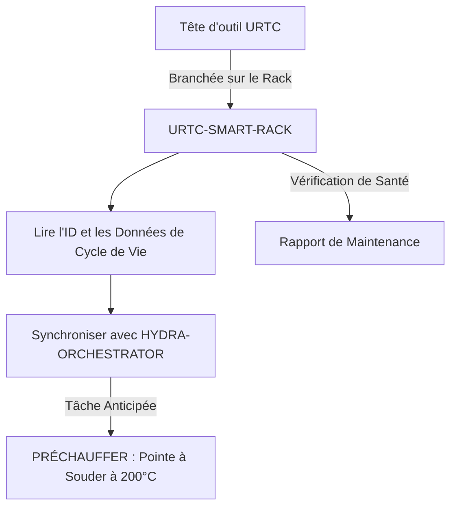

<p align="center">
  
</p>

# 🗄️ URTC-SMART-RACK

<p align="center"><a href="README.md">🇺🇸 English</a> | <a href="README_spa.md">🇪🇸 Español</a> | 🇫🇷 <b>Français</b> | <a href="README_ita.md">🇮🇹 Italiano</a> | <a href="README_deu.md">🇩🇪 Deutsch</a> | <a href="README_zho.md">🇨🇳 简体中文</a> | <a href="README_jpn.md">🇯🇵 日本語</a> | <a href="README_por.md">🇵🇹 Português</a></p>

### 🤖 Gestion Intelligente des Têtes d'Outil avec Suivi du Cycle de Vie et Thermique

<p align="center">
  
  
  
  
  
</p>

---

**Vérification d'honnêteté - ce qui fonctionne réellement aujourd'hui :** `tool_id.c`, `lifecycle.c`, `preheat.c`, `protocol.c`, `rack_command.c`, `link_watchdog.c`, `tool_limits.c`, `rack_app.c`, `rack_link.c`, `rack_deframer.c`, `rack_can.c`, `preheat_limit.c` et `rack_inventory.c` sont du vrai C pur, appuyé par 563 vérifications `TEST_ASSERT` qui passent (`tests/test_*.c`, compilées et exécutées avec le propre compilateur C de l'hôte, pas `arm-none-eabi-gcc`) - confirmé en compilant et en exécutant exactement cette suite de tests hôte. Cela couvre le décodage d'ID, le suivi d'usage/cycle de vie, l'activation du préchauffage et la température cible, l'analyse du protocole avec framing CRC8, la validation de plage des commandes, la gestion du timeout de liaison/idempotence, et le suivi de l'inventaire multi-emplacements (quel outil est rangé où, un outil réel jamais dans deux emplacements à la fois) - uniquement de la logique, aucun matériel. Comme le dit déjà l'introduction du README : aucun PCB/schéma n'existe encore pour cette carte, donc rien ici n'a jamais piloté une vraie broche GPIO, une puce F-RAM, un élément chauffant ou un transceiver CAN réels - `main.c`/`startup_stm32g4_minimal.c` prouvent seulement que la compilation croisée et l'édition de liens pour Cortex-M4F réussissent contre un script de liaison provisoire, pas que quoi que ce soit ici tourne sur du vrai silicium. Voir `CHANGELOG.md` pour savoir exactement ce qui a été livré jusqu'à présent. La ligne série est testée aussi : 19 flux d'octets avec l'heure d'arrivée de chaque morceau (une trame en morceaux, du bruit, un CRC faux, une version ou une longueur qui ne convient pas, un silence pile à la limite du délai, le bouclage de l'horloge en millisecondes) passent par le vrai désencadreur, et les trames qui en sortent et ses compteurs sont ceux du modèle d'URTC-COMMON.

---

> **État de la sûreté et de la cybersécurité :** cet écosystème n'est pas un système de sécurité certifié et aucune carte URTC assemblée n'existe encore. Les bootloaders contrôlent les images de firmware par CRC32 et un HMAC-SHA256 à clé partagée, pas par une signature asymétrique (prévue) ; les images d'application publiées sont signées avec la clé publique de développement (`signing_key_kind: dev`), si bien que n'importe qui peut produire une image acceptée par le bootloader ; rien n'a été transmis à une carte réelle. Lisez la [base de sécurité](https://github.com/JuanenRac/URTC-DOCS/blob/main/docs/SECURITY_BASELINE.md) et le [modèle de menaces](https://github.com/JuanenRac/URTC-DOCS/blob/main/docs/THREAT_MODEL.md) avant de vous fier à une affirmation d'ici pour la sécurité d'une personne.

## 📋 En un coup d'œil

| | |
|---|---|
| Version | `0.2.2` |
| Maturité | Fonctionnel |
| Tests | 531 |
| Technologie | C / STM32G4 / arm-none-eabi-gcc |
| Cible | Une carte à microcontrôleur (le firmware) ; compilé sur un PC |
| Sur matériel réel | Pas encore : aucune exécution sur du matériel réel n'est consignée pour cette version |

**Aller à :** [Présentation](#-présentation) · [Architecture](#-architecture) · [Sécurité](#-sécurité-et-protection) · [Interfaces](#-interfaces) · [Démarrage rapide](#-démarrage-rapide) · [Tests](#-tests) · [Structure](#-structure-du-dépôt) · [Liés](#-projets-liés)

<!-- urtc-section:status_smart_rack -->
## 🚦 État du projet

🟢 fait et vérifié · 🟡 fonctionne, avec des limites connues · 🟠 à moitié fait ou non vérifié · 🔴 non fait ou non fonctionnel. Rien n'est vert si cela n'a jamais tourné sur du vrai matériel.

| Partie | État | Ce que le dépôt peut démontrer |
| --- | :---: | --- |
| Logiciel | 🟡 | Fonctionne sur un PC et face au simulateur ; jamais utilisé avec une vraie carte. |
| Tests | 🟢 | La suite de tests passe dans la CI à chaque push. |
| Matériel réel | 🟠 | Pas encore d'essai sur une vraie carte : l'essai au banc reste à faire. |
| Documentation | 🟡 | README en huit langues et documents de référence ; les traductions n'ont pas été relues par des locuteurs natifs. |

<!-- /urtc-section:status_smart_rack -->

## 🎯 Présentation

**URTC-SMART-RACK** est un système de stockage intelligent pour les têtes d'outil au sein de l'écosystème URTC. Basé sur le microcontrôleur STM32G4, il surveille et prépare les outils tant qu'ils ne sont pas fixés à un robot.

Il permet des modes « Smart Idle », comme préchauffer des pointes à souder T12 juste avant un changement d'outil, et suit l'identifiant électronique et le nombre total de cycles d'utilisation de chaque tête URTC (la lecture de la version de firmware de chaque tête est prévue, non implémentée), garantissant une maintenance optimale et un déploiement instantané.

Aucun PCB/schéma n'existe encore pour cette carte (voir `hardware/`), donc rien ci-dessous ne peut piloter du GPIO/F-RAM/CAN réel - mais la *logique* à laquelle ces fonctionnalités se résument (décoder un ID, suivre l'utilisation, décider quand préchauffer et à quelle température) est réelle, en C pur, testée unitairement dès aujourd'hui.

### Fonctionnalités Clés :
* ✅ **v0 réelle - logique d'ID, cycle de vie & préchauffage :** `tool_id.c` décode une lecture d'ID brute sur 5 bits en une identité d'outil ; `lifecycle.c` suit les cycles/temps d'utilisation et signale la maintenance due ; `preheat.c` décide quand le préchauffage Smart Idle doit démarrer et à quelle température cible. 563 assertions de test sur le propre compilateur C de l'hôte - aucun PCB, driver GPIO ou F-RAM nécessaire pour exécuter ou tester tout cela. Également réel : un désencadreur de flux pour la liaison série (`rack_deframer.c` : cherche l'octet de début, se resynchronise après un octet perdu et abandonne une demi-trame après un délai), la forme CAN de la commande (`rack_can.c` : huit octets de données, température en big-endian ; aucune carte ne la porte encore) et une limite à la durée d'un préchauffage sans changement d'outil (`preheat_limit.c` : 10 minutes par défaut, configurable).
* ✅ **Têtes comme unités, contrôle thermique et préchauffage prédictif (testé sur l'hôte) :** `rack_inventory.c` peut repérer un emplacement par le type plus le numéro de série de la tête, et `rack_units.c` conserve l'usage, le temps de chauffe et les défauts thermiques de chaque tête physique (d'après ses propres compteurs, `0x1AA` / `0x1AB`), de sorte que l'usure suit la tête et non le type ; `slot_verify.c` dit ce qu'une lecture thermique d'un emplacement signifie pour le préchauffage commandé (atteint, trop lent, dépassement, un chauffage allumé dans un emplacement vide) ; `preheat_plan.c` transforme la file des travaux en ordres de préchauffage, désactivé par défaut. La lecture et la file viennent d'autres programmes, rien de tout cela n'a tourné sur une carte et les temps de chauffe sont des estimations.
* 🗄️ **Suivi des Outils** — identification automatique des têtes URTC via cavaliers d'ID 5 bits ou F-RAM. *(la logique de décodage d'ID elle-même est réelle - voir ci-dessus ; lire de vrais cavaliers/F-RAM nécessite le PCB.)*
* 🗂️ **Inventaire Multi-Emplacements** — `rack_inventory.c` suit quel outil est rangé dans quel emplacement, garde un outil réel dans exactement un seul emplacement à la fois (le déplacer ailleurs efface son ancien emplacement au lieu de prétendre qu'il est à deux endroits à la fois), et une cible de préchauffage par emplacement, adressée par identité d'outil. Au démarrage, `rack_inventory_reconcile()` le confronte à un capteur de présence par emplacement : un outil retiré rack éteint est effacé (consigne de préchauffage comprise) et un outil posé à la main est signalé pour identification. *(la logique d'inventaire elle-même est réelle - voir ci-dessus ; la relier à de vrais capteurs de présence par emplacement nécessite le PCB.)*
* 🌡️ **Logique de Préchauffage** — gestion thermique intelligente pour les outils de soudure et d'air chaud. *(la décision d'activation et les températures cibles sont réelles - voir ci-dessus ; piloter un vrai chauffage nécessite le PCB.)*
* 📈 **Journaux de Cycle de Vie** — enregistre le nombre total de cycles d'actionnement et d'heures d'utilisation dans la F-RAM de l'outil. *(les compteurs et la logique de maintenance due sont réels - voir ci-dessus ; les persister dans une vraie F-RAM nécessite le PCB.)*
* 📡 **Intégration CAN** — destinée à communiquer avec le Cerveau Cinématique HYDRA-UMC pour un ATC coordonné (changement d'outil automatique) ; cela n'a jamais fonctionné, car aucun pilote CAN ni aucune carte n'existe. *(le protocole filaire lui-même - framing, CRC, validation des commandes - est réel et testé sur l'hôte, voir ci-dessous ; un vrai transceiver CAN pour le transporter réellement reste nécessaire.)*
* 🔒 **Contrôles de Plage du Protocole** — framing versionné avec une somme de contrôle CRC8, validation de plage d'actionnement et un watchdog de timeout de liaison/idempotence avec un état sûr défini. Trame en version 2 : toute valeur sur plusieurs octets est en big-endian, comme le bus, et une trame de version 1 est refusée. *(implémenté en C pur et testé uniquement sur un PC ; jamais exécuté sur une carte, et pas une fonction de sécurité certifiée)*
* ✅ **Chaîne d'outils firmware Cortex-M4F** — une image bare-metal réelle (démarrage + linker + `main.c`) qui compile et se lie réellement avec `arm-none-eabi-gcc`, la même chaîne d'outils que le dépôt frère URTC. *(implémenté — voir COMPILATION ci-dessous)*

## 🧩 Rôle dans URTC

URTC-SMART-RACK est la carte qui range les têtes d'outil, pas une tête d'outil : un râtelier qui identifie chaque tête qu'il contient (l'ID d'outil sur 5 bits qu'utilise URTC), tient l'usage et les défauts thermiques de chaque tête physique, sait quel outil est dans quel emplacement et préchauffe un outil de soudure ou d'air chaud juste avant un changement d'outil (Smart Idle). Il partage les ID d'outil et les conventions de firmware d'URTC, mais c'est un outil complémentaire, pas un enfant d'URTC, et il est prévu pour être piloté par le contrôleur de robot HYDRA-UMC. Aucune carte n'existe encore : ce qui est réel aujourd'hui, c'est la logique et le protocole du râtelier, testés sur un ordinateur.

## 🏛️ Architecture

<p align="center">
  
</p>

Comment les parties de ce dépôt s'articulent : qui l'utilise, ce qu'il contient et de quoi il dépend. L'image est dessinée à partir de `docs/architecture.json` et vérifiée par rapport au code.

<details>
<summary>Version texte du diagramme (Mermaid)</summary>



</details>

### ARCHITECTURE & DÉCISIONS DE CONCEPTION

* **Pourquoi cette carte n'a pas encore de brochage/ID matériel réel défini.** Il n'existe pas encore de PCB pour cette carte - `src/firmware_common.h` porte une identité de version sans ID matériel, et les fichiers de démarrage/éditeur de liens sont écrits à la main comme substituts en attendant qu'une vraie puce STM32G4 soit fixée.
* **Pourquoi ce n'est pas un enfant d'URTC lui-même.** URTC-SMART-RACK est un Outil Complémentaire, pas un enfant de la famille URTC - c'est une carte physique séparée (un rack de stockage d'outils, pas une tête d'outil) qui partage l'espace d'ID d'outil et les conventions de firmware d'URTC, mais pas sa hiérarchie d'intégration.
* **Pourquoi `bump_version.py` est une copie à l'identique de celui d'URTC.** Le même format d'en-tête de firmware - réutiliser le script exact plutôt que le réinventer garde les deux synchronisés par construction.
* **Pourquoi `tool_id.c`/`lifecycle.c`/`preheat.c` arrivent avant tout driver GPIO/F-RAM/CAN.** Décoder un ID, cumuler l'utilisation et décider quand préchauffer sont des fonctions pures de données déjà en main - elles n'ont besoin d'aucun PCB pour être écrites ou testées, donc la v0 livre d'abord cette logique, testée avec le compilateur C de la machine elle-même plutôt qu'`arm-none-eabi-gcc`. Les drivers qui iraient réellement chercher ces données sur du matériel réel arriveront une fois le PCB existant.
* **Comment cela s'intègre dans le reste de l'écosystème.** Utilise le propre écosystème d'outils d'URTC (les mêmes ID d'outil ; les trames du rack ne sont pas encore des trames CAN, voir `docs/OPERATIONS.md`), et forme une paire naturelle avec HYDRA-UMC-DETECTION-HEF pour reconnaître visuellement quel outil est réellement stocké.
* **Pourquoi le protocole, la validation des commandes et le watchdog de liaison sont trois modules séparés.** `protocol.c` ne connaît que les octets, le framing et un CRC - il n'a aucune idée de ce qu'est une température "sûre". `rack_command.c` porte ce jugement, décodant et vérifiant la plage d'une commande réelle sans se soucier de la façon dont elle est arrivée sur le fil. `link_watchdog.c` suit le timeout/l'idempotence indépendamment des deux - une trame corrompue ne doit jamais même l'atteindre (voir la propre assertion réelle de `test_rack_link_scenarios.c` selon laquelle une trame à CRC invalide ne relance jamais le watchdog). Les garder séparés est ce qui rend chacun testable indépendamment sur l'hôte, et garde mince un futur gestionnaire de réception CAN - il appelle chaque couche dans l'ordre, il ne réimplémente le jugement d'aucune d'elles.
* **Limiteur de cadence des commandes.** Un déluge de commandes pour un même outil est freiné par un intervalle minimal entre commandes acceptées (20 ms par défaut, 0 le désactive ; `link_watchdog_set_command_interval()`). Une commande retenue ne change rien et n'est pas acquittée, mais compte comme une liaison vivante ; un état sûr ou une retransmission n'est jamais retenu. L'intervalle se règle dans le banc simulé du rack d'URTC-WEB-STUDIO.
* **Pourquoi une liaison non prouvée est traitée exactement comme une liaison morte.** `link_watchdog_is_link_lost()` est vrai à la fois après un vrai timeout ET avant même que la toute première trame ne soit jamais arrivée - les notes de diagnostic elles-mêmes l'appellent "estado seguro al arrancar". Un rack qui démarre sans qu'aucun hôte ne soit encore connecté doit démarrer dans l'état sûr, et non supposer silencieusement que c'est "bon" jusqu'à preuve du contraire.

## 🔒 Sécurité et protection

| Menace | Défense |
|---|---|
| Un ordre hors plage vers un outil | `rack_command.c` décode et vérifie la plage de chaque ordre sans se soucier de la façon dont il est arrivé ; `protocol.c` ne connaît que des octets, des trames et un CRC ; `tool_limits.c` tient la limite de chaque profil d'outil |
| Une trame corrompue ou ancienne | Une trame versionnée avec CRC-8 ; en version 2, toute valeur sur plusieurs octets est big-endian comme le bus et une trame de version 1 est refusée |
| Un déluge d'ordres | Un intervalle minimal entre ordres acceptés (20 ms par défaut, 0 le désactive) ; un ordre retenu ne change rien et n'est pas acquitté, mais compte comme une liaison vivante ; un état sûr ou une retransmission n'est jamais retenu |
| Une liaison perdue ou non éprouvée | `link_watchdog_is_link_lost()` est vrai après un vrai délai dépassé et aussi avant l'arrivée de la première trame : un râtelier qui s'allume sans hôte démarre en état sûr |
| Un préchauffage trop long ou trop chaud | `preheat_limit.c` limite la durée d'un préchauffage sans changement d'outil (10 minutes par défaut, configurable) et `tool_limits.c` la cible maximale de chaque profil d'outil |
| Un outil dans deux emplacements | `rack_inventory.c` garde un vrai outil dans un seul emplacement ; le ranger ailleurs vide l'ancien |

Tout cela est du C pur testé sur un ordinateur ; cela n'a jamais tourné sur une carte et ce n'est pas une fonction de sécurité certifiée.

## 🔌 Interfaces

* **La trame série du râtelier :** version 2, big-endian comme le bus, avec le CRC-8 que fournit URTC-COMMON (`src/urtc_crc8.h`, `src/urtc_frame.h`) ; `protocol.c` l'analyse et l'encode, `rack_deframer.c` trouve les trames dans un flux d'octets (resynchronisation après un octet perdu, demi-trame abandonnée après un délai) et `rack_link.c` décide quoi faire de chaque trame. Les formats sont dans [docs/OPERATIONS.md](docs/OPERATIONS.md).
* **La forme CAN de l'ordre :** `rack_can.c` (huit octets de données, température big-endian). Aucune carte ne la porte encore : les trames du râtelier ne sont pas encore des trames CAN.
* **Partagé avec URTC :** l'ID d'outil sur 5 bits (`tool_id.c`) et les compteurs `0x1AA` / `0x1AB` qui tiennent l'usage de chaque tête physique (`rack_units.c`). Les vecteurs que la couche de trames doit reproduire sont ceux d'URTC-COMMON (`conformance/rack_vectors.json`).

## 🚀 Démarrage rapide

Nécessite la chaîne d'outils ARM GNU (`arm-none-eabi-gcc`, `arm-none-eabi-objcopy`, `arm-none-eabi-size`) et Python 3.

```bash
# Linux/macOS
chmod +x build_firmware.sh   # une seule fois
./build_firmware.sh

# Windows
build_firmware.bat
```

Exemple réel - les tests côté hôte s'exécutent aussi seuls, utile pour vérifier la logique sans un build de firmware complet :

```bash
cc -std=c11 -Wall -Wextra -Isrc -Itests -o build/host_tests \
  tests/test_main.c tests/test_tool_id.c tests/test_lifecycle.c tests/test_preheat.c \
  tests/test_protocol.c tests/test_rack_command.c tests/test_link_watchdog.c tests/test_rack_link_scenarios.c \
  tests/test_rack_inventory.c tests/test_robustness.c tests/test_rack_app.c \
  tests/test_rack_deframer.c tests/test_rack_can.c tests/test_preheat_limit.c \
  src/tool_id.c src/tool_limits.c src/lifecycle.c src/preheat.c src/protocol.c src/rack_command.c src/link_watchdog.c src/rack_link.c \
  src/rack_inventory.c src/rack_app.c src/rack_deframer.c src/rack_can.c src/preheat_limit.c
./build/host_tests
# All tests passed.
```

<!-- urtc-section:compatibility -->
### Prérequis et compatibilité

Les versions des programmes URTC qui fonctionnent ensemble, et la version du protocole que parle chacune, figurent dans le tableau de compatibilité que génère URTC-COMMON : [docs/COMPATIBILITY.md](https://github.com/JuanenRac/URTC/blob/main/docs/COMPATIBILITY.md).
<!-- /urtc-section:compatibility -->

## 🧪 Tests

Les tests hôte sont des programmes C dans `tests/` (563 vérifications `TEST_ASSERT` dans 18 fichiers) compilés et exécutés avec le compilateur C de la machine, jamais `arm-none-eabi-gcc` : ID d'outil, limites d'outil, cycle de vie, préchauffage, la trame, le contrôle des ordres, le chien de garde de la liaison, des scénarios complets de liaison, l'inventaire, la robustesse face aux entrées erronées, la couche applicative, le dé-tramage (19 flux d'octets avec l'instant d'arrivée de chaque morceau : une trame en morceaux, du bruit, un mauvais CRC, une mauvaise version ou longueur, un silence à la limite du délai, un bouclage de l'horloge en millisecondes), la forme CAN, la limite de préchauffage et les unités de chaque tête ; les vecteurs sont ceux d'URTC-COMMON. Cinq fichiers de test Python (25 tests) vérifient que les scripts de compilation, les ressources de la release, les fichiers de version et le nombre de tests publié concordent. La CI compile les tests C avec AddressSanitizer et UBSan et échoue sous un plancher de couverture des lignes exécutées de `src/` (`tools/gcov_floor.py`). `bash build_firmware.sh` les exécute avant la compilation croisée et fait échouer la compilation si une assertion échoue. L'anneau d'octets qu'une interruption de réception remplit (`rack_ring.c`) et le stockage en deux copies du cycle de vie et de l'inventaire (`rack_persist.c`, testé avec une coupure de courant à chaque octet d'une sauvegarde) sont aussi de la logique pure ; la puce mémoire derrière ce stockage n'est pas encore choisie.

## 🏗️ Compilation et publication

La compilation commence par compiler et exécuter `tests/` avec le compilateur C *de la machine* (jamais `arm-none-eabi-gcc` : ce sont des tests de logique pure, sans toucher aux registres du MCU) et échoue entièrement si une assertion échoue. Ensuite seulement elle compile `main.c` et `startup_stm32g4_minimal.c` pour Cortex-M4F, les lie avec la carte mémoire provisoire `STM32G4_MINIMAL.ld` et publie des fichiers `.elf`/`.bin`/`.hex` versionnés dans `firmware/`. Compiler ne change jamais la version.

Chaque module de `src/` est aussi compilé pour Cortex-M4F et tous sont liés ensemble par vérification (aucune bibliothèque C n'est disponible sur la cible), même si l'image ne contient aujourd'hui que `main.c` et le fichier de démarrage. Avec `URTC_CI=1`, aucun fichier suivi n'est touché.

Les images du firmware (`.bin`, `.hex`, `.elf`) ne sont pas versionnées dans git : un build de release écrit `firmware/URTC_SMART_RACK_FIRMWARE_v<version>.*` (ignoré par git ; `build/firmware` en mode CI, `URTC_CI=1`) et elles ne sont publiées que comme assets de la release GitHub de chaque version. `python tools/publish_release_assets.py` vérifie les fichiers, écrit le fichier `.sha256` manquant et affiche la commande `gh release create` exacte avec les fichiers à joindre.

Il n'y a encore rien à flasher sur du matériel réel - aucun PCB n'existe pour confirmer la référence STM32G4 cible, le brochage, ou ses tailles réelles de flash/RAM. La carte mémoire du script de liaison est un placeholder prudent (documenté dans son propre en-tête) qui sera remplacé une fois le matériel réel existant, au même moment où la table des vecteurs écrite à la main de `startup_stm32g4_minimal.c` sera remplacée par le code de démarrage CMSIS/HAL propre à ST (suivant le modèle du dépôt frère URTC dans `src/F303-master/` pour ses cartes STM32F303).

Voir [`CHANGELOG.md`](CHANGELOG.md) pour l'historique complet des versions ; chaque version y a sa propre entrée.

## 📂 Structure du dépôt

<p align="center">
  
</p>

<details>
<summary>Version texte de l'arborescence</summary>

```text
URTC-SMART-RACK/
├── src/                                               le firmware : logique en C pur, les copies vérifiées d'URTC-COMMON, le point d'entrée et le script d'édition de liens provisoire
├── tests/                                             tests hôte en C (563 vérifications) et contrôles Python des scripts de compilation
├── docs/                                              OPERATIONS.md : ce que fait la logique, ce qu'elle refuse et ce qui reste non vérifié
├── hardware/                                          notes : pas encore de schéma ni de PCB
├── tools/                                             contrôle de compilation, plancher de couverture, ressources de release et outils partagés de CI et d'images
├── images/                                            bannière et images de ce README
├── .github/                                           workflow de CI et modèles d'issues et de pull requests
├── build-test.sh build-test.bat                       scripts de compilation et de test qui ne changent rien dans le dépôt
├── test.sh test.bat                                   lancent les tests
├── urtc.project.json                                  manifeste : version, rôle, maturité et commande de compilation
├── CHANGELOG.md                                       ce qui a changé à chaque version
├── SECURITY.md SUPPORT.md LICENSE                     politique de sécurité, assistance et licence
├── CONTRIBUTING.md CODE_OF_CONDUCT.md                 comment contribuer et code de conduite
├── .gitattributes .gitignore                          réglages Git
├── build_firmware.sh build_firmware.bat               tests hôte, compilation croisée, édition de liens et publication des images
├── bump.py bump_version.py bump_manifest_version.py   scripts qui augmentent la version
└── LICENSE.md ruff.toml                               licence de la documentation et réglages de lint
```

</details>

La liste annotée de chaque fichier source, une ligne par fichier, est dans [docs/SOURCE_MAP.md](docs/SOURCE_MAP.md).

## 🗺️ Feuille de route et limites connues

**Limites connues aujourd'hui**

* Aucun PCB ni schéma n'existe encore pour cette carte (voir `hardware/`) : rien de tout cela n'a jamais piloté une vraie broche GPIO, une F-RAM, un chauffage ou un transceiveur CAN. `main.c` et le fichier de démarrage prouvent seulement que la compilation croisée et l'édition de liens pour Cortex-M4F réussissent avec un script d'édition de liens provisoire.
* La lecture de la version du firmware de chaque tête est prévue, pas implémentée.
* La forme CAN de l'ordre n'a jamais tourné : il n'existe ni pilote CAN ni carte, et les trames du râtelier ne sont pas encore des trames CAN.
* Les durées de chauffe du préchauffage prédictif sont des estimations et son interrupteur est désactivé par défaut.

**Ensuite**

* Concevoir la carte, fixer la référence STM32G4 et remplacer le script d'édition de liens et le fichier de démarrage provisoires par ceux de ST ; écrire les pilotes GPIO, F-RAM et CAN qui fournissent ses données à la logique.

## 🌍 Langues

Le README et les textes existent en anglais, espagnol, français, italien, allemand, chinois, japonais et portugais européen.

## 🔗 Projets liés

URTC est fait de dépôts indépendants, chacun avec sa version, ses tests et son README. Voici la famille, par groupes :

* **URTC Tool Platform:**
  * [URTC](https://github.com/JuanenRac/URTC) - firmware de la carte de la tête d'outil (25 profils d'outil, bootloader CAN) et référence du protocole CAN.
  * [URTC-COMMON](https://github.com/JuanenRac/URTC-COMMON) - le protocole CAN écrit une seule fois comme données (spécification, tables générées, vecteurs de conformité) et le code que les programmes partagent.
  * [URTC-FLASHER](https://github.com/JuanenRac/URTC-FLASHER) - outil de bureau qui met à jour le firmware de la carte par CAN ou par SWD/JTAG.
  * [URTC-GATEWAY](https://github.com/JuanenRac/URTC-GATEWAY) - passerelle devant le bus CAN : ne laisse passer que les identifiants d'une liste, limite leur cadence et demande une clé de session.
  * **URTC-SMART-RACK** (ce dépôt) - logique C indépendante du matériel et protocole de commandes pour un support d'outils avec préchauffage et suivi du cycle de vie.
  * [URTC-TESTER](https://github.com/JuanenRac/URTC-TESTER) - testeur de bureau du bus CAN en direct qui affiche les commandes et la télémétrie du profil d'outil signalé par une carte.
  * [URTC-VISION-TOOL](https://github.com/JuanenRac/URTC-VISION-TOOL) - protocole de trames de capteur en C et compagnon Python thermique/RVB pour une tête d'outil d'inspection.
  * [URTC-WEB-STUDIO](https://github.com/JuanenRac/URTC-WEB-STUDIO) - application de navigateur qui flashe et teste la carte via Web Serial et SLCAN, sans rien installer.
* **Ecosystem Operations:**
  * [URTC-DOCS](https://github.com/JuanenRac/URTC-DOCS) - architecture, interfaces, base de sécurité et catalogue généré de l'écosystème, plus les outils qui comparent tous les dépôts.
  * [URTC-UPDATER](https://github.com/JuanenRac/URTC-UPDATER) - outil de bureau qui détecte, installe et met à jour les dépôts de la famille URTC, une action explicite à la fois.

**Projets frères (indépendants, avec la même base et les mêmes outils) :**

* **[HYDRA-UMC-DOCS](https://github.com/JuanenRac/HYDRA-UMC-DOCS)** - projet frère : le centre de documentation de HYDRA-UMC, un écosystème indépendant qui partage la base et les outils de celui-ci
* **[ARMOR-DOCS](https://github.com/JuanenRac/ARMOR-DOCS)** - projet frère : le centre de documentation d'A.R.M.O.R., l'écosystème de sécurité, lui aussi indépendant et construit sur la même base
* **[JuanenRac](https://github.com/JuanenRac/JuanenRac)** - le profil et le tableau d'état de tous les écosystèmes

## 📚 Documentation

- **[CONTRIBUTING.md](CONTRIBUTING.md)** — pile technologique et lignes directrices de codage pour une pull request.
- **[CODE_OF_CONDUCT.md](CODE_OF_CONDUCT.md)** — les normes de comportement attendues dans cette communauté.
- **[SECURITY.md](SECURITY.md)** — comment signaler une vulnérabilité, et les véritables axes de sécurité de ce projet.
- **[SUPPORT.md](SUPPORT.md)** — où poser des questions et signaler des bugs.
- **[LICENSE.md](LICENSE.md)** — la licence propre de ce projet.

## 🤝 Contribuer et communauté

* Avant une pull request, lancez `URTC_CI=1 python tools/ci_validate.py` : il doit réussir. Voir [CONTRIBUTING.md](CONTRIBUTING.md) et le [code de conduite](CODE_OF_CONDUCT.md).
* Le README existe en huit langues : une modification du texte se fait dans les huit fichiers, et les sections partagées avec d'autres dépôts sont écrites par `tools/readme_sections.py` d'URTC-COMMON.
* Un changement du protocole CAN commence dans URTC-COMMON (`spec/can_protocol.json`) et arrive dans ce dépôt par la copie vérifiée.
* Ne décrivez pas comme fonctionnant sur une carte ce qui a seulement été compilé.
* Signalez une vulnérabilité en privé : [SECURITY.md](SECURITY.md). Questions, idées et rapports : electrohobby3d@gmail.com ([SUPPORT.md](SUPPORT.md)).

## 👤 AUTEUR

**JuanenRac** (Electro Hobby 3D)
📧 electrohobby3d@gmail.com
📺 [youtube.com/@electrohobby3d](https://youtube.com/@electrohobby3d)

## 📜 LICENCE

GPL-3.0-or-later - Voir LICENSE pour plus de détails.
