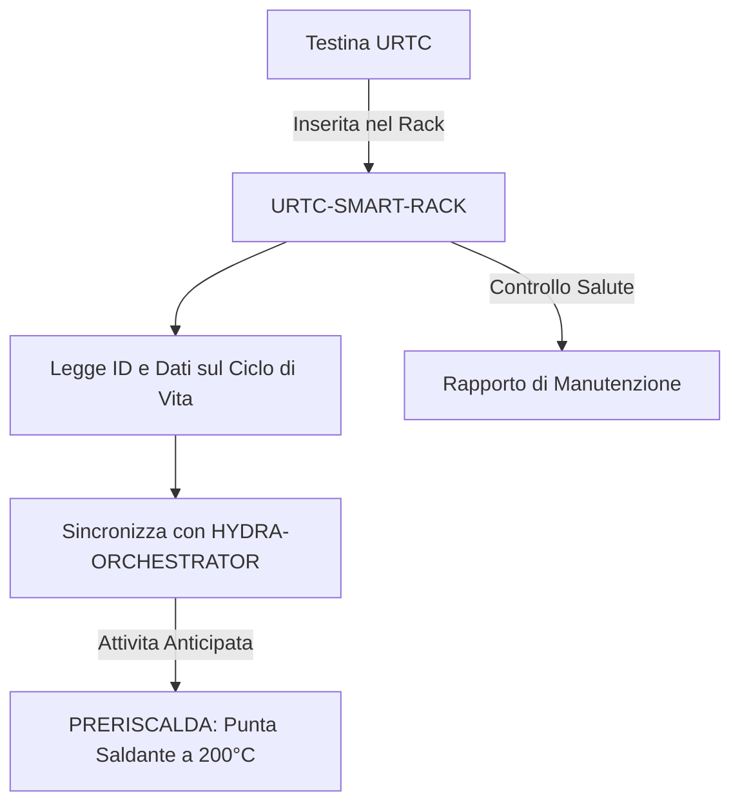

<p align="center">
  
</p>

# 🗄️ URTC-SMART-RACK

<p align="center"><a href="README.md">🇺🇸 English</a> | <a href="README_spa.md">🇪🇸 Español</a> | <a href="README_fra.md">🇫🇷 Français</a> | 🇮🇹 <b>Italiano</b> | <a href="README_deu.md">🇩🇪 Deutsch</a> | <a href="README_zho.md">🇨🇳 简体中文</a> | <a href="README_jpn.md">🇯🇵 日本語</a> | <a href="README_por.md">🇵🇹 Português</a></p>

### 🤖 Gestione Intelligente delle Testine Utensile con Tracciamento del Ciclo di Vita e Termico

<p align="center">
  
  
  
  
  
</p>

---

**Verifica di onestà - cosa funziona davvero oggi:** `tool_id.c`, `lifecycle.c`, `preheat.c`, `protocol.c`, `rack_command.c`, `link_watchdog.c`, `tool_limits.c`, `rack_app.c`, `rack_link.c`, `rack_deframer.c`, `rack_can.c`, `preheat_limit.c` e `rack_inventory.c` sono vero C puro, supportato da 573 controlli `TEST_ASSERT` superati (`tests/test_*.c`, compilati ed eseguiti con il compilatore C proprio dell'host, non `arm-none-eabi-gcc`) - confermato compilando ed eseguendo esattamente quella suite di test host. Questo copre la decodifica dell'ID, il tracciamento di utilizzo/ciclo di vita, l'attivazione del preriscaldamento e la temperatura target, il parsing del protocollo con framing CRC8, la validazione dell'intervallo dei comandi, la gestione di timeout del collegamento/idempotenza, e il tracciamento dell'inventario multi-slot (quale utensile è riposto dove, un utensile reale mai in due slot contemporaneamente) - tutta logica, niente hardware. Come dice già l'introduzione del README: non esiste ancora un PCB/schema per questa scheda, quindi niente qui ha mai pilotato un vero pin GPIO, un chip F-RAM, un elemento riscaldante o un transceiver CAN reali - `main.c`/`startup_stm32g4_minimal.c` dimostrano solo che la compilazione incrociata e il linking per Cortex-M4F riescono contro un linker script segnaposto, non che qualcosa qui giri su silicio reale. Vedi `CHANGELOG.md` per sapere esattamente cosa è stato consegnato finora. Viene provata anche la linea seriale: 19 flussi di byte con l'ora di arrivo di ogni pezzo (un frame a pezzi, rumore, un CRC sbagliato, una versione o una lunghezza che non va, un silenzio proprio al limite del timeout, il giro dell'orologio dei millisecondi) passano per il vero deframer, e i frame che ne escono e i suoi contatori sono quelli del modello di URTC-COMMON.

---

> **Stato di sicurezza (safety e security):** questo ecosistema non è un sistema di sicurezza certificato e non esiste ancora alcuna scheda URTC assemblata. I bootloader controllano le immagini firmware con CRC32 e un HMAC-SHA256 a chiave condivisa, non con una firma asimmetrica (prevista); le immagini applicative pubblicate sono firmate con la chiave pubblica di sviluppo (`signing_key_kind: dev`), quindi chiunque può produrre un'immagine accettata dal bootloader; nulla è stato trasmesso a una scheda reale. Leggi la [base di sicurezza](https://github.com/JuanenRac/URTC-DOCS/blob/main/docs/SECURITY_BASELINE.md) e il [modello delle minacce](https://github.com/JuanenRac/URTC-DOCS/blob/main/docs/THREAT_MODEL.md) prima di fidarti di qualsiasi affermazione qui per la sicurezza di una persona.

## 📋 In breve

| | |
|---|---|
| Versione | `0.2.2` |
| Maturità | Funzionale |
| Test | 573 |
| Tecnologia | C / STM32G4 / arm-none-eabi-gcc |
| Destinazione | Una scheda con microcontrollore (il firmware); compilato su un PC |
| Su hardware reale | Non ancora: per questa versione non risulta alcuna esecuzione su hardware reale |

**Vai a:** [Panoramica](#-panoramica) · [Architettura](#-architettura) · [Sicurezza](#-sicurezza-e-protezione) · [Interfacce](#-interfacce) · [Avvio rapido](#-avvio-rapido) · [Test](#-test) · [Struttura](#-struttura-del-repository) · [Correlati](#-progetti-correlati)

<!-- urtc-section:status_smart_rack -->
## 🚦 Stato del progetto

🟢 fatto e verificato · 🟡 funziona, con limiti noti · 🟠 a metà o non verificato · 🔴 non fatto o non funzionante. Nulla è verde se non ha mai girato su hardware reale.

| Parte | Stato | Ciò che il repository può dimostrare |
| --- | :---: | --- |
| Software | 🟡 | Funziona su un PC e contro il simulatore; mai usato con una scheda reale. |
| Test | 🟢 | La suite di test passa nella CI a ogni push. |
| Hardware reale | 🟠 | Nessuna esecuzione su una scheda reale: la prova al banco è ancora da fare. |
| Documentazione | 🟡 | README in otto lingue e documenti di riferimento; le traduzioni non sono state riviste da madrelingua. |

<!-- /urtc-section:status_smart_rack -->

## 🎯 Panoramica

**URTC-SMART-RACK** è un sistema di stoccaggio intelligente per testine utensile all'interno dell'ecosistema URTC. Basato sul microcontrollore STM32G4, monitora e prepara gli utensili mentre non sono collegati a un robot.

Abilita modalità "Smart Idle", come il preriscaldamento delle punte saldanti T12 poco prima di un cambio utensile, e traccia l'ID elettronico e i cicli totali di utilizzo di ogni testina URTC (la lettura della versione del firmware di ogni testina è prevista, non implementata), garantendo una manutenzione ottimale e un dispiegamento a zero secondi.

Non esiste ancora un PCB/schematico per questa scheda (vedi `hardware/`), quindi nulla di sottostante può pilotare GPIO/F-RAM/CAN reali - ma la *logica* a cui queste funzionalità si riducono (decodificare un ID, tracciare l'utilizzo, decidere quando preriscaldare e a quale temperatura) è reale, C puro, testata unitariamente oggi stesso.

### Caratteristiche Principali:
* ✅ **v0 reale - logica ID, ciclo di vita e preriscaldamento:** `tool_id.c` decodifica una lettura ID grezza a 5 bit in un'identità utensile; `lifecycle.c` traccia cicli/tempo di utilizzo e segnala la manutenzione dovuta; `preheat.c` decide quando deve iniziare il preriscaldamento Smart Idle e a quale temperatura target. 573 asserzioni di test sul compilatore C proprio dell'host - nessun PCB, driver GPIO o F-RAM necessario per eseguire o testare tutto questo. Anche reale: un deframer di flusso per il collegamento seriale (`rack_deframer.c`: cerca il byte di inizio, si risincronizza dopo un byte perso e scarta mezzo frame dopo un timeout), la forma CAN del comando (`rack_can.c`: otto byte di dati, temperatura big-endian; nessuna scheda la porta ancora) e un limite alla durata di un preriscaldamento senza cambio utensile (`preheat_limit.c`: 10 minuti per impostazione predefinita, configurabile).
* ✅ **Teste come unità, verifica termica e preriscaldamento predittivo (testato sull'host):** `rack_inventory.c` può identificare uno slot con il tipo più il numero di serie della testa, e `rack_units.c` conserva l'uso, il tempo di riscaldatore e i guasti termici di ogni testa fisica (dai suoi contatori, `0x1AA` / `0x1AB`), così l'usura segue la testa e non il tipo; `slot_verify.c` dice cosa significa una lettura termica di uno slot per il preriscaldamento ordinato (raggiunto, troppo lento, superamento, un riscaldatore acceso in uno slot vuoto); `preheat_plan.c` trasforma la coda dei lavori in ordini di preriscaldamento, disattivato per impostazione predefinita. La lettura e la coda arrivano da altri programmi, nulla di tutto ciò è stato eseguito su una scheda e i tempi di riscaldamento sono stime.
* 🗄️ **Tracciamento Utensili** — identificazione automatica delle testine URTC tramite jumper ID a 5 bit o F-RAM. *(la logica di decodifica ID in sé è reale - vedi sopra; leggere jumper/F-RAM reali richiede il PCB.)*
* 🗂️ **Inventario Multi-Slot** — `rack_inventory.c` traccia quale utensile è riposto in quale slot, mantiene un utensile reale in esattamente uno slot alla volta (spostarlo altrove libera il suo vecchio slot invece di dichiarare che è in due posti contemporaneamente), e un target di preriscaldamento per slot, indirizzato per identità dell'utensile. All'avvio, `rack_inventory_reconcile()` lo confronta con un sensore di presenza per slot: un utensile rimosso a rack spento viene cancellato (compreso il target di preriscaldamento) e uno inserito a mano viene segnalato per l'identificazione. *(la logica dell'inventario in sé è reale - vedi sopra; collegarla a veri sensori di presenza per slot richiede il PCB.)*
* 🌡️ **Logica di Preriscaldamento** — gestione termica intelligente per utensili di saldatura e aria calda. *(la decisione di attivazione e le temperature target sono reali - vedi sopra; pilotare un riscaldatore reale richiede il PCB.)*
* 📈 **Registri del Ciclo di Vita** — registra i cicli totali di attuazione e le ore di utilizzo nella F-RAM dell'utensile. *(i contatori e la logica di manutenzione dovuta sono reali - vedi sopra; persisterli su F-RAM reale richiede il PCB.)*
* 📡 **Integrazione CAN** — pensata per comunicare con il Cervello Cinematico di HYDRA-UMC per un ATC coordinato (cambio utensile automatico); non ha mai funzionato, perché non esistono né un driver CAN né una scheda. *(il protocollo stesso - framing, CRC, validazione dei comandi - è reale e testato sull'host, vedi sotto; serve ancora un vero transceiver CAN per trasportarlo davvero.)*
* 🔒 **Controlli di Intervallo del Protocollo** — framing versionato con checksum CRC8, validazione dell'intervallo di attuazione e un watchdog di timeout del collegamento/idempotenza con uno stato sicuro definito. Trama in versione 2: ogni valore su più byte è big-endian, come il bus, e una trama di versione 1 viene rifiutata. *(implementato in C puro e testato solo su un PC; mai eseguito su una scheda e non è una funzione di sicurezza certificata)*
* ✅ **Toolchain firmware Cortex-M4F** — un'immagine bare-metal reale (avvio + linker + `main.c`) che compila e collega davvero con `arm-none-eabi-gcc`, la stessa toolchain usata dal repository gemello URTC. *(implementato — vedi COMPILAZIONE sotto)*

## 🧩 Ruolo in URTC

URTC-SMART-RACK è la scheda che custodisce le teste utensile, non una testa utensile: un rack che identifica ogni testa che contiene (l'ID utensile a 5 bit usato da URTC), tiene l'uso e i guasti termici di ogni testa fisica, sa quale utensile è in quale alloggiamento e preriscalda un utensile di saldatura o ad aria calda poco prima di un cambio utensile (Smart Idle). Condivide gli ID utensile e le convenzioni del firmware di URTC, ma è uno strumento complementare, non un figlio di URTC, e deve essere pilotato dal controllore robot HYDRA-UMC. Nessuna scheda esiste ancora: ciò che è reale oggi è la logica e il protocollo del rack, testati su un computer.

## 🏛️ Architettura

<p align="center">
  
</p>

Come si incastrano le parti di questo repository: chi lo usa, che cosa contiene e da che cosa dipende. L'immagine è disegnata da `docs/architecture.json` e verificata rispetto al codice.

<details>
<summary>Versione testuale del diagramma (Mermaid)</summary>



</details>

### ARCHITETTURA E DECISIONI DI PROGETTAZIONE

* **Perché questa scheda non ha ancora un pinout/ID hardware reale definito.** Non esiste ancora un PCB per questa scheda - `src/firmware_common.h` porta un'identità di versione senza ID hardware, e i file di avvio/linker sono scritti a mano come segnaposto in sostituzione dell'avvio CMSIS/HAL proprio di ST finché non viene fissato un vero componente STM32G4.
* **Perché non è un figlio di URTC stesso.** URTC-SMART-RACK è uno Strumento Complementare, non un figlio della famiglia URTC - è una scheda fisica separata (un rack di stoccaggio utensili, non una testa utensile) che condivide lo spazio di ID degli utensili e le convenzioni firmware di URTC, ma non la sua gerarchia di integrazione.
* **Perché `bump_version.py` è una copia identica di quello di URTC.** Lo stesso formato di header del firmware - riutilizzare lo script esatto invece di reinventarlo mantiene i due allineati per costruzione.
* **Perché `tool_id.c`/`lifecycle.c`/`preheat.c` arrivano prima di qualsiasi driver GPIO/F-RAM/CAN.** Decodificare un ID, accumulare l'utilizzo e decidere quando preriscaldare sono funzioni pure di dati già disponibili - non hanno bisogno di alcun PCB per essere scritte o testate, quindi la v0 consegna prima questa logica, testata con il compilatore C della macchina stessa anziché `arm-none-eabi-gcc`. I driver che effettivamente reperirebbero quei dati da hardware reale arriveranno quando esisterà il PCB.
* **Come si inserisce nel resto dell'ecosistema.** Usa l'ecosistema utensili proprio di URTC (gli stessi ID utensile; i frame del rack non sono ancora frame CAN, vedi `docs/OPERATIONS.md`), e forma un abbinamento naturale con HYDRA-UMC-DETECTION-HEF per riconoscere visivamente quale utensile è realmente in rastrelliera.
* **Perché il protocollo, la validazione dei comandi e il watchdog del collegamento sono tre moduli separati.** `protocol.c` conosce solo byte, framing e un CRC - non ha idea di cosa sia una temperatura "sicura". `rack_command.c` possiede quel giudizio, decodificando e verificando l'intervallo di un comando reale senza preoccuparsi di come sia arrivato sul filo. `link_watchdog.c` traccia il timeout/l'idempotenza indipendentemente da entrambi - un frame corrotto non deve mai nemmeno raggiungerlo (vedi la stessa asserzione reale di `test_rack_link_scenarios.c` secondo cui un frame con CRC errato non fa mai rivivere il watchdog). Tenerli separati è ciò che rende ciascuno testabile autonomamente sull'host, e mantiene snello un futuro handler di ricezione CAN - chiama ogni livello in ordine, non reimplementa il giudizio di nessuno di essi.
* **Limitatore di frequenza dei comandi.** Una raffica di comandi per uno stesso utensile viene frenata da un intervallo minimo tra i comandi accettati (20 ms di default, 0 lo disattiva; `link_watchdog_set_command_interval()`). Un comando trattenuto non cambia nulla e non riceve conferma, ma conta come collegamento vivo; uno stato sicuro o una ritrasmissione non vengono mai trattenuti. L'intervallo si regola nel banco simulato del rack di URTC-WEB-STUDIO.
* **Perché un collegamento non provato viene trattato esattamente come uno morto.** `link_watchdog_is_link_lost()` è vero sia dopo un vero timeout SIA prima che sia mai arrivato il primissimo frame - le stesse note di diagnosi lo chiamano "estado seguro al arrancar". Una rastrelliera che si accende senza che sia ancora connesso alcun host deve avviarsi nello stato sicuro, non assumere silenziosamente che vada "bene" finché non sia dimostrato il contrario.

## 🔒 Sicurezza e protezione

| Minaccia | Difesa |
|---|---|
| Un ordine fuori intervallo a un utensile | `rack_command.c` decodifica e controlla l'intervallo di ogni ordine senza curarsi di come sia arrivato; `protocol.c` conosce solo byte, frame e un CRC; `tool_limits.c` tiene il limite di ogni profilo utensile |
| Un frame corrotto o vecchio | Un frame versionato con CRC-8; nella versione 2 ogni valore su più byte è big-endian come il bus e un frame di versione 1 viene rifiutato |
| Una raffica di ordini | Un intervallo minimo tra gli ordini accettati (20 ms per impostazione predefinita, 0 lo disattiva); un ordine trattenuto non cambia nulla e non riceve conferma, ma conta come collegamento vivo; uno stato sicuro o una ritrasmissione non viene mai trattenuta |
| Un collegamento perso o non provato | `link_watchdog_is_link_lost()` è vero dopo un vero timeout e anche prima che arrivi il primo frame: un rack che si accende senza host parte in stato sicuro |
| Un preriscaldamento troppo lungo o troppo caldo | `preheat_limit.c` limita quanto può durare un preriscaldamento senza cambio utensile (10 minuti per impostazione predefinita, configurabile) e `tool_limits.c` il bersaglio massimo di ogni profilo utensile |
| Un utensile in due alloggiamenti | `rack_inventory.c` tiene un vero utensile in un solo alloggiamento; riporlo altrove svuota il precedente |

Tutto questo è C puro testato su un computer; non è mai girato su una scheda e non è una funzione di sicurezza certificata.

## 🔌 Interfacce

* **Il frame seriale del rack:** versione 2, big-endian come il bus, con il CRC-8 fornito da URTC-COMMON (`src/urtc_crc8.h`, `src/urtc_frame.h`); `protocol.c` lo interpreta e lo codifica, `rack_deframer.c` trova i frame in un flusso di byte (risincronizzazione dopo un byte perso, mezzo frame scartato dopo un timeout) e `rack_link.c` decide che cosa fare di ogni frame. I formati sono in [docs/OPERATIONS.md](docs/OPERATIONS.md).
* **La forma CAN dell'ordine:** `rack_can.c` (otto byte di dati, temperatura big-endian). Nessuna scheda la porta ancora: i frame del rack non sono ancora frame CAN.
* **Condiviso con URTC:** l'ID utensile a 5 bit (`tool_id.c`) e i contatori `0x1AA` / `0x1AB` che tengono l'uso di ogni testa fisica (`rack_units.c`). I vettori che lo strato dei frame deve riprodurre sono quelli di URTC-COMMON (`conformance/rack_vectors.json`).

## 🚀 Avvio rapido

Richiede la toolchain ARM GNU (`arm-none-eabi-gcc`, `arm-none-eabi-objcopy`, `arm-none-eabi-size`) e Python 3.

```bash
# Linux/macOS
chmod +x build_firmware.sh   # una tantum
./build_firmware.sh

# Windows
build_firmware.bat
```

Esempio reale - i test lato host si eseguono anche da soli, utile per verificare la logica senza un build firmware completo:

```bash
cc -std=c11 -Wall -Wextra -Isrc -Itests -o build/host_tests \
  tests/test_main.c tests/test_tool_id.c tests/test_lifecycle.c tests/test_preheat.c \
  tests/test_protocol.c tests/test_rack_command.c tests/test_link_watchdog.c tests/test_rack_link_scenarios.c \
  tests/test_rack_inventory.c tests/test_robustness.c tests/test_rack_app.c \
  tests/test_rack_deframer.c tests/test_rack_can.c tests/test_preheat_limit.c \
  src/tool_id.c src/tool_limits.c src/lifecycle.c src/preheat.c src/protocol.c src/rack_command.c src/link_watchdog.c src/rack_link.c \
  src/rack_inventory.c src/rack_app.c src/rack_deframer.c src/rack_can.c src/preheat_limit.c
./build/host_tests
# All tests passed.
```

<!-- urtc-section:compatibility -->
### Requisiti e compatibilità

Quali versioni dei programmi URTC funzionano insieme, e quale versione del protocollo parla ciascuna, è elencato nella tabella di compatibilità generata da URTC-COMMON: [docs/COMPATIBILITY.md](https://github.com/JuanenRac/URTC/blob/main/docs/COMPATIBILITY.md).
<!-- /urtc-section:compatibility -->

## 🧪 Test

I test host sono programmi C in `tests/` (573 controlli `TEST_ASSERT` in 18 file) compilati ed eseguiti con il compilatore C del computer, mai `arm-none-eabi-gcc`: ID utensile, limiti utensile, ciclo di vita, preriscaldamento, il frame, il controllo degli ordini, il watchdog del collegamento, interi scenari di collegamento, l'inventario, la robustezza contro input errati, lo strato applicativo, il deframer (19 flussi di byte con l'istante di arrivo di ogni pezzo: un frame a pezzi, rumore, un CRC errato, una versione o lunghezza sbagliata, un silenzio al limite del timeout, un giro dell'orologio dei millisecondi), la forma CAN, il limite di preriscaldamento e le unità di ogni testa; i vettori sono quelli di URTC-COMMON. Cinque file di test Python (25 test) verificano che gli script di compilazione, gli asset della release, i file di versione e il numero di test pubblicato concordino. La CI compila i test C con AddressSanitizer e UBSan e fallisce sotto una soglia di copertura delle righe eseguite di `src/` (`tools/gcov_floor.py`). `bash build_firmware.sh` li esegue prima della compilazione incrociata e fa fallire la compilazione se un'asserzione fallisce. L'anello di byte che un interrupt di ricezione riempie (`rack_ring.c`) e la memorizzazione in due copie del ciclo di vita e dell'inventario (`rack_persist.c`, provata con un calo di corrente a ogni byte di un salvataggio) sono anch'essi logica pura; il chip di memoria dietro la memorizzazione non è ancora scelto.

## 🏗️ Compilazione e rilascio

La compilazione compila ed esegue prima `tests/` con il compilatore C *del computer* (mai `arm-none-eabi-gcc`: sono test di pura logica, senza toccare registri dell'MCU) e fallisce del tutto se un'asserzione fallisce. Solo dopo compila `main.c` e `startup_stm32g4_minimal.c` per Cortex-M4F, li collega con la mappa di memoria provvisoria `STM32G4_MINIMAL.ld` e pubblica file `.elf`/`.bin`/`.hex` versionati in `firmware/`. Compilare non cambia mai la versione.

Ogni modulo di `src/` viene compilato anche per Cortex-M4F e tutti vengono collegati insieme come controllo (sul target non c'è libreria C), anche se oggi l'immagine contiene solo `main.c` e il file di avvio. Con `URTC_CI=1` non viene toccato alcun file versionato.

Le immagini del firmware (`.bin`, `.hex`, `.elf`) non sono versionate in git: una build di release scrive `firmware/URTC_SMART_RACK_FIRMWARE_v<versione>.*` (ignorato da git; `build/firmware` in modalità CI, `URTC_CI=1`) e sono pubblicate solo come asset della release GitHub di ogni versione. `python tools/publish_release_assets.py` controlla i file, scrive il file `.sha256` mancante e stampa il comando `gh release create` esatto con i file da allegare.

Non c'è ancora nulla da flashare su hardware reale - non esiste un PCB che confermi la parte STM32G4 target, il pinout, o le sue reali dimensioni di flash/RAM. La mappa di memoria del linker script è un placeholder prudente (documentato nella propria intestazione) che verrà sostituito quando esisterà hardware reale, lo stesso momento in cui la tabella dei vettori scritta a mano di `startup_stm32g4_minimal.c` verrà sostituita dal codice di avvio CMSIS/HAL proprio di ST (seguendo il modello del repository gemello URTC in `src/F303-master/` per le sue schede STM32F303).

Vedi [`CHANGELOG.md`](CHANGELOG.md) per la cronologia completa delle versioni; ogni versione vi ha la propria voce.

## 📂 Struttura del repository

<p align="center">
  
</p>

<details>
<summary>Versione testuale dell'albero</summary>

```text
URTC-SMART-RACK/
├── src/                                               il firmware: logica in C puro, le copie verificate di URTC-COMMON, il punto di ingresso e lo script di link provvisorio
├── tests/                                             test host in C (573 controlli) e controlli Python degli script di compilazione
├── docs/                                              OPERATIONS.md: che cosa fa la logica, che cosa rifiuta e che cosa resta non verificato
├── hardware/                                          note: ancora nessuno schema né PCB
├── tools/                                             controllo di compilazione, soglia di copertura, asset della release e strumenti condivisi di CI e immagini
├── images/                                            banner e immagini di questo README
├── .github/                                           workflow di CI e modelli per issue e pull request
├── build-test.sh build-test.bat                       script di compilazione e test che non cambiano nulla nel repository
├── test.sh test.bat                                   eseguono i test
├── urtc.project.json                                  manifesto: versione, ruolo, maturità e comando di compilazione
├── CHANGELOG.md                                       che cosa è cambiato in ogni versione
├── SECURITY.md SUPPORT.md LICENSE                     politica di sicurezza, supporto e licenza
├── CONTRIBUTING.md CODE_OF_CONDUCT.md                 come contribuire e codice di condotta
├── .gitattributes .gitignore                          impostazioni di Git
├── build_firmware.sh build_firmware.bat               test host, compilazione incrociata, link e pubblicazione delle immagini
├── bump.py bump_version.py bump_manifest_version.py   script che alzano la versione
└── LICENSE.md ruff.toml                               licenza della documentazione e impostazioni di lint
```

</details>

L'elenco annotato di ogni file sorgente, una riga per file, è in [docs/SOURCE_MAP.md](docs/SOURCE_MAP.md).

## 🗺️ Roadmap e limiti noti

**Limiti noti oggi**

* Per questa scheda non esistono ancora PCB né schema (vedi `hardware/`): niente di tutto questo ha mai pilotato un vero pin GPIO, una F-RAM, un riscaldatore o un transceiver CAN. `main.c` e il file di avvio dimostrano solo che la compilazione incrociata e il link per Cortex-M4F riescono con uno script di link provvisorio.
* La lettura della versione del firmware di ogni testa è prevista, non implementata.
* La forma CAN dell'ordine non è mai girata: non esistono né un driver CAN né una scheda, e i frame del rack non sono ancora frame CAN.
* I tempi di riscaldamento del preriscaldamento predittivo sono stime e il suo interruttore è spento per impostazione predefinita.

**Prossimi passi**

* Progettare la scheda, fissare il componente STM32G4 e sostituire lo script di link e il file di avvio provvisori con quelli di ST; scrivere i driver GPIO, F-RAM e CAN che forniscono i dati alla logica.

## 🌍 Lingue

Il README e i testi esistono in inglese, spagnolo, francese, italiano, tedesco, cinese, giapponese e portoghese europeo.

## 🔗 Progetti correlati

URTC è fatto di repository indipendenti, ciascuno con la propria versione, i propri test e il proprio README. Ecco la famiglia, per gruppi:

* **URTC Tool Platform:**
  * [URTC](https://github.com/JuanenRac/URTC) - firmware della scheda della testa utensile (25 profili utensile, bootloader CAN) e riferimento del protocollo CAN.
  * [URTC-COMMON](https://github.com/JuanenRac/URTC-COMMON) - il protocollo CAN scritto una sola volta come dati (specifica, tabelle generate, vettori di conformità) e il codice condiviso dai programmi.
  * [URTC-FLASHER](https://github.com/JuanenRac/URTC-FLASHER) - strumento desktop che aggiorna il firmware della scheda via CAN o via SWD/JTAG.
  * [URTC-GATEWAY](https://github.com/JuanenRac/URTC-GATEWAY) - gateway davanti al bus CAN: lascia passare solo gli identificatori di un elenco, ne limita la frequenza e chiede una chiave di sessione.
  * **URTC-SMART-RACK** (questo repository) - logica C indipendente dall'hardware e protocollo di comandi per un portautensili con preriscaldamento e tracciamento del ciclo di vita.
  * [URTC-TESTER](https://github.com/JuanenRac/URTC-TESTER) - tester desktop del bus CAN in tempo reale che mostra i comandi e la telemetria del profilo utensile segnalato da una scheda.
  * [URTC-VISION-TOOL](https://github.com/JuanenRac/URTC-VISION-TOOL) - protocollo di frame del sensore in C e un companion Python termico/RGB per una testa utensile di ispezione.
  * [URTC-WEB-STUDIO](https://github.com/JuanenRac/URTC-WEB-STUDIO) - app per browser che programma e collauda la scheda via Web Serial e SLCAN, senza installare nulla.
* **Ecosystem Operations:**
  * [URTC-DOCS](https://github.com/JuanenRac/URTC-DOCS) - architettura, interfacce, base di sicurezza e catalogo generato dell'ecosistema, più gli strumenti che confrontano tutti i repository.
  * [URTC-UPDATER](https://github.com/JuanenRac/URTC-UPDATER) - strumento desktop che rileva, installa e aggiorna i repository della famiglia URTC, un'azione esplicita alla volta.

**Progetti fratelli (indipendenti, con la stessa base e gli stessi strumenti):**

* **[HYDRA-UMC-DOCS](https://github.com/JuanenRac/HYDRA-UMC-DOCS)** - progetto fratello: il centro di documentazione di HYDRA-UMC, un ecosistema indipendente che condivide base e strumenti con questo
* **[ARMOR-DOCS](https://github.com/JuanenRac/ARMOR-DOCS)** - progetto fratello: il centro di documentazione di A.R.M.O.R., l'ecosistema di sicurezza, anch'esso indipendente e sulla stessa base
* **[JuanenRac](https://github.com/JuanenRac/JuanenRac)** - il profilo e il pannello di stato di tutti gli ecosistemi

## 📚 Documentazione

- **[CONTRIBUTING.md](CONTRIBUTING.md)** — stack tecnologico e linee guida di codifica per una pull request.
- **[CODE_OF_CONDUCT.md](CODE_OF_CONDUCT.md)** — gli standard di comportamento attesi in questa comunità.
- **[SECURITY.md](SECURITY.md)** — come segnalare una vulnerabilità, e le reali aree di attenzione sulla sicurezza di questo progetto.
- **[SUPPORT.md](SUPPORT.md)** — dove porre domande e segnalare bug.
- **[LICENSE.md](LICENSE.md)** — la licenza propria di questo progetto.

## 🤝 Contribuire e comunità

* Prima di una pull request esegui `URTC_CI=1 python tools/ci_validate.py`: deve passare. Vedi [CONTRIBUTING.md](CONTRIBUTING.md) e il [codice di condotta](CODE_OF_CONDUCT.md).
* Il README esiste in otto lingue: una modifica del testo si fa in tutti e otto i file, e le sezioni condivise con altri repository le scrive `tools/readme_sections.py` di URTC-COMMON.
* Una modifica al protocollo CAN parte da URTC-COMMON (`spec/can_protocol.json`) e arriva in questo repository tramite la copia verificata.
* Non descrivere come funzionante su una scheda ciò che è stato solo compilato.
* Segnala una vulnerabilità in privato: [SECURITY.md](SECURITY.md). Domande, idee e segnalazioni: electrohobby3d@gmail.com ([SUPPORT.md](SUPPORT.md)).

## 👤 AUTORE

**JuanenRac** (Electro Hobby 3D)
📧 electrohobby3d@gmail.com
📺 [youtube.com/@electrohobby3d](https://youtube.com/@electrohobby3d)

## 📜 LICENZA

GPL-3.0-or-later - Vedi LICENSE per i dettagli.
