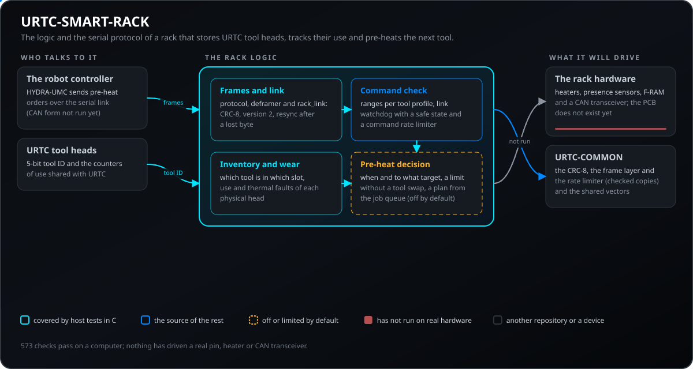
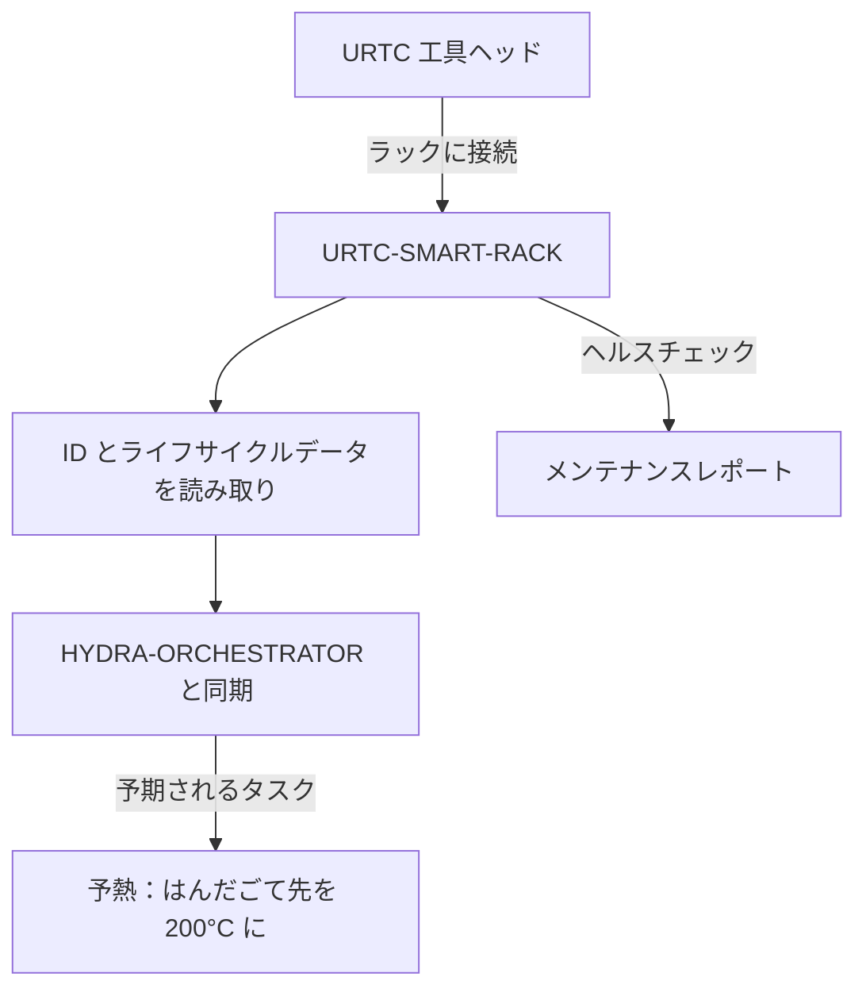
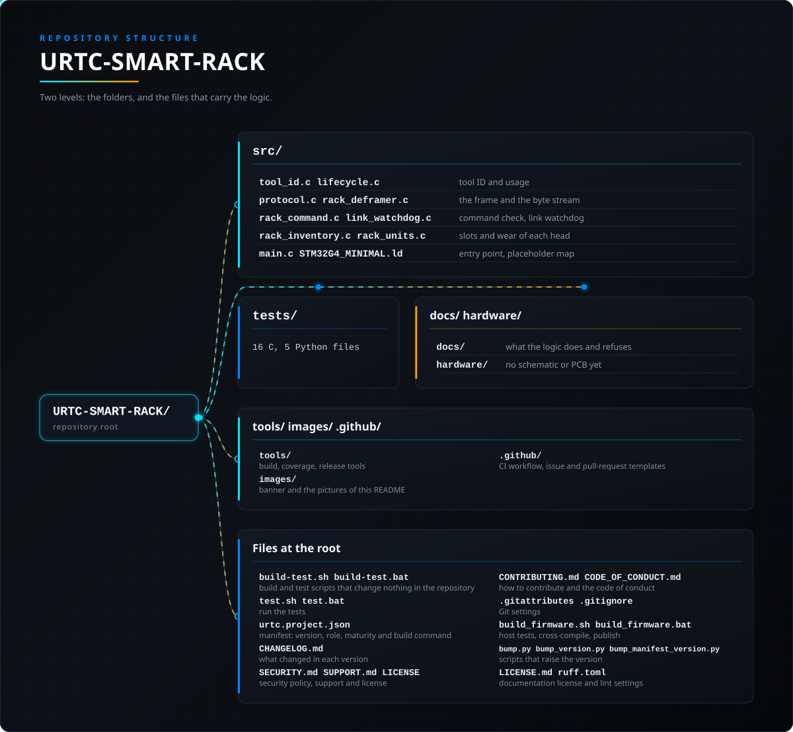

<p align="center">
  
</p>

# 🗄️ URTC-SMART-RACK

<p align="center"><a href="README.md">🇺🇸 English</a> | <a href="README_spa.md">🇪🇸 Español</a> | <a href="README_fra.md">🇫🇷 Français</a> | <a href="README_ita.md">🇮🇹 Italiano</a> | <a href="README_deu.md">🇩🇪 Deutsch</a> | <a href="README_zho.md">🇨🇳 简体中文</a> | 🇯🇵 <b>日本語</b> | <a href="README_por.md">🇵🇹 Português</a></p>

### 🤖 ライフサイクルおよび温度追跡機能を備えたインテリジェントなエンドエフェクター管理システム

<p align="center">
  
  
  
  
  
</p>

---

**正直な現状確認 - 実際に今動くもの:** `tool_id.c`、`lifecycle.c`、`preheat.c`、`protocol.c`、`rack_command.c`、`link_watchdog.c`、`tool_limits.c`、`rack_app.c`、`rack_link.c`、`rack_deframer.c`、`rack_can.c`、`preheat_limit.c`、そして `rack_inventory.c` は本物の純粋な C コードであり、571件の通過している `TEST_ASSERT` チェック（`tests/test_*.c`、`arm-none-eabi-gcc` ではなくホスト自身の C コンパイラでコンパイル・実行）に裏付けられている——実際にこのホストテストスイートをコンパイルして実行し確認済みだ。これは ID デコード、使用状況/ライフサイクルの追跡、予熱の起動判断と目標温度、CRC8 フレーミングのプロトコル解析、コマンドの範囲検証、リンクタイムアウト/冪等性の処理、そしてマルチスロット工具インベントリの追跡(どの工具がどのスロットに収納されているか、実物の工具が同時に2つのスロットに存在することはない)をカバーしている——すべてロジックであり、ハードウェアは一切含まれない。README 自身の冒頭がすでに述べている通り、このボード用の PCB/回路図はまだ存在しないため、ここにあるものはいずれも実際の GPIO ピン、F-RAM チップ、ヒーター、CAN トランシーバーを一度も駆動したことがない——`main.c`/`startup_stm32g4_minimal.c` は、Cortex-M4F 向けのクロスコンパイルとリンクがプレースホルダーのリンカスクリプトに対して成功することを示すだけであり、これらが実際のシリコン上で動くことを示すものではない。これまでに実際に出荷されたものの詳細は `CHANGELOG.md` を参照。 シリアル回線も試験しています。各断片が届いた時刻付きの 19 本のバイト列（断片に分かれたフレーム、ノイズ、誤った CRC、合わないバージョンや長さ、タイムアウトちょうどの無音、ミリ秒クロックの一周）を本物のデフレーマーに通し、出てくるフレームとそのカウンターは URTC-COMMON のモデルと同じです。

---

> **安全性とセキュリティの現状:** このエコシステムは認証された安全システムではなく、実装済みの URTC 基板もまだ存在しません。ブートローダーはファームウェアイメージを CRC32 と共有鍵の HMAC-SHA256 で検査しており、非対称署名ではありません(予定)。公開されているアプリケーションイメージは公開の開発用鍵(`signing_key_kind: dev`)で署名されているため、誰でもブートローダーが受け入れるイメージを作れます。実際の基板には何も送信されていません。ここに書かれた内容を人の安全のために頼る前に、[セキュリティベースライン](https://github.com/JuanenRac/URTC-DOCS/blob/main/docs/SECURITY_BASELINE.md)と[脅威モデル](https://github.com/JuanenRac/URTC-DOCS/blob/main/docs/THREAT_MODEL.md)をお読みください。

## 📋 ひと目で

| | |
|---|---|
| バージョン | `0.2.2` |
| 成熟度 | 機能する |
| テスト | 571 |
| 技術 | C / STM32G4 / arm-none-eabi-gcc |
| 対象 | マイコン基板（ファームウェア）。ビルドは PC で行います |
| 実機での確認 | まだです：このバージョンについて実機での動作記録はありません |

**移動先：** [概要](#-概要) · [アーキテクチャ](#-アーキテクチャ) · [セキュリティ](#-セキュリティと安全) · [インターフェース](#-インターフェース) · [クイックスタート](#-クイックスタート) · [テスト](#-テスト) · [構成](#-リポジトリの構成) · [関連](#-関連プロジェクト)

<!-- urtc-section:status_smart_rack -->
## 🚦 プロジェクトの状況

🟢 完了・検証済み · 🟡 動作するが既知の制限あり · 🟠 途中、または未検証 · 🔴 未実施または動作しない。実機で一度も動いていないものは緑になりません。

| 項目 | 状態 | リポジトリが示せること |
| --- | :---: | --- |
| ソフトウェア | 🟡 | PC とシミュレーターでは動作します。実際のボードでは一度も実行していません。 |
| テスト | 🟢 | テストスイートはプッシュごとに CI で通ります。 |
| 実機 | 🟠 | 実際のボードでの実行はまだありません。ベンチテストは未実施です。 |
| ドキュメント | 🟡 | 8 言語の README と参照ドキュメントがあります。翻訳はネイティブによるレビューを受けていません。 |

<!-- /urtc-section:status_smart_rack -->

## 🎯 概要

**URTC-SMART-RACK** は、URTC エコシステム内のエンドエフェクター向け
インテリジェント収納システムです。STM32G4 マイクロコントローラーを基盤
とし、工具がロボットに装着されていない間、それを監視し準備します。

工具交換の直前に T12 はんだごて先を予熱するといった「スマートアイドル」
モードを可能にし、すべての URTC ヘッドの電子 ID と
総使用サイクル数を追跡し（各ヘッドのファームウェアバージョンの読み取りは計画中で、未実装）、最適なメンテナンスとゼロ秒デプロイを
実現します。

この基板にはまだ PCB/回路図が存在しないため（`hardware/` 参照）、以下の
どの機能も実際の GPIO/F-RAM/CAN ハードウェアを駆動することはできません——
しかし、それらの機能が帰着する*ロジック*（ID のデコード、使用状況の追跡、
いつ・何度で予熱すべきかの判断）は本物であり、純粋な C で書かれ、今日
すでに単体テスト済みです。

### 主な機能：
* ✅ **本物の v0 —— ID・ライフサイクル・予熱ロジック：** `tool_id.c` は生の 5 ビット ID 読み取り値を工具の識別情報にデコードします。`lifecycle.c` は使用サイクル/時間を追跡し、メンテナンス期限を通知します。`preheat.c` はスマートアイドル予熱をいつ開始すべきか、目標温度は何度かを決定します。ホスト自身の C コンパイラで 571 件のテストアサーションを実施——これらすべての実行・テストに PCB、GPIO ドライバー、F-RAM は不要です。また実装済み：シリアルリンク用のストリーム・デフレーマ（`rack_deframer.c`：開始バイトを探し、バイト欠落後に再同期し、タイムアウト後に途中のフレームを破棄）、コマンドの CAN 形式（`rack_can.c`：データ 8 バイト、ビッグエンディアンの温度。これを載せる基板はまだありません）、工具交換なしで予熱を続けられる時間の上限（`preheat_limit.c`：既定 10 分、設定可能）。
* ✅ **工具ヘッドを個体として扱う、熱の確認、先読み予熱（ホストでテスト済み）：** `rack_inventory.c` はスロットを種類とヘッドのシリアル番号で識別でき、`rack_units.c` は物理的なヘッドごとの使用回数、ヒーター時間、熱の異常を（ヘッド自身のカウンター `0x1AA` / `0x1AB` から）記録するため、摩耗は種類ではなくヘッドに付いて回ります。`slot_verify.c` はスロットの温度読み取りが、指示した予熱に対して何を意味するか（到達、遅すぎる、行き過ぎ、空のスロットでヒーターが入っている）を判定し、`preheat_plan.c` はジョブキューを予熱の指示に変換します（既定ではオフ）。読み取り値とキューは別のプログラムから来ます。基板上では何も動かしておらず、加熱時間は推定値です。
* 🗄️ **工具追跡** — 5 ビット ID ジャンパーまたは F-RAM 経由での URTC ヘッドの自動識別。*（ID デコードロジック自体は本物です——上記参照。実際のジャンパー/F-RAM の読み取りには PCB が必要です。）*
* 🗂️ **マルチスロット・インベントリ** — `rack_inventory.c` はどの工具がどのスロットに収納されているかを追跡し、実物の工具を常に1つのスロットにのみ保持します(別のスロットへ移すと元のスロットは自動的に空になり、2箇所に同時に存在すると主張することはありません)。予熱目標は工具の識別情報で参照されるスロットごとの設定です。起動時に `rack_inventory_reconcile()` がスロットごとの在席センサーと照合します：ラックの電源オフ中に抜かれたツールは（予熱目標を含めて）クリアされ、手で差し込まれたツールは識別が必要なものとして報告されます。 *(インベントリロジック自体は本物です——上記参照。実際のスロットごとの検知センサーへの接続には PCB が必要です。)*
* 🌡️ **予熱ロジック** — はんだ付けおよび熱風工具向けのインテリジェントな温度管理。*（起動判断と目標温度は本物です——上記参照。実際のヒーターの駆動には PCB が必要です。）*
* 📈 **ライフサイクルログ** — 総アクチュエーションサイクル数と使用時間を工具の F-RAM に記録します。*（カウンターとメンテナンス期限ロジックは本物です——上記参照。実際の F-RAM への永続化には PCB が必要です。）*
* 📡 **CAN 統合** — 協調した ATC（自動工具交換）のために HYDRA-UMC 運動学ブレインと通信することを想定していますが、CAN ドライバーもボードも存在しないため、実際に動作したことはありません。*（ワイヤープロトコル自体——フレーミング、CRC、コマンド検証——は本物で、ホスト上でテスト済みです。以下を参照。ただし実際にそれを伝送するための本物の CAN トランシーバーはまだ必要です。）*
* 🔒 **プロトコルの範囲チェック** — バージョン化されたフレーミングと CRC8 チェックサム、アクチュエーション範囲検証、そして明確な安全状態を持つリンクタイムアウト/冪等性ウォッチドッグ。フレームのバージョン 2：複数バイトの値はすべてバスと同じビッグエンディアンで、バージョン 1 のフレームは拒否されます。*（純粋な C として実装され、PC 上でのみテスト済みです。ボード上で動作したことはなく、認証された安全機能でもありません）*
* ✅ **Cortex-M4F ファームウェアツールチェーン** — 兄弟リポジトリ URTC が使用するのと同じツールチェーンを用いて、`arm-none-eabi-gcc` でクロスコンパイルおよびリンクされる、実際のベアメタルイメージ（起動コード + リンカ + `main.c`）。*（実装済み——下記の「ビルド」を参照）*

## 🧩 URTC での役割

URTC-SMART-RACK はツールヘッドを保管するボードで、ツールヘッドそのものではありません。収めた各ヘッドを識別し（URTC が使う 5 ビットのツール ID）、物理ヘッドごとの使用状況と熱的な故障を記録し、どのツールがどのスロットにあるかを把握し、ツール交換の直前にはんだ付けやホットエアのツールを予熱します（Smart Idle）。URTC のツール ID とファームウェアの規約を共有しますが、URTC の子ではなく補完的なツールで、HYDRA-UMC のロボットコントローラーから制御される想定です。ボードはまだ存在せず、現時点で実在するのはロジックとラックのプロトコルで、コンピューター上で試験されています。

## 🏛️ アーキテクチャ

<p align="center">
  
</p>

このリポジトリの各部分の関係：誰が使い、何を持ち、何に依存するか。図は `docs/architecture.json` から描かれ、コードと照合されます。

<details>
<summary>図のテキスト版 (Mermaid)</summary>



</details>

### アーキテクチャと設計上の決定

* **この基板にまだ実際のピン配置/ハードウェア ID が定義されていない理由。** この基板にはまだ PCB が存在しません——`src/firmware_common.h` はハードウェア ID を持たないバージョン識別情報を携えており、起動/リンカファイルは、実際の STM32G4 部品が確定するまで ST 自身の CMSIS/HAL 起動コードの代わりを務める手書きのプレースホルダーです。
* **URTC 自体の子プロジェクトではない理由。** URTC-SMART-RACK は URTC ファミリーの子プロジェクトではなく、補完ツールです——独立した物理基板（工具ヘッドではなく工具保管ラック）でありながら、URTC 自身の工具 ID 空間とファームウェアの慣例を共有していますが、その統合階層は共有していません。
* **`bump_version.py` が URTC のものとそのままのコピーである理由。** ファームウェアヘッダーの形式が同じで、同じスクリプトを作り直さずに再利用することで、両者は構造上、足並みがそろいます。
* **`tool_id.c`/`lifecycle.c`/`preheat.c` が GPIO/F-RAM/CAN ドライバーより先に実装される理由。** ID のデコード、使用状況の累積、予熱タイミングの判断は、すでに手元にあるデータに対する純粋な関数であり、書くにもテストするにも PCB を必要としません。そのため v0 ではまずこのロジックを実装し、`arm-none-eabi-gcc` ではなくマシン自身の C コンパイラでホストテストを行います。実際のハードウェアからこれらのデータを取得するドライバーは、PCB が存在するようになってから実装されます。
* **エコシステムの他の部分との関係。** URTC 自身の工具エコシステム（同じ工具 ID。ラックのフレームはまだ CAN フレームではありません。`docs/OPERATIONS.md` を参照）を利用しており、実際にどの工具がラックに収納されているかを視覚的に認識する HYDRA-UMC-DETECTION-HEF と自然に組み合わされます。
* **プロトコル、コマンド検証、リンクウォッチドッグが 3 つの独立したモジュールである理由。** `protocol.c` はバイト、フレーミング、CRC しか知らず、何が「安全」な温度なのかは一切知りません。`rack_command.c` がその判断を担い、実際のコマンドをデコードして範囲チェックします。それがワイヤー上でどのように届いたかは気にしません。`link_watchdog.c` は両者とは独立してタイムアウト/冪等性を追跡します——壊れたフレームは決してそこにさえ届いてはなりません（`test_rack_link_scenarios.c` 自身の実際のアサーションで、CRC 不正なフレームがウォッチドッグを決して復活させないことを参照）。これらを分離しておくことで、それぞれをホスト上で単独にテストできるようになり、将来の CAN 受信ハンドラを薄く保てます——各レイヤーを順番に呼び出すだけで、どの判断も自分で再実装しません。
* **コマンドのレート制限。** 同じツールへのコマンドの連続送信は、受理したコマンド間の最小間隔で抑えられます（既定は 20 ms、0 で無効。`link_watchdog_set_command_interval()`）。保留されたコマンドは何も変更せず応答も返しませんが、リンクは生きているとみなされます。安全状態や再送は保留されません。この間隔は URTC-WEB-STUDIO のシミュレート済みラック試験台で調整できます。
* **検証されていないリンクが、死んだリンクと完全に同じとして扱われる理由。** `link_watchdog_is_link_lost()` は、実際のタイムアウト後も、最初のフレームがまだ一度も到着していない段階も、両方とも真です——診断ノート自身がそれを「estado seguro al arrancar」と呼んでいます。まだホストが一度も接続されていない状態で起動するラックは、安全状態で起動しなければならず、証明されるまで黙って「大丈夫」だと仮定してはなりません。

## 🔒 セキュリティと安全

| 脅威 | 防御 |
|---|---|
| ツールへの範囲外の命令 | `rack_command.c` は届き方に関係なくすべての命令をデコードして範囲を検査します。`protocol.c` はバイト、フレーム、CRC だけを知り、`tool_limits.c` は各ツールプロファイルの上限を持ちます |
| 壊れた、または古いフレーム | バージョン付きフレームと CRC-8。バージョン 2 では複数バイトの値はバスと同じビッグエンディアンで、バージョン 1 のフレームは拒否されます |
| 命令の洪水 | 受理した命令の間の最小間隔（既定 20 ミリ秒、0 で無効）。保留された命令は何も変えず確認応答もありませんが、リンクは生きているものとして数えられます。安全状態や再送が保留されることはありません |
| 失われた、または未証明のリンク | `link_watchdog_is_link_lost()` は、実際のタイムアウト後と最初のフレームが届く前の両方で真になります。ホストなしで電源が入ったラックは安全状態から始まります |
| 長すぎる、または高温すぎる予熱 | `preheat_limit.c` はツール交換なしで予熱が続く時間を制限し（既定 10 分、設定可能）、`tool_limits.c` は各ツールプロファイルの最高目標値を制限します |
| 1 つのツールが 2 つのスロットに | `rack_inventory.c` は実在するツールを 1 つのスロットにだけ置きます。別の場所に収めると、元のスロットは空になります |

これはすべてコンピューター上で試験された純粋な C で、ボード上で動いたことはなく、認証された安全機能でもありません。

## 🔌 インターフェース

* **ラックのシリアルフレーム：** バージョン 2、バスと同じビッグエンディアンで、URTC-COMMON が提供する CRC-8（`src/urtc_crc8.h`、`src/urtc_frame.h`）を使います。`protocol.c` が解析と符号化を行い、`rack_deframer.c` がバイト列からフレームを見つけ（欠落バイト後の再同期、タイムアウト後の半端なフレームの破棄）、`rack_link.c` が各フレームの扱いを決めます。形式は [docs/OPERATIONS.md](docs/OPERATIONS.md) にあります。
* **命令の CAN 形式：** `rack_can.c`（データ 8 バイト、温度はビッグエンディアン）。これを載せたボードはまだなく、ラックのフレームはまだ CAN フレームではありません。
* **URTC と共有するもの：** 5 ビットのツール ID（`tool_id.c`）と、物理ヘッドごとの使用状況を保つカウンター `0x1AA` / `0x1AB`（`rack_units.c`）。フレーム層が再現すべきベクトルは URTC-COMMON のもの（`conformance/rack_vectors.json`）です。

## 🚀 クイックスタート

ARM GNU ツールチェーン（`arm-none-eabi-gcc`、`arm-none-eabi-objcopy`、
`arm-none-eabi-size`）と Python 3 が必要です。

```bash
# Linux/macOS
chmod +x build_firmware.sh   # 初回のみ
./build_firmware.sh

# Windows
build_firmware.bat
```

実例——ホスト側のテストは単独でも実行でき、完全なファームウェアビルドを
行わずにロジックを確認するのに便利です：

```bash
cc -std=c11 -Wall -Wextra -Isrc -Itests -o build/host_tests \
  tests/test_main.c tests/test_tool_id.c tests/test_lifecycle.c tests/test_preheat.c \
  tests/test_protocol.c tests/test_rack_command.c tests/test_link_watchdog.c tests/test_rack_link_scenarios.c \
  tests/test_rack_inventory.c tests/test_robustness.c tests/test_rack_app.c \
  tests/test_rack_deframer.c tests/test_rack_can.c tests/test_preheat_limit.c \
  src/tool_id.c src/tool_limits.c src/lifecycle.c src/preheat.c src/protocol.c src/rack_command.c src/link_watchdog.c src/rack_link.c \
  src/rack_inventory.c src/rack_app.c src/rack_deframer.c src/rack_can.c src/preheat_limit.c
./build/host_tests
# All tests passed.
```

<!-- urtc-section:compatibility -->
### 要件と互換性

どのバージョンの URTC プログラムが連携して動作し、それぞれがどのプロトコルバージョンを話すかは、URTC-COMMON が生成する互換性表に載っています：[docs/COMPATIBILITY.md](https://github.com/JuanenRac/URTC/blob/main/docs/COMPATIBILITY.md)。
<!-- /urtc-section:compatibility -->

## 🧪 テスト

ホストテストは `tests/` にある C プログラム（18 ファイル、571 件の `TEST_ASSERT` 検査）で、`arm-none-eabi-gcc` ではなくコンピューター自身の C コンパイラーでコンパイル・実行します。ツール ID、ツールの上限、ライフサイクル、予熱、フレーム、命令の検査、リンクのウォッチドッグ、リンク全体のシナリオ、在庫、不正な入力への堅牢性、アプリケーション層、デフレーマー（各断片が届いた時刻付きの 19 本のバイト列：断片化したフレーム、ノイズ、不正な CRC、誤ったバージョンや長さ、タイムアウトぎりぎりの無音、ミリ秒クロックの折り返し）、CAN 形式、予熱の上限、各ヘッドの単位を扱い、ベクトルは URTC-COMMON のものです。5 つの Python テストファイル（25 件）は、ビルドスクリプト、リリースの成果物、バージョンファイル、公開しているテスト数が一致していることを検査します。CI は C のテストを AddressSanitizer と UBSan 付きでビルドし、`src/` の実行行のカバレッジが下限を下回ると失敗します（`tools/gcov_floor.py`）。`bash build_firmware.sh` はクロスコンパイルの前にこれらを実行し、アサーションが 1 つでも失敗するとビルドを失敗させます。受信割り込みが埋めるバイトリング（`rack_ring.c`）と、ライフサイクルとインベントリの二重コピー保存（`rack_persist.c`、保存中の全バイトで電源を切って試験）も純粋なロジックです。保存の裏にあるメモリチップはまだ選んでいません。

## 🏗️ ビルドとリリース

ビルドはまず `tests/` を*コンピューター自身の* C コンパイラー（`arm-none-eabi-gcc` ではありません。純粋なロジックのテストで、MCU のレジスタには触れません）でコンパイル・実行し、アサーションが 1 つでも失敗するとビルド全体が失敗します。その後はじめて `main.c` と `startup_stm32g4_minimal.c` を Cortex-M4F 用にコンパイルし、仮の `STM32G4_MINIMAL.ld` メモリマップとリンクして、バージョン付きの `.elf`/`.bin`/`.hex` を `firmware/` に出力します。ビルドがバージョンを変えることはありません。

`src/` 以下のすべてのモジュールも Cortex-M4F 用にコンパイルされ、検査としてまとめてリンクされます（ターゲットには C ライブラリがありません）。現時点でイメージに入っているのは `main.c` と起動ファイルだけです。`URTC_CI=1` を設定すると、バージョン管理されたファイルには一切触れません。

ファームウェアイメージ（`.bin`、`.hex`、`.elf`）は git で管理されません。リリースビルドは `firmware/URTC_SMART_RACK_FIRMWARE_v<バージョン>.*` に書き出し（git の無視対象。CI モード、つまり `URTC_CI=1` では `build/firmware`）、各バージョンの GitHub リリースのアセットとしてのみ公開されます。`python tools/publish_release_assets.py` がファイルを検査し、不足している `.sha256` ファイルを書き出して、添付するファイルを含む正確な `gh release create` コマンドを表示します。

実際のハードウェアにフラッシュできるものは今のところ何もありません——
対象の STM32G4 部品、ピン配置、実際の flash/RAM サイズを確認できる PCB が
存在しないためです。リンカスクリプトのメモリマップは保守的なプレース
ホルダー（そのファイル自身のヘッダーコメントに記載）であり、実際の
ハードウェアが存在するようになった時点で置き換えられます。それと同じ
タイミングで、`startup_stm32g4_minimal.c` の手書きのベクターテーブルも
ST 自身の CMSIS/HAL 起動コードに置き換えられます（兄弟リポジトリ URTC の
STM32F303 基板向け `src/F303-master/` を踏襲）。

バージョンの全履歴は [`CHANGELOG.md`](CHANGELOG.md) を参照してください。各バージョンにそれぞれの項目があります。

## 📂 リポジトリの構成

<p align="center">
  
</p>

<details>
<summary>ツリーのテキスト版</summary>

```text
URTC-SMART-RACK/
├── src/                                               ファームウェア：純粋な C のロジック、URTC-COMMON の検査済みコピー、エントリーポイント、仮のリンカースクリプト
├── tests/                                             C のホストテスト（571 件の検査）とビルドスクリプトの Python 検査
├── docs/                                              OPERATIONS.md：ロジックが行うこと、拒否すること、未検証のまま残すこと
├── hardware/                                          メモ：回路図も PCB もまだありません
├── tools/                                             ビルド検査、カバレッジ下限、リリース成果物、共有の CI・画像ツール
├── images/                                            バナーとこの README の画像
├── .github/                                           CI ワークフローと Issue・プルリクエストのテンプレート
├── build-test.sh build-test.bat                       リポジトリを変更しないビルド・テストのスクリプト
├── test.sh test.bat                                   テストを実行
├── urtc.project.json                                  マニフェスト：バージョン、役割、成熟度、ビルドコマンド
├── CHANGELOG.md                                       各バージョンの変更内容
├── SECURITY.md SUPPORT.md LICENSE                     セキュリティポリシー、サポート、ライセンス
├── CONTRIBUTING.md CODE_OF_CONDUCT.md                 貢献方法と行動規範
├── .gitattributes .gitignore                          Git の設定
├── build_firmware.sh build_firmware.bat               ホストテスト、クロスコンパイル、リンク、イメージの公開
├── bump.py bump_version.py bump_manifest_version.py   バージョンを上げるスクリプト
└── LICENSE.md ruff.toml                               ドキュメントのライセンスと lint 設定
```

</details>

各ソースファイルの注釈付き一覧（1 ファイル 1 行）は [docs/SOURCE_MAP.md](docs/SOURCE_MAP.md) にあります。

## 🗺️ ロードマップと既知の制限

**現時点で分かっている制限**

* このボードにはまだ PCB も回路図もありません（`hardware/` 参照）。ここにあるものは、実際の GPIO ピン、F-RAM チップ、ヒーター、CAN トランシーバーを一度も動かしたことがありません。`main.c` と起動ファイルが示すのは、仮のリンカースクリプトで Cortex-M4F 向けのクロスコンパイルとリンクが通るということだけです。
* 各ヘッドのファームウェアバージョンの読み取りは計画段階で、未実装です。
* 命令の CAN 形式は一度も動いていません。CAN ドライバーもボードも存在せず、ラックのフレームはまだ CAN フレームではありません。
* 予測予熱の加熱時間は推定値で、そのスイッチは既定でオフです。

**次のステップ**

* ボードを設計し、STM32G4 の部品を決め、仮のリンカースクリプトと起動ファイルを ST のものに置き換え、ロジックにデータを供給する GPIO、F-RAM、CAN のドライバーを書きます。

## 🌍 言語

README とテキストは、英語、スペイン語、フランス語、イタリア語、ドイツ語、中国語、日本語、ヨーロッパポルトガル語で提供されています。

## 🔗 関連プロジェクト

URTC は独立したリポジトリで構成され、それぞれに固有のバージョン、テスト、README があります。グループ別のファミリーは次のとおりです：

* **URTC Tool Platform:**
  * [URTC](https://github.com/JuanenRac/URTC) - ツールヘッド基板のファームウェア(25 のツールプロファイル、CAN ブートローダー)と CAN プロトコルのリファレンス。
  * [URTC-COMMON](https://github.com/JuanenRac/URTC-COMMON) - 一度だけデータとして書かれた CAN プロトコル(仕様、生成された表、適合ベクトル)と、各プログラムが共有するコード。
  * [URTC-FLASHER](https://github.com/JuanenRac/URTC-FLASHER) - CAN または SWD/JTAG で基板のファームウェアを更新するデスクトップツール。
  * [URTC-GATEWAY](https://github.com/JuanenRac/URTC-GATEWAY) - CAN バスの手前に置くゲートウェイ。一覧にある識別子だけを通し、レートを制限し、セッション鍵を求めます。
  * **URTC-SMART-RACK** (このリポジトリ) - 予熱とライフサイクル追跡を備えたツールラック向けの、ハードウェア非依存の C ロジックとコマンドプロトコル。
  * [URTC-TESTER](https://github.com/JuanenRac/URTC-TESTER) - 基板が報告するツールプロファイルの操作部とテレメトリを表示する、デスクトップ用のライブ CAN バステスター。
  * [URTC-VISION-TOOL](https://github.com/JuanenRac/URTC-VISION-TOOL) - C のセンサーフレームプロトコルと、検査用ツールヘッド向けの Python サーマル/RGB コンパニオン。
  * [URTC-WEB-STUDIO](https://github.com/JuanenRac/URTC-WEB-STUDIO) - Web Serial と SLCAN で基板の書き込みとテストを行うブラウザアプリ。インストール不要。
* **Ecosystem Operations:**
  * [URTC-DOCS](https://github.com/JuanenRac/URTC-DOCS) - エコシステムのアーキテクチャ、インターフェース、セキュリティベースライン、生成されたカタログと、全リポジトリを比較するツール。
  * [URTC-UPDATER](https://github.com/JuanenRac/URTC-UPDATER) - URTC ファミリーのリポジトリを検出・インストール・更新するデスクトップツール。操作は一つずつ明示的に行います。

**姉妹プロジェクト（独立しており、基盤とツールを共有）：**

* **[HYDRA-UMC-DOCS](https://github.com/JuanenRac/HYDRA-UMC-DOCS)** - 姉妹プロジェクト：HYDRA-UMC のドキュメントハブ。基盤とツールを共有する独立したエコシステム
* **[ARMOR-DOCS](https://github.com/JuanenRac/ARMOR-DOCS)** - 姉妹プロジェクト：A.R.M.O.R. セキュリティエコシステムのドキュメントハブ。こちらも独立し、同じ基盤の上にある
* **[JuanenRac](https://github.com/JuanenRac/JuanenRac)** - すべてのエコシステムのプロフィールとステータスダッシュボード

## 📚 ドキュメント

- **[CONTRIBUTING.md](CONTRIBUTING.md)** —— プルリクエストのための技術スタックとコーディング指針。
- **[CODE_OF_CONDUCT.md](CODE_OF_CONDUCT.md)** —— このコミュニティで期待される行動規範。
- **[SECURITY.md](SECURITY.md)** —— 脆弱性の報告方法と、このプロジェクトの実際のセキュリティ重点領域。
- **[SUPPORT.md](SUPPORT.md)** —— 質問の投稿先とバグの報告先。
- **[LICENSE.md](LICENSE.md)** —— このプロジェクト自身のライセンス。

## 🤝 コントリビュートとコミュニティ

* プルリクエストの前に `URTC_CI=1 python tools/ci_validate.py` を実行してください。通過する必要があります。[CONTRIBUTING.md](CONTRIBUTING.md) と[行動規範](CODE_OF_CONDUCT.md)を参照してください。
* README は 8 言語で提供されています。文章の変更は 8 つのファイルすべてで行い、他のリポジトリと共有するセクションは URTC-COMMON の `tools/readme_sections.py` が書き込みます。
* CAN プロトコルの変更は URTC-COMMON（`spec/can_protocol.json`）から始まり、検査済みのコピーを通じてこのリポジトリに届きます。
* ビルドしただけのものを、ボード上で動いているかのように書かないでください。
* 脆弱性は非公開で報告してください：[SECURITY.md](SECURITY.md)。質問、アイデア、報告：electrohobby3d@gmail.com（[SUPPORT.md](SUPPORT.md)）。

## 👤 作者

**JuanenRac** (Electro Hobby 3D)
📧 electrohobby3d@gmail.com
📺 [youtube.com/@electrohobby3d](https://youtube.com/@electrohobby3d)

## 📜 ライセンス

GPL-3.0-or-later —— 詳細は LICENSE を参照してください。
