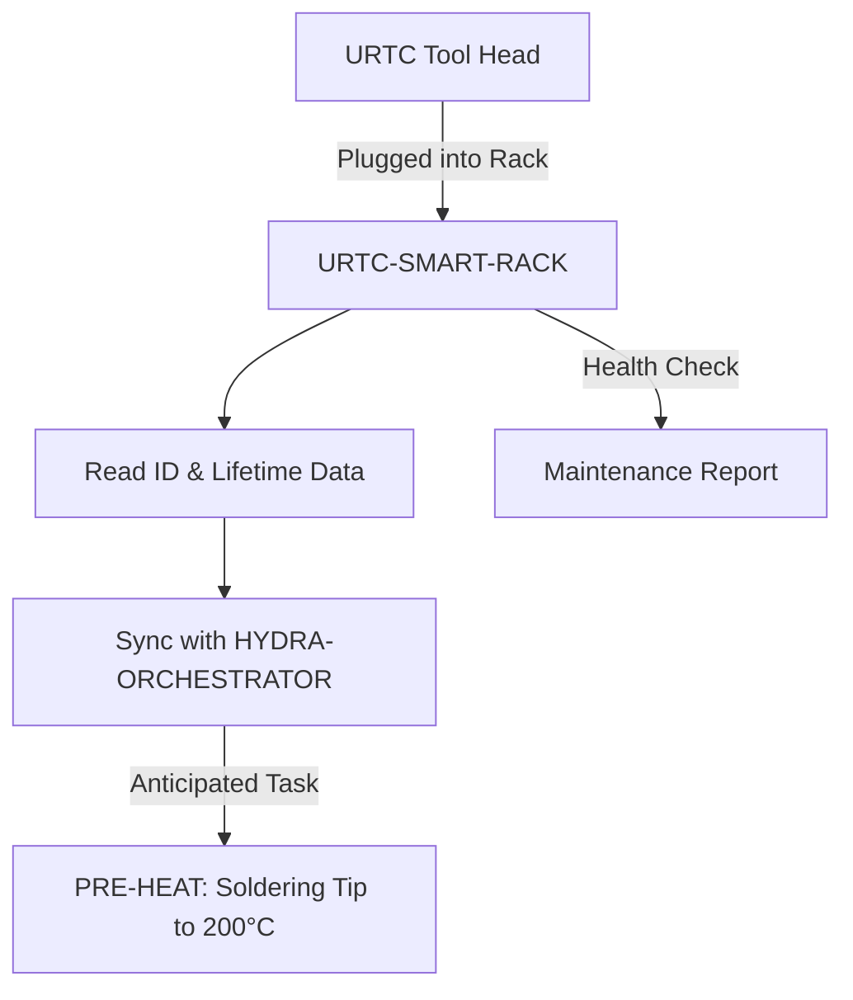

<p align="center">
  
</p>

# 🗄️ URTC-SMART-RACK

<p align="center"><a href="README.md">🇺🇸 English</a> | <a href="README_spa.md">🇪🇸 Español</a> | <a href="README_fra.md">🇫🇷 Français</a> | <a href="README_ita.md">🇮🇹 Italiano</a> | <a href="README_deu.md">🇩🇪 Deutsch</a> | <a href="README_zho.md">🇨🇳 简体中文</a> | <a href="README_jpn.md">🇯🇵 日本語</a> | 🇵🇹 <b>Português</b></p>

### 🤖 Gestão Inteligente de End-Effectors com Acompanhamento de Ciclo de Vida e Temperatura

<p align="center">
  
  
  
  
  
</p>

---

**Verificação de honestidade - o que realmente funciona hoje:** `tool_id.c`, `lifecycle.c`, `preheat.c`, `protocol.c`, `rack_command.c`, `link_watchdog.c`, `tool_limits.c`, `rack_app.c`, `rack_link.c`, `rack_deframer.c`, `rack_can.c`, `preheat_limit.c` e `rack_inventory.c` são C puro e real, apoiado por 620 verificações `TEST_ASSERT` aprovadas (`tests/test_*.c`, compiladas e executadas com o próprio compilador de C do anfitrião, não com `arm-none-eabi-gcc`) - confirmado ao compilar e executar exatamente essa bateria de testes no anfitrião. Isso cobre a descodificação de ID, o acompanhamento de utilização/ciclo de vida, a ativação do pré-aquecimento e a temperatura alvo, a análise do protocolo com trama CRC8, a validação de intervalos dos comandos, a gestão de timeout da ligação/idempotência e o acompanhamento do inventário de ferramentas em vários compartimentos (que ferramenta está guardada em que compartimento, nunca uma mesma ferramenta física em dois compartimentos ao mesmo tempo) - tudo isto é lógica, nada é hardware. Como a própria introdução do README já diz: ainda não existe PCB/esquema para esta placa, pelo que nada aqui alguma vez acionou um pino GPIO, um chip F-RAM, uma resistência de aquecimento ou um transcetor CAN reais - `main.c`/`startup_stm32g4_minimal.c` só provam que a compilação cruzada e a ligação para Cortex-M4F têm êxito com um linker script provisório, não que tudo isto funcione em silício real. Consulte `CHANGELOG.md` para ver exatamente o que já foi entregue até agora. A linha série também é testada: 19 fluxos de bytes com a hora de chegada de cada pedaço (uma trama em pedaços, ruído, um CRC mau, uma versão ou um comprimento que não serve, um silêncio mesmo no limite do tempo de espera, a volta do relógio de milissegundos) passam pelo deframer real, e as tramas que saem e os seus contadores são os do modelo de URTC-COMMON.

---

> **Estado de segurança (safety e security):** este ecossistema não é um sistema de segurança certificado e ainda não existe nenhuma placa URTC montada. Os bootloaders verificam as imagens de firmware com CRC32 e um HMAC-SHA256 de chave partilhada, não com uma assinatura assimétrica (prevista); as imagens de aplicação publicadas estão assinadas com a chave pública de desenvolvimento (`signing_key_kind: dev`), pelo que qualquer pessoa pode produzir uma imagem que o bootloader aceita; nada foi transmitido a uma placa real. Leia a [base de segurança](https://github.com/JuanenRac/URTC-DOCS/blob/main/docs/SECURITY_BASELINE.md) e o [modelo de ameaças](https://github.com/JuanenRac/URTC-DOCS/blob/main/docs/THREAT_MODEL.md) antes de confiar em qualquer afirmação aqui para a segurança de uma pessoa.

## 📋 Num relance

| | |
|---|---|
| Versão | `0.2.2` |
| Maturidade | Funcional |
| Testes | 620 |
| Tecnologia | C / STM32G4 / arm-none-eabi-gcc |
| Destino | Uma placa com microcontrolador (o firmware); compila-se num PC |
| Em hardware real | Ainda não: não há registo de execução em hardware real para esta versão |

**Ir para:** [Visão geral](#-visão-geral) · [Arquitetura](#-arquitetura) · [Segurança](#-segurança-e-proteção) · [Interfaces](#-interfaces) · [Início rápido](#-início-rápido) · [Testes](#-testes) · [Estrutura](#-estrutura-do-repositório) · [Relacionados](#-projetos-relacionados)

<!-- urtc-section:status_smart_rack -->
## 🚦 Estado do projeto

🟢 feito e verificado · 🟡 funciona, com limites conhecidos · 🟠 a meio ou por verificar · 🔴 por fazer ou a não funcionar. Nada é verde se nunca correu em hardware real.

| Parte | Estado | O que o repositório consegue demonstrar |
| --- | :---: | --- |
| Software | 🟡 | Funciona num PC e contra o simulador; nunca foi usado com uma placa real. |
| Testes | 🟢 | A bateria de testes passa na CI em cada envio. |
| Hardware real | 🟠 | Ainda não correu numa placa real: o ensaio de bancada continua pendente. |
| Documentação | 🟡 | README em oito línguas e documentos de referência; as traduções não foram revistas por falantes nativos. |

<!-- /urtc-section:status_smart_rack -->

## 🎯 Visão geral

O **URTC-SMART-RACK** é um sistema inteligente de armazenamento de end-effectors dentro do ecossistema URTC. Baseado no microcontrolador STM32G4, monitoriza e prepara as ferramentas enquanto não estão acopladas a um robô.

Permite modos "Smart Idle", como o pré-aquecimento de pontas de soldar T12 imediatamente antes de uma troca de ferramenta, e regista o ID eletrónico e o total de ciclos de utilização de cada cabeça URTC (ler a versão de firmware de cada cabeça está planeado, não implementado), garantindo uma manutenção ótima e uma colocação em serviço em zero segundos.

Ainda não existe PCB/esquema para esta placa (ver `hardware/`), pelo que nada do que se segue pode acionar hardware real de GPIO/F-RAM/CAN - mas a *lógica* a que essas funcionalidades se resumem (descodificar um ID, acompanhar a utilização, decidir quando pré-aquecer e a que temperatura) é C puro e real, testado por testes unitários hoje.

### Funcionalidades principais:
* ✅ **v0 real - lógica de ID da ferramenta, ciclo de vida e pré-aquecimento:** `tool_id.c` descodifica uma leitura bruta de ID de 5 bits numa identidade de ferramenta; `lifecycle.c` regista os ciclos/o tempo de utilização e assinala quando a manutenção é devida; `preheat.c` decide quando o pré-aquecimento Smart Idle deve começar e a que temperatura alvo. 620 asserções de teste com o próprio compilador de C do anfitrião - não é necessário PCB, controlador de GPIO nem F-RAM para executar ou testar nada disto. Também real: um desencapsulador de fluxo para a ligação série (`rack_deframer.c`: procura o byte de início, ressincroniza-se após um byte perdido e descarta meia trama após um tempo limite), a forma CAN do comando (`rack_can.c`: oito bytes de dados, temperatura em big-endian; ainda nenhuma placa a transporta) e um limite para o tempo que um pré-aquecimento pode durar sem troca de ferramenta (`preheat_limit.c`: 10 minutos por predefinição, configurável).
* ✅ **Cabeças como unidades, verificação térmica e pré-aquecimento preditivo (testado no anfitrião):** `rack_inventory.c` pode identificar uma posição pelo tipo mais o número de série da cabeça, e `rack_units.c` guarda o uso, o tempo de aquecedor e as falhas térmicas de cada cabeça física (a partir dos seus próprios contadores, `0x1AA` / `0x1AB`), de modo que o desgaste acompanha a cabeça e não o tipo; `slot_verify.c` diz o que uma leitura térmica de uma posição significa para o pré-aquecimento ordenado (atingido, demasiado lento, ultrapassagem, um aquecedor ligado numa posição vazia); `preheat_plan.c` transforma a fila de trabalhos em ordens de pré-aquecimento, desligado por predefinição. A leitura e a fila vêm de outros programas, nada disto funcionou numa placa e os tempos de aquecimento são estimativas.
* 🗄️ **Identificação de Ferramentas** — identificação automática das cabeças URTC através de jumpers de ID de 5 bits ou de F-RAM. *(a própria lógica de descodificação de ID é real - ver acima; ler jumpers/F-RAM reais requer a PCB.)*
* 🗂️ **Inventário Multi-Compartimento** — `rack_inventory.c` regista que ferramenta está fisicamente guardada em que compartimento, mantém uma ferramenta real em exatamente um compartimento de cada vez (ao guardá-la noutro sítio, o compartimento anterior é libertado em vez de declarar que está em dois lugares ao mesmo tempo) e um alvo de pré-aquecimento por compartimento, obtido pela identidade da ferramenta. No arranque, `rack_inventory_reconcile()` confronta-o com um sensor de presença por compartimento: uma ferramenta retirada enquanto o rack estava desligado é libertada (incluindo o alvo de pré-aquecimento) e uma ferramenta colocada à mão é assinalada para identificação. *(a própria lógica do inventário é real - ver acima; ligá-la a sensores de presença reais por compartimento requer a PCB.)*
* 🧭 **Cabeças de configuração livre (testado no anfitrião):** uma cabeça cujos jumpers de ID leem `0x1F` não é tomada por «sem ferramenta»: o `free_tool.c` pergunta-lhe (`0x1A3`), só aceita uma resposta que nomeie uma ferramenta (`0x1F` e uma seleção de 1 a 25) e dá à ranhura essa identidade como a uma cabeça lida por jumpers; até lá a ranhura não tem ferramenta, pelo que não há alvo nem ordem de pré-aquecimento. Tempos, tentativas, espera e atualização são valores de configuração, não lógica, e outra ferramenta numa resposta posterior é uma troca de ferramenta. Reproduzido com os vetores partilhados; as consultas nunca correram num barramento, e a cabeça lê o registo da F-RAM no arranque, pelo que uma alteração exige reiniciá-la.
* 🌡️ **Lógica de Pré-Aquecimento** — gestão térmica inteligente para ferramentas de soldadura e de ar quente. *(a decisão de ativação e as temperaturas alvo são reais - ver acima; acionar uma resistência de aquecimento real requer a PCB.)*
* 📈 **Registos de Ciclo de Vida** — regista o total de ciclos de atuação e as horas de utilização na F-RAM da ferramenta. *(os contadores e a lógica de manutenção devida são reais - ver acima; guardá-los numa F-RAM real requer a PCB.)*
* 📡 **Integração CAN** — destina-se a comunicar com o Kinematic Brain do HYDRA-UMC para um ATC (Auto Tool Change) coordenado; isto nunca foi executado, porque não existe nem um driver CAN nem uma placa. *(o próprio protocolo de linha - tramas, CRC, validação de comandos - é real e testado no anfitrião, ver abaixo; continua a ser necessário um transcetor CAN real para o transportar efetivamente.)*
* 🔒 **Verificações de Intervalo do Protocolo** — tramas versionadas com soma de verificação CRC8, validação de intervalos de atuação e um watchdog de timeout/idempotência da ligação com um estado seguro definido. Trama na versão 2: todo o valor de vários bytes é big-endian, como o barramento, e uma trama da versão 1 é recusada. *(implementado em C puro e testado apenas num PC; nunca executado numa placa e não é uma função de segurança certificada)*
* ✅ **Toolchain de firmware Cortex-M4F** — uma imagem bare-metal real (startup + linker + `main.c`) que compila de forma cruzada e liga com `arm-none-eabi-gcc`, a mesma toolchain que o repositório irmão URTC utiliza. *(implementado — ver BUILD abaixo)*

## 🧩 Papel no URTC

O URTC-SMART-RACK é a placa que guarda as cabeças de ferramenta, não uma cabeça de ferramenta: um suporte que identifica cada cabeça que contém (o ID de ferramenta de 5 bits que o URTC usa), regista o uso e as falhas térmicas de cada cabeça física, sabe que ferramenta está em que posição e pré-aquece uma ferramenta de soldadura ou de ar quente mesmo antes de uma troca de ferramenta (Smart Idle). Partilha os IDs de ferramenta e as convenções de firmware do URTC, mas é uma ferramenta complementar, não filha do URTC, e destina-se a ser comandado pelo controlador de robô HYDRA-UMC. Ainda não existe nenhuma placa: o que é real hoje é a lógica e o protocolo do suporte, testados num computador.

## 🏛️ Arquitetura

<p align="center">
  
</p>

Como as partes deste repositório se encaixam: quem o usa, o que contém e de que depende. A imagem é desenhada a partir de `docs/architecture.json` e verificada com o código.

<details>
<summary>Versão em texto do diagrama (Mermaid)</summary>



</details>

### ARQUITETURA E DECISÕES DE DESIGN

* **Porque é que esta placa ainda não tem pinout/ID de hardware definido.** Ainda não existe PCB para esta placa - `src/firmware_common.h` transporta uma identidade de versão sem ID de hardware, e os ficheiros de startup/linker são marcadores de posição escritos à mão que substituem o startup CMSIS/HAL da própria ST até que uma peça STM32G4 real seja definida.
* **Porque é que não é um filho do próprio URTC.** O URTC-SMART-RACK é uma Ferramenta Complementar, não um filho da família URTC - é uma placa física separada (um rack de armazenamento de ferramentas, não uma cabeça de ferramenta) que por acaso partilha o espaço de IDs de ferramenta e as convenções de firmware do próprio URTC, mas não a sua hierarquia de integração.
* **Porque `bump_version.py` é uma cópia direta do do URTC.** O mesmo formato de cabeçalho de firmware - reutilizar o script exato em vez de o reinventar mantém os dois em sincronia por construção.
* **Porque é que `tool_id.c`/`lifecycle.c`/`preheat.c` são entregues antes de qualquer controlador de GPIO/F-RAM/CAN.** Descodificar um ID, acumular utilização e decidir quando pré-aquecer são funções puras de dados já disponíveis - não precisam de PCB para serem escritas ou testadas, pelo que a v0 entrega primeiro essa lógica, testada no anfitrião com o compilador de C da própria máquina em vez de `arm-none-eabi-gcc`. Os controladores que obteriam efetivamente esses dados do hardware real chegam quando a PCB existir.
* **Como isto se integra no resto do ecossistema.** Usa o ecossistema de ferramentas do próprio URTC (os mesmos IDs de ferramenta; as tramas do rack ainda não são tramas CAN, ver `docs/OPERATIONS.md`) e forma um par natural com o HYDRA-UMC-DETECTION-HEF para reconhecer visualmente que ferramenta está efetivamente guardada.
* **Porque é que o protocolo, a validação de comandos e o watchdog da ligação são três módulos separados.** `protocol.c` só conhece bytes, tramas e um CRC - não faz ideia do que é uma temperatura "segura". `rack_command.c` é responsável por esse juízo, descodificando e verificando os intervalos de um comando real sem se preocupar com a forma como chegou ao fio. `link_watchdog.c` acompanha o timeout/idempotência independentemente de ambos - uma trama corrompida nunca deve sequer chegar até ele (ver a asserção real de `test_rack_link_scenarios.c` de que uma trama com CRC errado nunca reanima o watchdog). Mantê-los separados é o que torna cada um testável isoladamente no anfitrião e mantém um futuro tratador de receção CAN fino - chama cada camada por ordem, não volta a implementar nenhum dos seus juízos.
* **Limitador de taxa de comandos.** Uma enxurrada de comandos para a mesma ferramenta é travada por um intervalo mínimo entre comandos aceites (20 ms por defeito, 0 desativa; `link_watchdog_set_command_interval()`). Um comando retido não altera nada e recebe uma recusa (`HELD_RATE`) e não uma confirmação, mas conta como ligação viva; um estado seguro ou uma retransmissão nunca são retidos. O intervalo pode ser ajustado na bancada simulada do rack do URTC-WEB-STUDIO.
* **Porque é que uma ligação não comprovada é tratada exatamente como uma ligação morta.** `link_watchdog_is_link_lost()` é verdadeiro tanto após um timeout real COMO antes de a primeira trama alguma vez ter chegado - o "estado seguro al arrancar" das próprias notas de diagnóstico. Um rack que arranca sem nenhum anfitrião ainda ligado deve começar no estado seguro, e não assumir silenciosamente que "está tudo bem" até prova em contrário.

## 🔒 Segurança e proteção

| Ameaça | Defesa |
|---|---|
| Uma ordem fora do intervalo para uma ferramenta | `rack_command.c` descodifica e verifica o intervalo de cada ordem sem se preocupar com a forma como chegou; `protocol.c` só conhece bytes, tramas e um CRC; `tool_limits.c` guarda o limite de cada perfil de ferramenta |
| Uma trama corrompida ou antiga | Uma trama versionada com CRC-8; na versão 2 todo o valor de vários bytes é big-endian como o barramento e uma trama da versão 1 é recusada |
| Uma enxurrada de ordens | Um intervalo mínimo entre ordens aceites (20 ms por omissão, 0 desativa); uma ordem retida não altera nada e recebe uma recusa (`HELD_RATE`) e não uma confirmação, mas conta como ligação viva; um estado seguro ou uma retransmissão nunca é retido |
| Uma ligação perdida ou não provada | `link_watchdog_is_link_lost()` é verdadeiro depois de um verdadeiro timeout e também antes de chegar a primeira trama: um suporte que liga sem anfitrião arranca em estado seguro |
| Pré-aquecer demasiado tempo ou demasiado quente | `preheat_limit.c` limita quanto tempo um pré-aquecimento pode durar sem troca de ferramenta (10 minutos por omissão, configurável) e `tool_limits.c` o alvo máximo de cada perfil de ferramenta |
| Uma ferramenta em duas posições | `rack_inventory.c` mantém uma ferramenta real em exatamente uma posição; guardá-la noutra limpa a anterior |

Tudo isto é C puro testado num computador; nunca correu numa placa e não é uma função de segurança certificada.

## 🔌 Interfaces

* **A trama série do suporte:** versão 2, big-endian como o barramento, com o CRC-8 fornecido pelo URTC-COMMON (`src/urtc_crc8.h`, `src/urtc_frame.h`); `protocol.c` interpreta-a e codifica-a, `rack_deframer.c` encontra tramas num fluxo de bytes (ressincronização após um byte perdido, meia trama descartada após um timeout) e `rack_link.c` decide o que fazer a cada trama. Os formatos estão em [docs/OPERATIONS.md](docs/OPERATIONS.md).
* **A forma CAN da ordem:** `rack_can.c` (oito bytes de dados, temperatura big-endian). Nenhuma placa a transporta ainda: as tramas do suporte ainda não são tramas CAN.
* **Partilhado com o URTC:** o ID de ferramenta de 5 bits (`tool_id.c`) e os contadores `0x1AA` / `0x1AB` que guardam o uso de cada cabeça física (`rack_units.c`). Os vetores que a camada de tramas tem de reproduzir são os do URTC-COMMON (`conformance/rack_vectors.json`).
* **A resposta a um comando:** cada trama bem formada recebe uma trama de resposta, uma confirmação ou uma recusa com o seu motivo num byte (comprimento errado, sem ferramenta na ranhura, temperatura acima do limite, ferramenta inválida, sem aquecedor, retida por chegar cedo demais, comando desconhecido); `rack_reply_encode()` escreve-a e os testes no PC comparam-na byte a byte com os vetores partilhados do URTC-COMMON, pelo que o firmware e o modelo dos programas não podem divergir. As bancadas simuladas do rack do URTC-TESTER e do URTC-WEB-STUDIO leem-na; nenhum transporte a envia ainda numa placa. Um hotend de impressora 3D só é pré-aquecido quando `printer_target_c` está definido na configuração do plano (0 por omissão, limitado ao teto de 310 graus da ferramenta).

## 🚀 Início rápido

Requer a ARM GNU Toolchain (`arm-none-eabi-gcc`, `arm-none-eabi-objcopy`, `arm-none-eabi-size`) e Python 3.

```bash
# Linux/macOS
chmod +x build_firmware.sh   # one-time
./build_firmware.sh

# Windows
build_firmware.bat
```

Exemplo real - os testes do lado do anfitrião também se executam de forma autónoma, útil para verificar a lógica sem uma compilação completa do firmware:

```bash
cc -std=c11 -Wall -Wextra -Isrc -Itests -o build/host_tests \
  tests/test_main.c tests/test_tool_id.c tests/test_lifecycle.c tests/test_preheat.c \
  tests/test_protocol.c tests/test_rack_command.c tests/test_link_watchdog.c tests/test_rack_link_scenarios.c \
  tests/test_rack_inventory.c tests/test_robustness.c tests/test_rack_app.c \
  tests/test_rack_deframer.c tests/test_rack_can.c tests/test_preheat_limit.c \
  src/tool_id.c src/tool_limits.c src/lifecycle.c src/preheat.c src/protocol.c src/rack_command.c src/link_watchdog.c src/rack_link.c \
  src/rack_inventory.c src/rack_app.c src/rack_deframer.c src/rack_can.c src/preheat_limit.c
./build/host_tests
# All tests passed.
```

<!-- urtc-section:compatibility -->
### Requisitos e compatibilidade

As versões dos programas URTC que funcionam em conjunto, e a versão do protocolo que cada uma fala, constam da tabela de compatibilidade que o URTC-COMMON gera: [docs/COMPATIBILITY.md](https://github.com/JuanenRac/URTC/blob/main/docs/COMPATIBILITY.md). As notas de uma versão dos repositórios que incluem `tools/changelog_section.py` (o firmware, o flasher, o tester e o updater) são a secção do CHANGELOG dessa versão seguida desta tabela: `python tools/changelog_section.py VERSION --compat`.
<!-- /urtc-section:compatibility -->

## 🧪 Testes

Os testes de host são programas C em `tests/` (620 verificações `TEST_ASSERT` em 19 ficheiros) compilados e executados com o compilador C do próprio computador, nunca com `arm-none-eabi-gcc`: ID de ferramenta, limites de ferramenta, ciclo de vida, pré-aquecimento, a trama, a verificação das ordens, o cão de guarda da ligação, cenários completos da ligação, o inventário, a robustez contra entradas erradas, a camada de aplicação, o desenquadrador (19 fluxos de bytes com o instante de chegada de cada pedaço: uma trama em pedaços, ruído, um CRC errado, uma versão ou comprimento errados, um silêncio no limite do timeout, uma volta do relógio de milissegundos), a forma CAN, o limite de pré-aquecimento e as unidades de cada cabeça; os vetores são os do URTC-COMMON. Cinco ficheiros de teste Python (25 testes) verificam que os scripts de compilação, os ativos da release, os ficheiros de versão e o número de testes publicado concordam. A CI compila os testes C com AddressSanitizer e UBSan e falha abaixo de um mínimo de cobertura das linhas executadas de `src/` (`tools/gcov_floor.py`). `bash build_firmware.sh` executa-os antes da compilação cruzada e falha a compilação se uma asserção falhar. O anel de bytes que uma interrupção de receção preenche (`rack_ring.c`) e o armazenamento em duas cópias do ciclo de vida e do inventário (`rack_persist.c`, testado com um corte de energia em cada byte de uma gravação) também são lógica pura; o chip de memória por trás do armazenamento ainda não está escolhido.

## 🏗️ Compilação e publicação

A compilação começa por compilar e executar `tests/` com o compilador C *do próprio computador* (nunca `arm-none-eabi-gcc`: são testes de lógica pura, sem tocar em registos do MCU) e falha por completo se alguma asserção falhar. Só então compila `main.c` e `startup_stm32g4_minimal.c` para Cortex-M4F, liga-os ao mapa de memória provisório `STM32G4_MINIMAL.ld` e publica ficheiros `.elf`/`.bin`/`.hex` com versão em `firmware/`. Compilar nunca altera a versão.

Cada módulo de `src/` é também compilado para Cortex-M4F e todos são ligados em conjunto como verificação (não há biblioteca C no alvo), embora hoje a imagem só contenha `main.c` e o ficheiro de arranque. Com `URTC_CI=1` nenhum ficheiro versionado é tocado.

As imagens de firmware (`.bin`, `.hex`, `.elf`) não são versionadas no git: uma compilação de release escreve `firmware/URTC_SMART_RACK_FIRMWARE_v<versão>.*` (ignorado pelo git; `build/firmware` em modo CI, `URTC_CI=1`) e são publicadas apenas como assets da release do GitHub de cada versão. `python tools/publish_release_assets.py` verifica os ficheiros, escreve o ficheiro `.sha256` em falta e imprime o comando `gh release create` exato com os ficheiros a anexar.

Ainda não há nada para gravar em hardware real — não existe PCB que confirme a peça STM32G4 de destino, o pinout ou os tamanhos reais de flash/RAM. O mapa de memória do linker script é um marcador de posição conservador (documentado no seu próprio comentário de cabeçalho) que será substituído quando existir hardware real, o mesmo momento em que a tabela de vetores escrita à mão de `startup_stm32g4_minimal.c` é substituída pelo código de startup CMSIS/HAL da própria ST (espelhando o `src/F303-master/` do repositório irmão URTC para as suas placas STM32F303).

Veja [`CHANGELOG.md`](CHANGELOG.md) para o histórico completo de versões; cada versão tem aí a sua própria entrada.

## 📂 Estrutura do repositório

<p align="center">
  
</p>

<details>
<summary>Versão em texto da árvore</summary>

```text
URTC-SMART-RACK/
├── src/                                               o firmware: lógica em C puro, as cópias verificadas do URTC-COMMON, o ponto de entrada e o script de ligação provisório
├── tests/                                             testes de host em C (620 verificações) e verificações em Python dos scripts de compilação
├── docs/                                              OPERATIONS.md: o que a lógica faz, recusa e deixa por verificar
├── hardware/                                          notas: ainda sem esquema nem PCB
├── tools/                                             verificação de compilação, mínimo de cobertura, ativos da release e ferramentas partilhadas de CI e imagens
├── images/                                            faixa e imagens deste README
├── .github/                                           fluxo de CI e modelos de issues e pull requests
├── build-test.sh build-test.bat                       scripts de compilação e testes que não alteram nada no repositório
├── test.sh test.bat                                   executam os testes
├── urtc.project.json                                  manifesto: versão, papel, maturidade e comando de compilação
├── CHANGELOG.md                                       o que mudou em cada versão
├── SECURITY.md SUPPORT.md LICENSE                     política de segurança, suporte e licença
├── CONTRIBUTING.md CODE_OF_CONDUCT.md                 como contribuir e código de conduta
├── .gitattributes .gitignore                          definições do Git
├── build_firmware.sh build_firmware.bat               testes de host, compilação cruzada, ligação e publicação das imagens
├── bump.py bump_version.py bump_manifest_version.py   scripts que sobem a versão
└── LICENSE.md ruff.toml                               licença da documentação e definições de lint
```

</details>

A lista anotada de cada ficheiro de código, uma linha por ficheiro, está em [docs/SOURCE_MAP.md](docs/SOURCE_MAP.md).

## 🗺️ Roteiro e limites conhecidos

**Limites conhecidos hoje**

* Ainda não existe PCB nem esquema para esta placa (veja `hardware/`): nada disto alguma vez comandou um pino GPIO real, uma F-RAM, um aquecedor ou um transcetor CAN. `main.c` e o ficheiro de arranque apenas provam que a compilação cruzada e a ligação para Cortex-M4F funcionam com um script de ligação provisório.
* Ler a versão do firmware de cada cabeça está planeado, não implementado.
* A forma CAN da ordem nunca correu: não existe nem um controlador CAN nem uma placa, e as tramas do suporte ainda não são tramas CAN.
* Os tempos de aquecimento do pré-aquecimento preditivo são estimativas e o seu interruptor está desligado por omissão.

**A seguir**

* Projetar a placa, fixar o componente STM32G4 e substituir o script de ligação e o ficheiro de arranque provisórios pelos da ST; escrever os controladores de GPIO, F-RAM e CAN que fornecem os dados à lógica.

## 🌍 Idiomas

O README e os textos existem em inglês, espanhol, francês, italiano, alemão, chinês, japonês e português europeu.

## 🔗 Projetos relacionados

O URTC é feito de repositórios independentes, cada um com a sua versão, os seus testes e o seu README. Esta é a família, por grupos:

* **URTC Tool Platform:**
  * [URTC](https://github.com/JuanenRac/URTC) - firmware da placa da cabeça de ferramenta (25 perfis de ferramenta, bootloader CAN) e a referência do protocolo CAN.
  * [URTC-COMMON](https://github.com/JuanenRac/URTC-COMMON) - o protocolo CAN escrito uma só vez como dados (especificação, tabelas geradas, vetores de conformidade) e o código que os programas partilham.
  * [URTC-FLASHER](https://github.com/JuanenRac/URTC-FLASHER) - ferramenta de ambiente de trabalho que atualiza o firmware da placa por CAN ou por SWD/JTAG.
  * [URTC-GATEWAY](https://github.com/JuanenRac/URTC-GATEWAY) - gateway à frente do barramento CAN: só deixa passar os identificadores de uma lista, limita a sua taxa e pede uma chave de sessão.
  * **URTC-SMART-RACK** (este repositório) - lógica em C independente do hardware e protocolo de comandos para um suporte de ferramentas com pré-aquecimento e acompanhamento do ciclo de vida.
  * [URTC-TESTER](https://github.com/JuanenRac/URTC-TESTER) - testador de ambiente de trabalho do barramento CAN em direto que mostra os controlos e a telemetria do perfil de ferramenta que uma placa reporta.
  * [URTC-VISION-TOOL](https://github.com/JuanenRac/URTC-VISION-TOOL) - protocolo de tramas de sensor em C e um companheiro em Python térmico/RGB para uma cabeça de ferramenta de inspeção.
  * [URTC-WEB-STUDIO](https://github.com/JuanenRac/URTC-WEB-STUDIO) - aplicação de navegador que grava e testa a placa por Web Serial e SLCAN, sem instalar nada.
* **Ecosystem Operations:**
  * [URTC-DEVTOOLS](https://github.com/JuanenRac/URTC-DEVTOOLS) - as ferramentas de repositório partilhadas da família como um conjunto com versão e um ficheiro de bloqueio que distingue uma cópia editada de uma desatualizada.
  * [URTC-DOCS](https://github.com/JuanenRac/URTC-DOCS) - arquitetura, interfaces, base de segurança e catálogo gerado do ecossistema, mais as ferramentas que comparam todos os repositórios.
  * [URTC-UPDATER](https://github.com/JuanenRac/URTC-UPDATER) - ferramenta de ambiente de trabalho que deteta, instala e atualiza os repositórios da família URTC, uma ação explícita de cada vez.

**Projetos irmãos (independentes, com a mesma base e as mesmas ferramentas):**

* **[HYDRA-UMC-DOCS](https://github.com/JuanenRac/HYDRA-UMC-DOCS)** - projeto irmão: o centro de documentação do HYDRA-UMC, um ecossistema independente que partilha a base e as ferramentas com este
* **[ARMOR-DOCS](https://github.com/JuanenRac/ARMOR-DOCS)** - projeto irmão: o centro de documentação do A.R.M.O.R., o ecossistema de segurança, também independente e sobre a mesma base
* **[JuanenRac](https://github.com/JuanenRac/JuanenRac)** - o perfil e o painel de estado de todos os ecossistemas

## 📚 Documentação

- **[CONTRIBUTING.md](CONTRIBUTING.md)** — stack tecnológica e diretrizes de código para um pull request.
- **[CODE_OF_CONDUCT.md](CODE_OF_CONDUCT.md)** — as normas de comportamento esperadas nesta comunidade.
- **[SECURITY.md](SECURITY.md)** — como comunicar uma vulnerabilidade e as áreas de foco de segurança reais deste projeto.
- **[SUPPORT.md](SUPPORT.md)** — onde colocar questões e comunicar erros.
- **[LICENSE.md](LICENSE.md)** — a licença deste projeto.

## 🤝 Contribuir e comunidade

* Antes de um pull request execute `URTC_CI=1 python tools/ci_validate.py`: tem de passar. Veja [CONTRIBUTING.md](CONTRIBUTING.md) e o [código de conduta](CODE_OF_CONDUCT.md).
* O README existe em oito idiomas: uma alteração ao texto faz-se nos oito ficheiros, e as secções partilhadas com outros repositórios são escritas por `tools/readme_sections.py` do URTC-COMMON.
* Uma alteração ao protocolo CAN começa no URTC-COMMON (`spec/can_protocol.json`) e chega a este repositório através da cópia verificada.
* Não descreva como a funcionar numa placa aquilo que só foi compilado.
* Comunique uma vulnerabilidade em privado: [SECURITY.md](SECURITY.md). Perguntas, ideias e relatórios: electrohobby3d@gmail.com ([SUPPORT.md](SUPPORT.md)).

## 👤 AUTOR

**JuanenRac** (Electro Hobby 3D)
📧 electrohobby3d@gmail.com
📺 [youtube.com/@electrohobby3d](https://youtube.com/@electrohobby3d)

## 📜 LICENÇA

GPL-3.0-or-later - Consulte LICENSE para mais detalhes.
