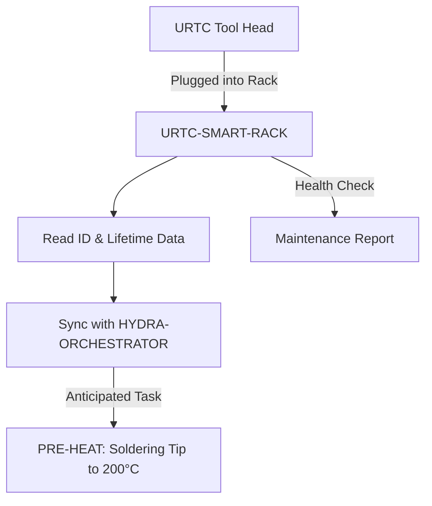

<p align="center">
  
</p>

# 🗄️ URTC-SMART-RACK

<p align="center"><a href="README.md">🇺🇸 English</a> | <a href="README_spa.md">🇪🇸 Español</a> | <a href="README_fra.md">🇫🇷 Français</a> | <a href="README_ita.md">🇮🇹 Italiano</a> | <a href="README_deu.md">🇩🇪 Deutsch</a> | <a href="README_zho.md">🇨🇳 简体中文</a> | <a href="README_jpn.md">🇯🇵 日本語</a> | 🇵🇹 <b>Português</b></p>

### 🤖 Gestão Inteligente de End-Effectors com Acompanhamento de Ciclo de Vida e Temperatura

<p align="center">
  
  
  
  
</p>

**Verificação de honestidade - o que realmente funciona hoje:** `tool_id.c`, `lifecycle.c`, `preheat.c`, `protocol.c`, `rack_command.c`, `link_watchdog.c`, `rack_link.c` e `rack_inventory.c` são C puro e real, apoiado por 138 verificações `TEST_ASSERT` aprovadas (`tests/test_*.c`, compiladas e executadas com o próprio compilador de C do anfitrião, não com `arm-none-eabi-gcc`) - confirmado ao compilar e executar exatamente essa bateria de testes no anfitrião. Isso cobre a descodificação de ID, o acompanhamento de utilização/ciclo de vida, a ativação do pré-aquecimento e a temperatura alvo, a análise do protocolo com trama CRC8, a validação de intervalos dos comandos, a gestão de timeout da ligação/idempotência e o acompanhamento do inventário de ferramentas em vários compartimentos (que ferramenta está guardada em que compartimento, nunca uma mesma ferramenta física em dois compartimentos ao mesmo tempo) - tudo isto é lógica, nada é hardware. Como a própria introdução do README já diz: ainda não existe PCB/esquema para esta placa, pelo que nada aqui alguma vez acionou um pino GPIO, um chip F-RAM, uma resistência de aquecimento ou um transcetor CAN reais - `main.c`/`startup_stm32g4_minimal.c` só provam que a compilação cruzada e a ligação para Cortex-M4F têm êxito com um linker script provisório, não que tudo isto funcione em silício real. Consulte `CHANGELOG.md` para ver exatamente o que já foi entregue até agora.

---

## 📋 Num relance

| | |
|---|---|
| Versão | `0.1.4` |
| Maturidade | Estabelecido |
| Tecnologia | C / STM32G4 / arm-none-eabi-gcc |
| Destino | Uma placa com microcontrolador (o firmware); compila-se num PC |
| Em hardware real | Ainda não: não há registo de execução em hardware real para esta versão |

## 1. 🛠️ VISÃO TÉCNICA GERAL

O **URTC-SMART-RACK** é um sistema inteligente de armazenamento de end-effectors dentro do ecossistema HYDRA-UMC. Baseado no microcontrolador STM32G4, monitoriza e prepara as ferramentas enquanto não estão acopladas a um robô.

Permite modos "Smart Idle", como o pré-aquecimento de pontas de soldar T12 imediatamente antes de uma troca de ferramenta, e regista o ID eletrónico, a versão de firmware e o total de ciclos de utilização de cada cabeça URTC, garantindo uma manutenção ótima e uma colocação em serviço em zero segundos.

Ainda não existe PCB/esquema para esta placa (ver `hardware/`), pelo que nada do que se segue pode acionar hardware real de GPIO/F-RAM/CAN - mas a *lógica* a que essas funcionalidades se resumem (descodificar um ID, acompanhar a utilização, decidir quando pré-aquecer e a que temperatura) é C puro e real, testado por testes unitários hoje.

### Funcionalidades principais:
* ✅ **v0 real - lógica de ID da ferramenta, ciclo de vida e pré-aquecimento:** `tool_id.c` descodifica uma leitura bruta de ID de 5 bits numa identidade de ferramenta; `lifecycle.c` regista os ciclos/o tempo de utilização e assinala quando a manutenção é devida; `preheat.c` decide quando o pré-aquecimento Smart Idle deve começar e a que temperatura alvo. 138 asserções de teste com o próprio compilador de C do anfitrião - não é necessário PCB, controlador de GPIO nem F-RAM para executar ou testar nada disto.
* 🗄️ **Identificação de Ferramentas** — identificação automática das cabeças URTC através de jumpers de ID de 5 bits ou de F-RAM. *(a própria lógica de descodificação de ID é real - ver acima; ler jumpers/F-RAM reais requer a PCB.)*
* 🗂️ **Inventário Multi-Compartimento** — `rack_inventory.c` regista que ferramenta está fisicamente guardada em que compartimento, mantém uma ferramenta real em exatamente um compartimento de cada vez (ao guardá-la noutro sítio, o compartimento anterior é libertado em vez de declarar que está em dois lugares ao mesmo tempo) e um alvo de pré-aquecimento por compartimento, obtido pela identidade da ferramenta. No arranque, `rack_inventory_reconcile()` confronta-o com um sensor de presença por compartimento: uma ferramenta retirada enquanto o rack estava desligado é libertada (incluindo o alvo de pré-aquecimento) e uma ferramenta colocada à mão é assinalada para identificação. *(a própria lógica do inventário é real - ver acima; ligá-la a sensores de presença reais por compartimento requer a PCB.)*
* 🌡️ **Lógica de Pré-Aquecimento** — gestão térmica inteligente para ferramentas de soldadura e de ar quente. *(a decisão de ativação e as temperaturas alvo são reais - ver acima; acionar uma resistência de aquecimento real requer a PCB.)*
* 📈 **Registos de Ciclo de Vida** — regista o total de ciclos de atuação e as horas de utilização na F-RAM da ferramenta. *(os contadores e a lógica de manutenção devida são reais - ver acima; guardá-los numa F-RAM real requer a PCB.)*
* 📡 **Integração CAN** — comunica diretamente com o Kinematic Brain do HYDRA-UMC para um ATC (Auto Tool Change) coordenado. *(o próprio protocolo de linha - tramas, CRC, validação de comandos - é real, ver abaixo; continua a ser necessário um transcetor CAN real para o transportar efetivamente.)*
* 🔒 **Limites de Segurança do Protocolo** — tramas versionadas reais com soma de verificação CRC8, validação real de intervalos de atuação e um watchdog real de timeout/idempotência da ligação com um estado seguro definido. *(implementado)*
* ✅ **Toolchain de firmware Cortex-M4F** — uma imagem bare-metal real (startup + linker + `main.c`) que compila de forma cruzada e liga com `arm-none-eabi-gcc`, a mesma toolchain que o repositório irmão URTC utiliza. *(implementado — ver BUILD abaixo)*

---

## 2. 🔄 FLUXO DE TRABALHO DO SMART RACK



---

## 3. 🧱 ARQUITETURA E DECISÕES DE DESIGN

* **Porque é que esta placa ainda não tem pinout/ID de hardware definido.** Ainda não existe PCB para esta placa - `src/firmware_common.h` transporta uma identidade de versão sem ID de hardware, e os ficheiros de startup/linker são marcadores de posição escritos à mão que substituem o startup CMSIS/HAL da própria ST até que uma peça STM32G4 real seja definida.
* **Porque é que não é um filho do próprio URTC.** O URTC-SMART-RACK é uma Ferramenta Complementar, não um filho da família URTC - é uma placa física separada (um rack de armazenamento de ferramentas, não uma cabeça de ferramenta) que por acaso partilha o barramento CAN e as convenções de firmware do próprio URTC, mas não a sua hierarquia de integração.
* **Porque é que `bump_version.py` é uma cópia direta do do próprio URTC.** A mesma regra de versionamento tipo odómetro, o mesmo formato de cabeçalho de firmware - reutilizar o script exato em vez de o reinventar mantém os dois em sintonia por construção.
* **Porque é que `tool_id.c`/`lifecycle.c`/`preheat.c` são entregues antes de qualquer controlador de GPIO/F-RAM/CAN.** Descodificar um ID, acumular utilização e decidir quando pré-aquecer são funções puras de dados já disponíveis - não precisam de PCB para serem escritas ou testadas, pelo que a v0 entrega primeiro essa lógica, testada no anfitrião com o compilador de C da própria máquina em vez de `arm-none-eabi-gcc`. Os controladores que obteriam efetivamente esses dados do hardware real chegam quando a PCB existir.
* **Como isto se integra no resto do ecossistema.** Partilha o barramento CAN/ecossistema de ferramentas do próprio URTC e forma um par natural com o HYDRA-UMC-DETECTION-HEF para reconhecer visualmente que ferramenta está efetivamente guardada.
* **Porque é que o protocolo, a validação de comandos e o watchdog da ligação são três módulos separados.** `protocol.c` só conhece bytes, tramas e um CRC - não faz ideia do que é uma temperatura "segura". `rack_command.c` é responsável por esse juízo, descodificando e verificando os intervalos de um comando real sem se preocupar com a forma como chegou ao fio. `link_watchdog.c` acompanha o timeout/idempotência independentemente de ambos - uma trama corrompida nunca deve sequer chegar até ele (ver a asserção real de `test_rack_link_scenarios.c` de que uma trama com CRC errado nunca reanima o watchdog). Mantê-los separados é o que torna cada um testável isoladamente no anfitrião e mantém um futuro tratador de receção CAN fino - chama cada camada por ordem, não volta a implementar nenhum dos seus juízos.
* **Porque é que uma ligação não comprovada é tratada exatamente como uma ligação morta.** `link_watchdog_is_link_lost()` é verdadeiro tanto após um timeout real COMO antes de a primeira trama alguma vez ter chegado - o "estado seguro al arrancar" das próprias notas de diagnóstico. Um rack que arranca sem nenhum anfitrião ainda ligado deve começar no estado seguro, e não assumir silenciosamente que "está tudo bem" até prova em contrário.

---

## 📂 ESTRUTURA DE DIRETÓRIOS

```text
URTC-SMART-RACK/
├── src/                            # Firmware source
│   ├── firmware_common.h           # FIRMWARE_VERSION_MAJOR/MINOR/PATCH
│   ├── tool_id.h / .c              # Real: 5-bit raw reading -> tool ID decoding
│   ├── lifecycle.h / .c            # Real: usage-cycle/time tracking, maintenance-due check
│   ├── preheat.h / .c              # Real: Smart Idle activation + target temperature + safe-state target
│   ├── protocol.h / .c             # Real: versioned frame format + CRC8 parse/encode
│   ├── rack_command.h / .c         # Real: command decode + actuation-limit validation
│   ├── link_watchdog.h / .c        # Real: link timeout + command idempotency
│   ├── rack_link.h / .c            # Real: frame-dispatch decision (rack_link_decide) tying protocol/rack_command/link_watchdog/preheat together
│   ├── rack_inventory.h / .c       # Real: multi-slot tool inventory - which tool is racked where, one tool never in two slots at once
│   ├── main.c                      # Minimal entry point (proof-of-life heartbeat loop)
│   ├── startup_stm32g4_minimal.c   # Vector table + Reset_Handler (no ST HAL yet, see file header)
│   └── STM32G4_MINIMAL.ld          # Placeholder linker script (128K FLASH / 32K RAM floor)
├── tests/                          # Real host-native test harness (tool_id, lifecycle, preheat, protocol, rack_command, link_watchdog, rack link scenarios, rack inventory)
├── docs/                           # Documentation and user manual - empty, not created yet
├── hardware/                       # Hardware design files (PCB, 3D) - empty, no schematic yet
├── firmware/                       # Saída de compilação (.bin/.elf/.hex), ignorada pelo git - publicada apenas como assets da release do GitHub
├── build/                          # Intermediate build objects (gitignored)
├── images/                         # Media and diagrams
├── tools/
│   ├── build_test.py               # Non-versioning build/compile check
│   ├── publish_release_assets.py   # Lista os assets da release e imprime o comando gh
│   └── ci_validate.py              # Manifest/CHANGELOG/docs validation used by CI
├── bump_version.py                 # Odometer-style version bump (generic, shared with URTC)
├── bump_manifest_version.py        # Syncs urtc.project.json's version to the native one (--sync)
├── build_firmware.sh / .bat        # Real build: host tests + bump version + compile + link + publish
├── build-test.sh / .bat            # Non-versioning build/compile check
└── README.md
```

---

## 4. ⚙️ BUILD

Requer a ARM GNU Toolchain (`arm-none-eabi-gcc`, `arm-none-eabi-objcopy`, `arm-none-eabi-size`) e Python 3.

```bash
# Linux/macOS
chmod +x build_firmware.sh   # one-time
./build_firmware.sh

# Windows
build_firmware.bat
```

A compilação começa por compilar e executar `tests/` com o compilador de C *do próprio anfitrião* (nunca `arm-none-eabi-gcc` - estes são testes de lógica pura, sem tocar em registos do MCU) e falha por inteiro se alguma asserção falhar. Só então incrementa a versão de `src/firmware_common.h` (regra do odómetro, igual ao resto do ecossistema), compila `main.c` e `startup_stm32g4_minimal.c` para Cortex-M4F, liga-os ao mapa de memória provisório `STM32G4_MINIMAL.ld` e publica ficheiros `.elf`/`.bin`/`.hex` versionados em `firmware/`.

As imagens de firmware (`.bin`, `.hex`, `.elf`) não são versionadas no git: uma compilação de release escreve `firmware/URTC_SMART_RACK_FIRMWARE_v<versão>.*` (ignorado pelo git; `build/firmware` em modo CI, `HYDRA_UMC_CI=1`) e são publicadas apenas como assets da release do GitHub de cada versão. `python tools/publish_release_assets.py` verifica os ficheiros, escreve o ficheiro `.sha256` em falta e imprime o comando `gh release create` exato com os ficheiros a anexar.

Ainda não há nada para gravar em hardware real — não existe PCB que confirme a peça STM32G4 de destino, o pinout ou os tamanhos reais de flash/RAM. O mapa de memória do linker script é um marcador de posição conservador (documentado no seu próprio comentário de cabeçalho) que será substituído quando existir hardware real, o mesmo momento em que a tabela de vetores escrita à mão de `startup_stm32g4_minimal.c` é substituída pelo código de startup CMSIS/HAL da própria ST (espelhando o `src/F303-master/` do repositório irmão URTC para as suas placas STM32F303).

Exemplo real - os testes do lado do anfitrião também se executam de forma autónoma, útil para verificar a lógica sem uma compilação completa do firmware:

```bash
cc -std=c11 -Wall -Wextra -Isrc -Itests -o build/host_tests \
  tests/test_main.c tests/test_tool_id.c tests/test_lifecycle.c tests/test_preheat.c \
  tests/test_protocol.c tests/test_rack_command.c tests/test_link_watchdog.c tests/test_rack_link_scenarios.c \
  tests/test_rack_inventory.c \
  src/tool_id.c src/lifecycle.c src/preheat.c src/protocol.c src/rack_command.c src/link_watchdog.c src/rack_link.c \
  src/rack_inventory.c
./build/host_tests
# All tests passed.
```

---

## 5. 📋 CHANGELOG

Consulte [`CHANGELOG.md`](CHANGELOG.md) para o histórico completo de versões — cada compilação real incrementa automaticamente a versão de `src/firmware_common.h` (regra do odómetro, ver BUILD acima), e cada incremento tem a sua própria entrada aí.

---

## 🔗 Projetos Relacionados

Este projeto faz parte do ecossistema de robótica HYDRA-UMC do mesmo autor (JuanenRac / Electro Hobby 3D). Vale a pena conhecê-los, pois um pedido pode, na verdade, dizer respeito a um destes e não a este repositório.

**Diretamente Relacionados**
- **[URTC](https://github.com/JuanenRac/URTC)** — firmware da PCB física do Universal Robot Tool Controller, mais de 25 perfis de ferramenta sobre barramento CAN — o mesmo ecossistema de ferramentas, sobre o mesmo barramento CAN.
- **[HYDRA-UMC-DETECTION-HEF](https://github.com/JuanenRac/HYDRA-UMC-DETECTION-HEF)** — registo real de modelos compilados com verificação segura de carregamento por arquitetura Hailo/checksum — fornece o reconhecimento visual das ferramentas que este rack armazena.

**Também Fazem Parte do Ecossistema**

*Hardware e Plataforma Base*
- **[HYDRA-UMC](https://github.com/JuanenRac/HYDRA-UMC)** — a placa-mãe física do braço robótico: anfitrião CM5 + STM32H745 dual-core, orquestrando até 8 braços de ferramenta sobre CAN-OTA/SPI-OTA.
- **[HYDRA-UMC-OS](https://github.com/JuanenRac/HYDRA-UMC-OS)** — camada de produto reproduzível de Raspberry Pi OS para o CM5: agente só de leitura, configuração/perfis validados, provisionamento WiFi de primeiro contacto.
- **[HYDRA-UMC-SDK](https://github.com/JuanenRac/HYDRA-UMC-SDK)** — o contrato JSON-Schema partilhado e a fronteira de barreira de segurança contra a qual todas as bridges validam os seus comandos.
- **[HYDRA-UMC-CONNECTOR-HUB](https://github.com/JuanenRac/HYDRA-UMC-CONNECTOR-HUB)** — registo e validador declarativo de manifestos de adaptadores para conectores de máquinas externas; estende a própria ideia de contrato do SDK a máquinas externas sem substituir os projetos de gateway industrial.

*Backend e Clientes Base*
- **[HYDRA-UMC-SERVER](https://github.com/JuanenRac/HYDRA-UMC-SERVER)** — o verdadeiro backend headless (REST/WebSocket) com o qual todos os clientes de controlo realmente comunicam.
- **[HYDRA-UMC-STUDIO](https://github.com/JuanenRac/HYDRA-UMC-STUDIO)** — painel de controlo web com visualização 3D multi-robô em tempo real.
- **[HYDRA-UMC-SUITE](https://github.com/JuanenRac/HYDRA-UMC-SUITE)** — centro de comando de enxame para desktop (PySide6) para vários servidores em simultâneo, empacotado como executável autónomo.
- **[HYDRA-UMC-ANDROID-CONTROL](https://github.com/JuanenRac/HYDRA-UMC-ANDROID-CONTROL)** — aplicação nativa de controlo para Android com início de sessão biométrico e uma aplicação companheira emparelhada para Wear OS.
- **[HYDRA-UMC-IOS-CONTROL](https://github.com/JuanenRac/HYDRA-UMC-IOS-CONTROL)** — aplicação de controlo para iOS/iPadOS (Flutter) com sincronização WebSocket em tempo real.
- **[HYDRA-UMC-DSI](https://github.com/JuanenRac/HYDRA-UMC-DSI)** — interface tátil nativa para o ecrã tátil DSI de 7" integrado, embebida no próprio CM5.
- **[HYDRA-UMC-EDITOR-URDF](https://github.com/JuanenRac/HYDRA-UMC-EDITOR-URDF)** — criador/editor gráfico de URDF para desktop que envia os modelos terminados para o próprio catálogo do STUDIO.
- **[HYDRA-UMC-EDITOR-STL](https://github.com/JuanenRac/HYDRA-UMC-EDITOR-STL)** — editor de modelos STL para desktop, que transforma/substitui/remove/adiciona peças reais no mesmo catálogo de modelos que o HYDRA-UMC-EDITOR-URDF também edita.
- **[HYDRA-UMC-BRIDGE-AMR](https://github.com/JuanenRac/HYDRA-UMC-BRIDGE-AMR)** — fronteira de coordenação para frotas de AGV/AMR através de um verdadeiro publicador MQTT VDA 5050.
- **[HYDRA-UMC-BRIDGE-CNC](https://github.com/JuanenRac/HYDRA-UMC-BRIDGE-CNC)** — coordenador de alto nível de células CNC com acesso real ao estado GRBL e aos bytes de controlo.
- **[HYDRA-UMC-BRIDGE-DROIDS](https://github.com/JuanenRac/HYDRA-UMC-BRIDGE-DROIDS)** — fronteira de coordenação para droides com pernas/humanoides, com um verdadeiro emissor de comandos para o Boston Dynamics Spot.
- **[HYDRA-UMC-BRIDGE-LASER](https://github.com/JuanenRac/HYDRA-UMC-BRIDGE-LASER)** — coordenador de segurança de células laser que lê 3 salvaguardas GPIO reais de chave/invólucro/interlock.
- **[HYDRA-UMC-BRIDGE-OPENPNP](https://github.com/JuanenRac/HYDRA-UMC-BRIDGE-OPENPNP)** — coordenador seguro de alto nível do fluxo de placas para o pick-and-place OpenPnP.
- **[HYDRA-UMC-BRIDGE-PRINTER3D](https://github.com/JuanenRac/HYDRA-UMC-BRIDGE-PRINTER3D)** — fronteira de coordenação segura para impressoras 3D Moonraker/Klipper, com comandos de trabalho reais protegidos por barreira.
- **[HYDRA-UMC-BRIDGE-ROS2](https://github.com/JuanenRac/HYDRA-UMC-BRIDGE-ROS2)** — coordenador de segurança com um transporte ROS 2 rclpy real, importado de forma preguiçosa.
- **[HYDRA-UMC-BRIDGE-UAV](https://github.com/JuanenRac/HYDRA-UMC-BRIDGE-UAV)** — fronteira de coordenação para UAV equipados com câmara, com um verdadeiro emissor de comandos MAVLink.

*Plataforma de Ferramentas URTC*
- **[URTC-FLASHER](https://github.com/JuanenRac/URTC-FLASHER)** — ferramenta de gravação com interface gráfica para desktop para placas URTC, CAN-OTA mais SWD/JTAG de chip completo.
- **[URTC-TESTER](https://github.com/JuanenRac/URTC-TESTER)** — ferramenta de diagnóstico em direto do barramento CAN para desktop para placas URTC, um painel por perfil de ferramenta.
- **[URTC-WEB-STUDIO](https://github.com/JuanenRac/URTC-WEB-STUDIO)** — alternativa no navegador ao URTC-TESTER através da Web Serial API, sem necessidade de instalação local.

*Nó de IA de Visão (Hailo-8)*
- **[HYDRA-UMC-VISION-NODE](https://github.com/JuanenRac/HYDRA-UMC-VISION-NODE)** — hub de integração do pipeline de visão Hailo-8, com uma verificação real de prontidão de hardware por etapa.
- **[HYDRA-UMC-VISION-STREAMER](https://github.com/JuanenRac/HYDRA-UMC-VISION-STREAMER)** — pipeline GStreamer real + gerador de configuração MediaMTX com uma fronteira de integração HailoRT real.
- **[HYDRA-UMC-VISUAL-SERVOING-API](https://github.com/JuanenRac/HYDRA-UMC-VISUAL-SERVOING-API)** — lei de correção real de Position-Based Visual Servoing, protegida por barreira de segurança com base no estado da zona a montante.
- **[HYDRA-UMC-SAFETY-ZONES](https://github.com/JuanenRac/HYDRA-UMC-SAFETY-ZONES)** — verificação real de violação de zonas e pedido de E-STOP, com imposição de atualidade da calibração.

*Nó de IA Cognitiva (Hailo-10)*
- **[HYDRA-UMC-COGNITIVE-NODE](https://github.com/JuanenRac/HYDRA-UMC-COGNITIVE-NODE)** — hub de integração do pipeline cognitivo Hailo-10 (orquestração de LLM/VLA/voz).
- **[HYDRA-UMC-VLA-ENGINE](https://github.com/JuanenRac/HYDRA-UMC-VLA-ENGINE)** — codificação/descodificação real de tokens de ação e geração de trajetórias para um modelo Vision-Language-Action.
- **[HYDRA-UMC-VOICE-UI](https://github.com/JuanenRac/HYDRA-UMC-VOICE-UI)** — front-end de voz real (VAD + analisador de intenções) com um relé limitado para o Watch, protegido por confirmação.
- **[HYDRA-UMC-SEMANTIC-PLANNER](https://github.com/JuanenRac/HYDRA-UMC-SEMANTIC-PLANNER)** — decomposição real de tarefas baseada em regras e recuperação semântica de erros sobre códigos de erro do MCU.
- **[HYDRA-UMC-DOCS-QA](https://github.com/JuanenRac/HYDRA-UMC-DOCS-QA)** — pesquisa documental TF-IDF real, apenas com a biblioteca padrão, sobre a própria documentação Markdown deste ecossistema.
- **[HYDRA-UMC-LOCAL-TECHNICIAN](https://github.com/JuanenRac/HYDRA-UMC-LOCAL-TECHNICIAN)** — técnico de manutenção de IA local e regido por políticas para o próprio ecossistema - observa, diagnostica e propõe correções; os dois níveis de risco mais elevados não estão deliberadamente implementados ainda.

*Orquestração e Enxame*
- **[HYDRA-UMC-ORCHESTRATOR](https://github.com/JuanenRac/HYDRA-UMC-ORCHESTRATOR)** — hub de integração com um contrato real de relatório de saúde gRPC/Protobuf e uma máquina de estados de missão.
- **[HYDRA-UMC-JOB-DISPATCHER](https://github.com/JuanenRac/HYDRA-UMC-JOB-DISPATCHER)** — fila real de trabalhos baseada em prioridades com deduplicação, sobre uma API HTTP real.
- **[HYDRA-UMC-NODE-HEALING](https://github.com/JuanenRac/HYDRA-UMC-NODE-HEALING)** — watchdog real de saúde da frota baseado em gRPC, com retry/backoff e deteção de incompatibilidade de identidade.
- **[HYDRA-UMC-PATH-PLANNER-3D](https://github.com/JuanenRac/HYDRA-UMC-PATH-PLANNER-3D)** — planeador real de trajetórias 3D baseado em RRT, com validação real de colisões com obstáculos/espaço de trabalho.
- **[HYDRA-UMC-SWARM-SYNC](https://github.com/JuanenRac/HYDRA-UMC-SWARM-SYNC)** — sincronização real de estado CRDT LWW-Element-Map, testada por propriedades quanto à convergência multicélula.

*Gémeo Digital e Simulação*
- **[HYDRA-UMC-TWIN](https://github.com/JuanenRac/HYDRA-UMC-TWIN)** — hub de integração do motor de gémeo digital, com um contrato real de sincronização por compatibilidade de versões.
- **[HYDRA-UMC-HIL-BRIDGE](https://github.com/JuanenRac/HYDRA-UMC-HIL-BRIDGE)** — interlock de segurança hardware-in-the-loop real que encaminha comandos entre a simulação e o hardware real.
- **[HYDRA-UMC-PHYSICS-REPLICA](https://github.com/JuanenRac/HYDRA-UMC-PHYSICS-REPLICA)** — cinemática direta real e validação de limites de juntas sobre um subconjunto real de URDF.
- **[HYDRA-UMC-SYNTHETIC-DATA-GEN](https://github.com/JuanenRac/HYDRA-UMC-SYNTHETIC-DATA-GEN)** — gerador procedimental real de cenas 2D com exportação de anotações YOLO/COCO.

*Dados e Análise*
- **[HYDRA-UMC-DATALAKE](https://github.com/JuanenRac/HYDRA-UMC-DATALAKE)** — armazenamento real de séries temporais com sqlite3 e uma API HTTP real de ingestão/consulta.
- **[HYDRA-UMC-ANOMALY-DETECTOR](https://github.com/JuanenRac/HYDRA-UMC-ANOMALY-DETECTOR)** — detetor real de anomalias com FFT + linha de base estatística e monitorização de deriva.
- **[HYDRA-UMC-PRODUCTION-REPORTS](https://github.com/JuanenRac/HYDRA-UMC-PRODUCTION-REPORTS)** — cálculo real de OEE/disponibilidade sobre o histórico do DATALAKE, com exportação CSV reproduzível.
- **[HYDRA-UMC-TELEMETRY-COLLECTOR](https://github.com/JuanenRac/HYDRA-UMC-TELEMETRY-COLLECTOR)** — pipeline real de ingestão CAN/WebSocket para o DATALAKE, com deduplicação por sequência.

*Gateway Industrial*
- **[HYDRA-UMC-GATEWAY-INDUSTRIAL](https://github.com/JuanenRac/HYDRA-UMC-GATEWAY-INDUSTRIAL)** — hub de integração que retransmite para protocolos industriais, com uma camada real de lista de comandos permitidos/contrapressão.
- **[HYDRA-UMC-OPCUA-SERVER](https://github.com/JuanenRac/HYDRA-UMC-OPCUA-SERVER)** — espaço de endereçamento OPC-UA real, verificado com uma sessão real de cliente de protocolo binário.
- **[HYDRA-UMC-MQTT-BROKER](https://github.com/JuanenRac/HYDRA-UMC-MQTT-BROKER)** — broker MQTT real com autenticação opcional por cliente e ACL de tópicos.
- **[HYDRA-UMC-MTCONNECT-ADAPTER](https://github.com/JuanenRac/HYDRA-UMC-MTCONNECT-ADAPTER)** — endpoints XML reais MTConnect `/probe` e `/current` com saída em modo degradado.

*Ferramentas Complementares e Operações do Ecossistema*
- **[HYDRA-UMC-DASHBOARD-AI](https://github.com/JuanenRac/HYDRA-UMC-DASHBOARD-AI)** — painéis de Smart Summaries e Anomaly Highlighting sobre o DATALAKE/ANOMALY-DETECTOR, com uma alternativa estatística honesta.
- **[HYDRA-UMC-TOOL-CLI](https://github.com/JuanenRac/HYDRA-UMC-TOOL-CLI)** — CLI de frota com um contrato real e estável de códigos de saída, um verdadeiro cliente em direto da própria API do HYDRA-UMC-SERVER.
- **[HYDRA-UMC-WATCH](https://github.com/JuanenRac/HYDRA-UMC-WATCH)** — aplicação companheira WearOS com alertas hápticos reais e um relé de voz através do telemóvel emparelhado.
- **[URTC-VISION-TOOL](https://github.com/JuanenRac/URTC-VISION-TOOL)** — firmware mais um verdadeiro companheiro de visão em Python para uma cabeça de ferramenta de inspeção térmica/RGB.
- **[HYDRA-UMC-UPDATER](https://github.com/JuanenRac/HYDRA-UMC-UPDATER)** — ferramenta administrativa para desktop que descobre, clona e atualiza todos os repositórios deste ecossistema.
- **[HYDRA-UMC-OS-REBUILDER](https://github.com/JuanenRac/HYDRA-UMC-OS-REBUILDER)** — ferramenta para desktop Windows/Linux que constrói uma imagem CM5 pronta a gravar, pré-carregada com as versões mais atuais do ecossistema, com configuração de Wi-Fi/utilizador/SSH no primeiro arranque ao estilo do Raspberry Pi Imager.
- **[HYDRA-UMC-OPS-AGENT](https://github.com/JuanenRac/HYDRA-UMC-OPS-AGENT)** — coordenador de incidentes de manutenção: uma função edge de baixos privilégios recolhe um instantâneo higienizado de inventário/saúde, uma função de control-plane apresenta-o só em leitura e pede a um fornecedor de IA que sugira um diagnóstico - nunca aplica um patch nem implementa nada.
- **[HYDRA-UMC-DEV-SERVER](https://github.com/JuanenRac/HYDRA-UMC-DEV-SERVER)** — anfitrião de desenvolvimento reproduzível (Raspberry Pi 5 / CM5) que armazena o código-fonte do ecossistema e executa tarefas limitadas de compilação/teste numa fila durável; uma função dedicada de desenvolvimento, explicitamente não um CM5 operacional.


---

## 📚 Documentação e Comunidade

- **[CONTRIBUTING.md](CONTRIBUTING.md)** — stack tecnológica e diretrizes de código para um pull request.
- **[CODE_OF_CONDUCT.md](CODE_OF_CONDUCT.md)** — as normas de comportamento esperadas nesta comunidade.
- **[SECURITY.md](SECURITY.md)** — como comunicar uma vulnerabilidade e as áreas de foco de segurança reais deste projeto.
- **[SUPPORT.md](SUPPORT.md)** — onde colocar questões e comunicar erros.
- **[LICENSE.md](LICENSE.md)** — a licença deste projeto.

## 👤 AUTOR
**JuanenRac** (Electro Hobby 3D)
📧 electrohobby3d@gmail.com
📺 [youtube.com/@electrohobby3d](https://youtube.com/@electrohobby3d)

## 📜 LICENÇA
GPL-3.0 - Consulte LICENSE para mais detalhes.
