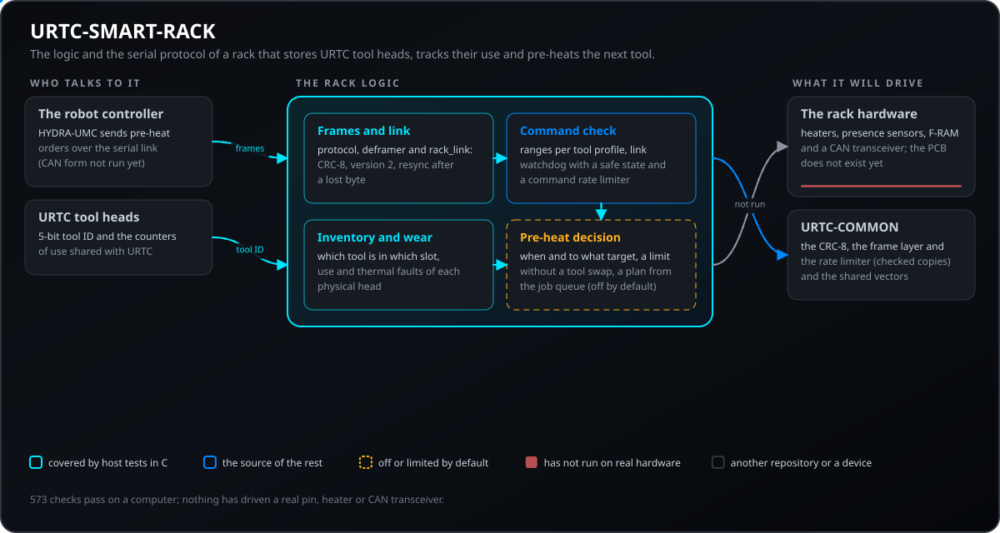
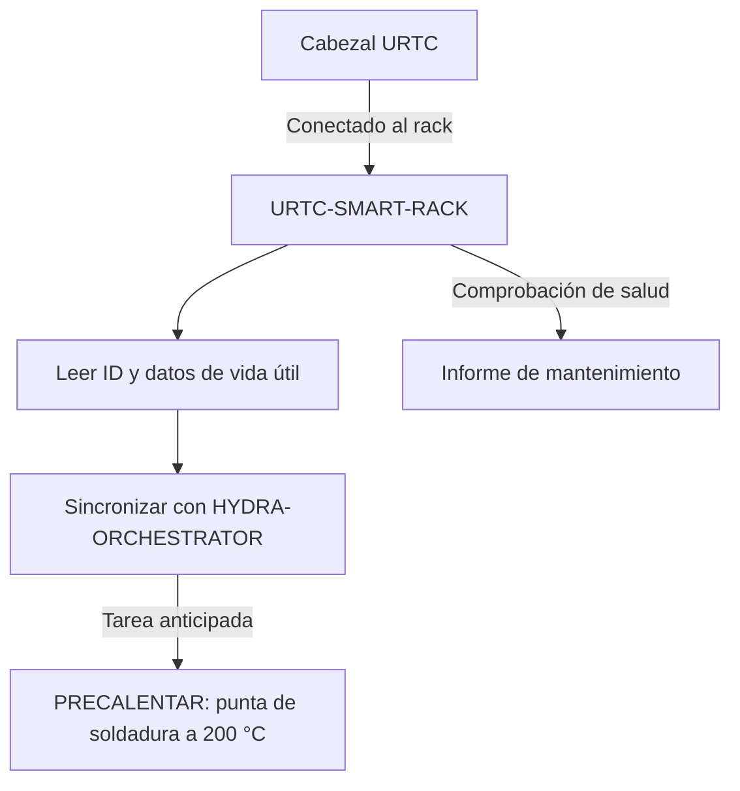
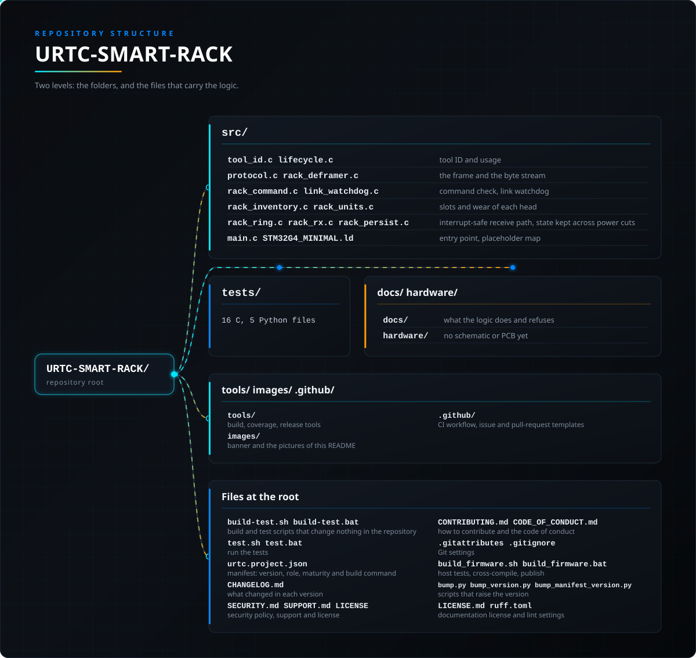

<p align="center">
  
</p>

# 🗄️ URTC-SMART-RACK

<p align="center"><a href="README.md">🇺🇸 English</a> | 🇪🇸 <b>Español</b> | <a href="README_fra.md">🇫🇷 Français</a> | <a href="README_ita.md">🇮🇹 Italiano</a> | <a href="README_deu.md">🇩🇪 Deutsch</a> | <a href="README_zho.md">🇨🇳 简体中文</a> | <a href="README_jpn.md">🇯🇵 日本語</a> | <a href="README_por.md">🇵🇹 Português</a></p>

### 🤖 Gestión Inteligente de Cabezales con Seguimiento de Vida Útil y Térmico

<p align="center">
  
  
  
  
  
</p>

---

**Aviso de honestidad: lo que funciona de verdad hoy:** `tool_id.c`, `lifecycle.c`, `preheat.c`, `protocol.c`, `rack_command.c`, `link_watchdog.c`, `tool_limits.c`, `rack_app.c`, `rack_link.c`, `rack_deframer.c`, `rack_can.c`, `preheat_limit.c` y `rack_inventory.c` son C real y puro, respaldado por 772 comprobaciones `TEST_ASSERT` que pasan (`tests/test_*.c`, compiladas y ejecutadas con el propio compilador C del host, no `arm-none-eabi-gcc`) - confirmado compilando y ejecutando exactamente esa suite de tests de host. Eso cubre la decodificación de ID, el seguimiento de uso/vida útil, la activación de precalentamiento y la temperatura objetivo, el análisis del protocolo con tramas con CRC8, la validación del rango de las órdenes, la gestión del tiempo de espera y de la idempotencia del enlace y el seguimiento del inventario multi-ranura (qué herramienta está guardada en qué ranura, una herramienta real nunca en dos ranuras a la vez) - todo lógica, nada de hardware. Como ya dice la propia introducción del README: todavía no existe PCB/esquemático para esta placa, así que nada de esto ha movido nunca un pin GPIO real, un chip F-RAM, un calentador o un transceptor CAN reales - `main.c`/`startup_stm32g4_minimal.c` solo demuestran que la compilación cruzada y el enlazado para Cortex-M4F funcionan con un script de enlazado provisional, no que nada de esto se ejecute en silicio real. Consulta `CHANGELOG.md` para ver exactamente qué se ha entregado hasta ahora. También se prueba la línea serie: 19 flujos de bytes con la hora de llegada de cada trozo (una trama en trozos, ruido, un CRC erróneo, una versión o una longitud que no encaja, un silencio justo en el límite del tiempo de espera, la vuelta del reloj de milisegundos) pasan por el desenmarcador real, y las tramas que salen y sus contadores son los del modelo de URTC-COMMON.

---

> **Estado de seguridad física y de ciberseguridad:** este ecosistema no es un sistema de seguridad certificado y todavía no existe ninguna placa URTC poblada. Los bootloaders comprueban las imágenes de firmware con CRC32 y un HMAC-SHA256 de clave compartida, no con una firma asimétrica (prevista); las imágenes de aplicación publicadas están firmadas con la clave pública de desarrollo (`signing_key_kind: dev`), así que cualquiera puede producir una imagen que el bootloader acepte; no se ha transmitido nada a una placa real. Lee la [línea base de seguridad](https://github.com/JuanenRac/URTC-DOCS/blob/main/docs/SECURITY_BASELINE.md) y el [modelo de amenazas](https://github.com/JuanenRac/URTC-DOCS/blob/main/docs/THREAT_MODEL.md) antes de fiarte de cualquier afirmación de este repositorio sobre la seguridad de una persona.

## 📋 De un vistazo

| | |
|---|---|
| Versión | `0.2.8` |
| Madurez | Funcional |
| Tests | 772 |
| Tecnología | C / STM32G4 / arm-none-eabi-gcc |
| Destino | Una placa con microcontrolador (el firmware); se compila en un PC |
| En hardware real | Todavía no: no consta ninguna ejecución en hardware real para esta versión |

**Ir a:** [Resumen](#-resumen) · [Arquitectura](#-arquitectura) · [Seguridad](#-seguridad-y-protección) · [Interfaces](#-interfaces) · [Inicio rápido](#-inicio-rápido) · [Pruebas](#-pruebas) · [Estructura](#-estructura-del-repositorio) · [Relacionados](#-proyectos-relacionados)

<!-- urtc-section:status_smart_rack -->
## 🚦 Estado del proyecto

🟢 hecho y verificado · 🟡 funciona, con límites conocidos · 🟠 a medias o sin verificar · 🔴 sin hacer o sin funcionar. Nada es verde si nunca corrió en hardware real.

| Parte | Estado | Lo que el repositorio puede demostrar |
| --- | :---: | --- |
| Software | 🟡 | Funciona en un PC y contra el simulador; nunca se ha usado con una placa real. |
| Pruebas | 🟢 | La batería de pruebas pasa en la CI en cada subida. |
| Hardware real | 🟠 | Aún no se ha ejecutado con una placa real: la prueba de banco sigue pendiente. |
| Interfaz y protocolos | 🟡 | Las rutas o los mensajes que ofrece están documentados y probados con un cliente; aún no los han usado todos los clientes |
| Documentación | 🟡 | README en ocho idiomas y documentos de referencia; las traducciones no las ha revisado ningún hablante nativo. |

<!-- /urtc-section:status_smart_rack -->

## 🎯 Resumen

**URTC-SMART-RACK** es un sistema de almacenamiento inteligente para cabezales de herramienta dentro del ecosistema URTC. Basado en el microcontrolador STM32G4, supervisa y prepara las herramientas mientras no están acopladas a un robot.

Habilita modos «Smart Idle», como precalentar puntas de soldadura T12 justo antes de un cambio de herramienta, y registra el ID electrónico y los ciclos totales de uso de cada cabezal URTC (leer la versión de firmware de cada cabezal está planificado, no implementado), lo que permite un mantenimiento óptimo y un despliegue sin espera.

Todavía no existe PCB/esquemático para esta placa (ver `hardware/`), así que nada de lo de abajo puede manejar GPIO/F-RAM/CAN real - pero la *lógica* en la que se reducen esas características (decodificar un ID, registrar el uso, decidir cuándo precalentar y a qué temperatura) es real, C puro, y ya tiene pruebas.

### Características Clave:
* ✅ **Real v0 - lógica de ID, vida útil y precalentamiento:** `tool_id.c` decodifica una lectura de ID de 5 bits en una identidad de herramienta; `lifecycle.c` registra ciclos/tiempo de uso y marca cuando hace falta mantenimiento; `preheat.c` decide cuándo debe empezar el precalentamiento Smart Idle y a qué temperatura objetivo. 772 aserciones de prueba con el propio compilador C del host - no hace falta PCB, controlador de GPIO ni F-RAM para ejecutar ni probar nada de esto. También real: un deframer de flujo para el enlace serie (`rack_deframer.c`: busca el byte de inicio, se resincroniza tras un byte perdido y descarta media trama tras un tiempo de espera), la forma CAN del comando (`rack_can.c`: ocho bytes de datos, temperatura en big-endian; todavía ninguna placa la lleva) y un límite del tiempo que un precalentamiento puede durar sin cambio de herramienta (`preheat_limit.c`: 10 minutos por defecto, configurable).
* ✅ **Cabezales como unidades, comprobación térmica y precalentamiento predictivo (probado en el host):** `rack_inventory.c` puede identificar una ranura por el tipo más el número de serie del cabezal, y `rack_units.c` guarda el uso, el tiempo de calentador y los fallos térmicos de cada cabezal físico (de sus propios contadores, `0x1AA` / `0x1AB`), de modo que el desgaste sigue al cabezal y no al tipo; `slot_verify.c` dice qué significa una lectura térmica de una ranura para el precalentamiento ordenado (alcanzado, demasiado lento, sobrepasado, un calentador encendido en una ranura vacía); `preheat_plan.c` convierte la cola de trabajos en órdenes de precalentamiento, apagado por defecto. La lectura y la cola vienen de otros programas, nada de esto ha funcionado en una placa y los tiempos de calentamiento son estimaciones.
* 🗄️ **Seguimiento de herramientas** — identificación automática de cabezales URTC mediante puentes de ID de 5 bits o la F-RAM. *(la lógica de decodificación del ID es real, ver arriba; leer puentes o F-RAM reales necesita la PCB.)*
* 🗂️ **Inventario de varias ranuras** — `rack_inventory.c` registra qué herramienta está guardada en qué ranura, mantiene una herramienta real en exactamente una ranura a la vez (al moverla a otra ranura se vacía la anterior, en vez de afirmar que está en dos sitios a la vez), y un objetivo de precalentamiento por ranura, referenciado por la identidad de la herramienta. Al arrancar, `rack_inventory_reconcile()` lo contrasta con un sensor de presencia por ranura: una herramienta retirada con el rack apagado se borra (con su objetivo de precalentamiento) y una colocada a mano se marca para identificarla. *(la lógica del inventario es real, ver arriba; conectarla a sensores de presencia reales por ranura necesita la PCB.)*
* 🧭 **Cabezales de configuración libre (probado en el host):** un cabezal cuyos puentes de ID leen `0x1F` no se toma por «sin herramienta»: `free_tool.c` le pregunta (`0x1A3`), acepta solo una respuesta que nombre una herramienta (`0x1F` y una selección de 1 a 25) y da a la ranura esa identidad como a un cabezal leído por puentes; hasta entonces la ranura no tiene herramienta, así que no hay objetivo ni orden de precalentado. Tiempos, intentos, espera y refresco son valores de configuración, no lógica, y otra herramienta en una respuesta posterior es un cambio de herramienta. Reproducido con los vectores compartidos; las consultas nunca han corrido en un bus, y el cabezal lee su registro de F-RAM al arrancar, así que un cambio exige reiniciarlo.
* 🌡️ **Lógica de precalentamiento** — gestión térmica inteligente para herramientas de soldadura y aire caliente. *(la decisión de activación y las temperaturas objetivo son reales, ver arriba; accionar un calentador real necesita la PCB.)*
* 📈 **Registros de vida útil** — registra los ciclos totales de actuación y las horas de uso en la F-RAM de la herramienta. *(los contadores y la lógica del mantenimiento pendiente son reales, ver arriba; guardarlos en una F-RAM real necesita la PCB.)*
* 📡 **Integración CAN** — pensada para comunicarse con el Cerebro Cinemático de HYDRA-UMC para un ATC coordinado (cambio automático de herramienta); esto nunca se ha ejecutado, porque no existe ningún controlador CAN ni placa. *(el protocolo en sí, con sus tramas, el CRC y la validación de las órdenes, es real y está probado en el host, ver más abajo; todavía hace falta un transceptor CAN real para transportarlo.)*
* 🔒 **Comprobaciones de rango del protocolo** — tramas con versión y suma de verificación CRC8, validación del rango de actuación y un perro guardián del tiempo de espera y de la idempotencia del enlace, con un estado seguro definido. Trama en versión 2: todo valor de varios bytes es big-endian, como el bus, y una trama de la versión 1 se rechaza. *(implementado como C puro y probado solo en un PC; nunca se ha ejecutado en una placa, y no es una función de seguridad certificada)*
* ✅ **Cadena de herramientas del firmware Cortex-M4F** — una imagen real sin sistema operativo (arranque + enlazado + `main.c`) que se compila y se enlaza de verdad con `arm-none-eabi-gcc`, la misma cadena de herramientas que usa el repositorio hermano URTC. *(implementado, ver «Compilación y publicación» más abajo)*

## 🧩 Papel en URTC

URTC-SMART-RACK es la placa que guarda los cabezales de herramienta, no un cabezal: un soporte que identifica cada cabezal que contiene (el ID de herramienta de 5 bits que usa URTC), lleva el uso y los fallos térmicos de cada cabezal físico, sabe qué herramienta está en cada ranura y precalienta una herramienta de soldadura o de aire caliente justo antes de un cambio de herramienta (Smart Idle). Comparte los ID de herramienta y las convenciones de firmware de URTC, pero es una herramienta complementaria, no una hija de URTC, y está pensada para que la maneje el controlador de robot HYDRA-UMC. Todavía no existe ninguna placa: lo real hoy es la lógica y el protocolo del rack, probados en un ordenador.

## 🏛️ Arquitectura

<p align="center">
  
</p>

Cómo encajan las partes de este repositorio: quién lo usa, qué contiene y de qué depende. La imagen se dibuja desde `docs/architecture.json` y se comprueba contra el código.

<details>
<summary>Versión en texto del diagrama (Mermaid)</summary>



</details>

### Arquitectura y decisiones de diseño

* **Por qué esta placa aún no tiene una asignación de pines ni un ID de hardware definidos.** Todavía no existe una PCB para esta placa: `src/firmware_common.h` lleva una identidad de versión sin ID de hardware, y los archivos de arranque y de enlazado están escritos a mano como marcadores de posición que sustituyen al arranque CMSIS/HAL de ST hasta que se fije una pieza STM32G4 real.
* **Por qué no es un hijo de URTC.** URTC-SMART-RACK es una herramienta complementaria, no un hijo de la familia URTC: es una placa física aparte (un rack de almacenamiento de herramientas, no un cabezal) que comparte el espacio de IDs de herramienta y las convenciones de firmware de URTC, pero no su jerarquía de integración.
* **Por qué `bump_version.py` es una copia literal del de URTC.** El formato de la cabecera de firmware es el mismo: reutilizar el script tal cual, en lugar de reinventarlo, mantiene a los dos sincronizados por construcción.
* **Por qué `tool_id.c`, `lifecycle.c` y `preheat.c` se implementan antes que cualquier controlador de GPIO, F-RAM o CAN.** Decodificar un ID, acumular el uso y decidir cuándo precalentar son funciones puras sobre datos que ya se tienen: no necesitan PCB para escribirse ni probarse, así que la v0 implementa primero esa lógica, probada con el propio compilador C de la máquina en lugar de `arm-none-eabi-gcc`. Los controladores que obtendrían esos datos del hardware real llegarán cuando exista la PCB.
* **Cómo encaja en el resto del ecosistema.** Usa los mismos IDs de herramienta que URTC (las tramas del rack todavía no son tramas CAN, ver `docs/OPERATIONS.md`) y forma una pareja natural con HYDRA-UMC-DETECTION-HEF para reconocer visualmente qué herramienta está realmente en el rack.
* **Por qué el protocolo, la validación de órdenes y el perro guardián del enlace son tres módulos separados.** `protocol.c` solo conoce bytes, tramas y un CRC: no sabe qué es una temperatura «segura». `rack_command.c` se encarga de ese juicio: decodifica y comprueba el rango de una orden real sin importarle cómo llegó por el cable. `link_watchdog.c` vigila el tiempo de espera y la idempotencia con independencia de ambos: una trama corrupta nunca debe llegar hasta él (véase la aserción de `test_rack_link_scenarios.c` según la cual una trama con CRC incorrecto nunca reactiva el perro guardián). Mantenerlos separados permite probar cada uno por su cuenta en el host y mantiene ligero a un futuro receptor CAN: llama a cada capa por orden y no reimplementa el juicio de ninguna.
* **Limitador de frecuencia de órdenes.** Una avalancha de órdenes para una misma herramienta se frena con un intervalo mínimo entre órdenes aceptadas (20 ms por defecto, 0 lo desactiva; `link_watchdog_set_command_interval()`). Una orden retenida no cambia nada y se responde con un rechazo (`HELD_RATE`), no con un acuse, pero cuenta como enlace activo; un estado seguro o una retransmisión nunca se retienen. El intervalo se puede ajustar en el banco simulado del rack de URTC-WEB-STUDIO.
* **Por qué un enlace no verificado se trata exactamente igual que uno perdido.** `link_watchdog_is_link_lost()` es verdadero tanto después de un tiempo de espera agotado como antes de que haya llegado la primera trama; las notas de diagnóstico lo llaman «estado seguro al arrancar». Un rack que se enciende sin que todavía haya un host conectado debe arrancar en el estado seguro y no dar por hecho en silencio que «está bien» hasta que se demuestre lo contrario.

## 🔒 Seguridad y protección

| Amenaza | Defensa |
|---|---|
| Una orden fuera de rango a una herramienta | `rack_command.c` decodifica y comprueba el rango de cada orden sin importarle cómo llegó; `protocol.c` solo conoce bytes, tramas y un CRC; `tool_limits.c` guarda el límite de cada perfil de herramienta |
| Una trama corrupta o antigua | Una trama con versión y CRC-8; en la versión 2 todo valor de varios bytes es big-endian como el bus y una trama de versión 1 se rechaza |
| Una avalancha de órdenes | Un intervalo mínimo entre órdenes aceptadas (20 ms por defecto, 0 lo desactiva); una orden retenida no cambia nada y se responde con un rechazo (`HELD_RATE`), no con una confirmación, pero cuenta como enlace vivo; un estado seguro o una retransmisión nunca se retiene |
| Un enlace perdido o no probado | `link_watchdog_is_link_lost()` es verdadero tras agotarse el tiempo de espera y también antes de que llegue la primera trama: un rack que se enciende sin host arranca en estado seguro |
| Precalentar demasiado tiempo o demasiado | `preheat_limit.c` limita cuánto puede durar un precalentamiento sin cambio de herramienta (10 minutos por defecto, configurable) y `tool_limits.c` el objetivo más alto de cada perfil de herramienta |
| Una herramienta en dos ranuras | `rack_inventory.c` mantiene una herramienta real en exactamente una ranura; al guardarla en otra se vacía la anterior |

Todo esto es C puro probado en un ordenador; nunca se ha ejecutado en una placa y no es una función de seguridad certificada.

## 🔌 Interfaces

* **La trama serie del rack:** versión 2, big-endian como el bus, con el CRC-8 que aporta URTC-COMMON (`src/urtc_crc8.h`, `src/urtc_frame.h`); `protocol.c` la interpreta y la codifica, `rack_deframer.c` encuentra tramas en un flujo de bytes (resincronización tras un byte perdido, media trama descartada tras agotarse el tiempo de espera) y `rack_link.c` decide qué hacer con cada trama. Los formatos están en [docs/OPERATIONS.md](docs/OPERATIONS.md).
* **La forma CAN de la orden:** `rack_can.c` (ocho bytes de datos, temperatura big-endian). Ninguna placa la lleva todavía: las tramas del rack aún no son tramas CAN.
* **Compartido con URTC:** el ID de herramienta de 5 bits (`tool_id.c`) y los contadores `0x1AA` / `0x1AB` que llevan el uso de cada cabezal físico (`rack_units.c`). Los vectores que debe reproducir la capa de tramas son los de URTC-COMMON (`conformance/rack_vectors.json`). Las tramas que el rack dice a un cabezal y cómo lee las respuestas (las dos preguntas `0x110` y `0x1AA`, la consigna del soldador `0x130` y del aire caliente `0x1E0`, repetida cada segundo mientras la orden siga) están en `head_link.c`, probado en el ordenador; ninguna placa de rack con transceptor las envía todavía.
* **La respuesta a una orden:** toda trama bien formada recibe una trama de respuesta, un acuse o un rechazo con su motivo en un byte (longitud incorrecta, sin herramienta en la ranura, temperatura por encima del límite, herramienta no válida, sin calefactor, retenida por llegar demasiado pronto, orden desconocida); `rack_reply_encode()` la escribe y las pruebas en el PC la comparan byte a byte con los vectores compartidos de URTC-COMMON, de modo que el firmware y el modelo de los programas no pueden divergir. Los bancos simulados del rack de URTC-TESTER y URTC-WEB-STUDIO la leen; ningún transporte la envía todavía en una placa. Un hotend de impresora 3D solo se precalienta cuando `printer_target_c` está fijado en la configuración del plan (0 por defecto, limitado al techo de 310 grados de la herramienta).

## 🚀 Inicio rápido

Requiere el ARM GNU Toolchain (`arm-none-eabi-gcc`, `arm-none-eabi-objcopy`, `arm-none-eabi-size`) y Python 3.

```bash
# Linux/macOS
chmod +x build_firmware.sh   # una sola vez
./build_firmware.sh

# Windows
build_firmware.bat
```

Ejemplo real: las pruebas del lado del host también se ejecutan por separado, lo que sirve para comprobar la lógica sin compilar el firmware completo:

```bash
cc -std=c11 -Wall -Wextra -Isrc -Itests -o build/host_tests \
  tests/test_main.c tests/test_tool_id.c tests/test_lifecycle.c tests/test_preheat.c \
  tests/test_protocol.c tests/test_rack_command.c tests/test_link_watchdog.c tests/test_rack_link_scenarios.c \
  tests/test_rack_inventory.c tests/test_robustness.c tests/test_rack_app.c \
  tests/test_rack_deframer.c tests/test_rack_can.c tests/test_preheat_limit.c \
  src/tool_id.c src/tool_limits.c src/lifecycle.c src/preheat.c src/protocol.c src/rack_command.c src/link_watchdog.c src/rack_link.c \
  src/rack_inventory.c src/rack_app.c src/rack_deframer.c src/rack_can.c src/preheat_limit.c
./build/host_tests
# All tests passed.
```

<!-- urtc-section:compatibility -->
### Requisitos y compatibilidad

Qué versiones de los programas de URTC funcionan juntas, y qué versión del protocolo habla cada una, figura en la tabla de compatibilidad que genera URTC-COMMON: [docs/COMPATIBILITY.md](https://github.com/JuanenRac/URTC/blob/main/docs/COMPATIBILITY.md). Las notas de una versión de los repositorios que llevan `tools/changelog_section.py` (el firmware, el flasher, el tester y el updater) son la sección del CHANGELOG de esa versión seguida de esta tabla: `python tools/changelog_section.py VERSION --compat`.
<!-- /urtc-section:compatibility -->

## 🧪 Pruebas

Las pruebas de host son programas en C en `tests/` (772 comprobaciones `TEST_ASSERT` en 24 archivos) compilados y ejecutados con el compilador de C del propio equipo, nunca con `arm-none-eabi-gcc`: ID de herramienta, límites de herramienta, ciclo de vida, precalentamiento, la trama, la comprobación de órdenes, el perro guardián del enlace, escenarios completos del enlace, el inventario, la robustez ante entradas erróneas, la capa de aplicación, el desenmarcador (19 flujos de bytes con el tiempo en que llegó cada trozo: una trama en trozos, ruido, un CRC erróneo, una versión o longitud incorrecta, un silencio en el límite del tiempo de espera, una vuelta del reloj de milisegundos), la forma CAN, el límite de precalentamiento y las unidades de cada cabezal; los vectores son los de URTC-COMMON. Cinco archivos de prueba en Python (25 pruebas) comprueban que los scripts de compilación, los archivos adjuntos de la release, los archivos de versión y el número de pruebas publicado concuerdan. La CI compila las pruebas en C con AddressSanitizer y UBSan y falla por debajo de un mínimo de cobertura de las líneas ejecutadas de `src/` (`tools/run_host_tests.py`). `bash build_firmware.sh` las ejecuta antes de compilar de forma cruzada y interrumpe la compilación si una aserción falla. El anillo de bytes que rellena una interrupción de recepción (`rack_ring.c`) y el almacenamiento en dos copias del ciclo de vida y del inventario (`rack_persist.c`, probado con un corte de corriente en cada byte de un guardado) también son lógica pura; el chip de memoria que hay detrás del almacenamiento aún no está elegido.

## 🏗️ Compilación y publicación

La compilación primero compila y ejecuta `tests/` con el compilador de C *del propio equipo* (nunca `arm-none-eabi-gcc`: son pruebas de lógica pura, sin tocar registros del MCU) y se interrumpe por completo si alguna aserción falla. Solo entonces compila `main.c` y `startup_stm32g4_minimal.c` para Cortex-M4F, los enlaza con el mapa de memoria provisional `STM32G4_MINIMAL.ld` y publica archivos `.elf`/`.bin`/`.hex` con versión en `firmware/`. Compilar nunca cambia la versión.

Cada módulo de `src/` se compila también para Cortex-M4F y todos se enlazan juntos como comprobación (no hay biblioteca C en el destino), aunque hoy la imagen solo contiene `main.c` y el archivo de arranque. Con `URTC_CI=1` no se toca ningún archivo versionado.

Las imágenes de firmware (`.bin`, `.hex`, `.elf`) no se versionan en git: un build de release escribe `firmware/URTC_SMART_RACK_FIRMWARE_v<versión>.*` (ignorado por git; `build/firmware` en modo CI, `URTC_CI=1`) y se publican solo como archivos adjuntos de la release de GitHub de cada versión. `python tools/publish_release_assets.py` comprueba los archivos, escribe el archivo `.sha256` que falte e imprime el comando `gh release create` exacto con los archivos que hay que adjuntar.

Todavía no hay nada que grabar en hardware real: no existe una PCB que confirme la pieza STM32G4 de destino, la asignación de pines ni los tamaños reales de flash y RAM. El mapa de memoria del script de enlazado es un marcador de posición conservador (documentado en su propia cabecera) que se sustituirá cuando exista hardware real, el mismo momento en que la tabla de vectores escrita a mano de `startup_stm32g4_minimal.c` se sustituirá por el código de arranque CMSIS/HAL de ST (siguiendo el patrón del repositorio hermano URTC en `src/F303-master/` para sus placas STM32F303).

Consulta [`CHANGELOG.md`](CHANGELOG.md) para ver el historial completo de versiones; cada versión tiene allí su propia entrada.

## 📂 Estructura del repositorio

<p align="center">
  
</p>

<details>
<summary>Versión en texto del árbol</summary>

```text
URTC-SMART-RACK/
├── src/                                               el firmware: lógica en C puro, las copias comprobadas de URTC-COMMON, el punto de entrada y el script de enlazado provisional
├── tests/                                             pruebas de host en C (772 comprobaciones) y comprobaciones en Python de los scripts de compilación
├── docs/                                              OPERATIONS.md: qué hace la lógica, qué rechaza y qué queda sin verificar
├── hardware/                                          notas: todavía sin esquema ni PCB
├── tools/                                             comprobación de compilación, mínimo de cobertura, activos de la release y herramientas compartidas de CI e imágenes
├── images/                                            banner e imágenes de este README
├── .github/                                           flujo de CI y plantillas de issues y pull requests
├── build-test.sh build-test.bat                       scripts de compilación y pruebas que no cambian nada en el repositorio
├── test.sh test.bat                                   ejecutan las pruebas
├── urtc.project.json                                  manifiesto: versión, papel, madurez y comando de compilación
├── CHANGELOG.md                                       qué cambió en cada versión
├── SECURITY.md SUPPORT.md LICENSE                     política de seguridad, soporte y licencia
├── CONTRIBUTING.md CODE_OF_CONDUCT.md                 cómo contribuir y código de conducta
├── .gitattributes .gitignore                          ajustes de Git
├── build_firmware.sh build_firmware.bat               pruebas de host, compilación cruzada, enlace y publicación de las imágenes
├── generate_manifest.py                               escribe el manifiesto de la imagen de firmware
├── bump.py bump_version.py bump_manifest_version.py   scripts que suben la versión
└── LICENSE.md ruff.toml                               licencia de la documentación y ajustes de lint
```

</details>

La lista anotada de cada archivo de código, una línea por archivo, está en [docs/SOURCE_MAP.md](docs/SOURCE_MAP.md).

## 🗺️ Hoja de ruta y límites conocidos

**Límites conocidos hoy**

* Todavía no existe PCB ni esquema para esta placa (véase `hardware/`): nada de esto ha movido nunca un pin GPIO real, una F-RAM, un calentador o un transceptor CAN. `main.c` y el archivo de arranque solo demuestran que la compilación cruzada y el enlace para Cortex-M4F funcionan con un script de enlazado provisional.
* Leer la versión de firmware de cada cabezal está planeado, no implementado.
* La forma CAN de la orden nunca se ha ejecutado: no existe ni un controlador CAN ni una placa, y las tramas del rack aún no son tramas CAN.
* Los tiempos de calentamiento del precalentamiento predictivo son estimaciones y su interruptor está apagado por defecto.

**Siguiente**

* Diseñar la placa, fijar la pieza STM32G4 y sustituir el script de enlazado y el archivo de arranque provisionales por los de ST; escribir los controladores de GPIO, F-RAM y CAN que dan los datos a la lógica.

## 🌍 Idiomas

El README y los textos existen en inglés, español, francés, italiano, alemán, chino, japonés y portugués de Portugal.

## 🔗 Proyectos relacionados

URTC se compone de repositorios independientes, cada uno con su versión, sus pruebas y su README. Esta es la familia, por grupos:

* **URTC Tool Platform:**
  * [URTC](https://github.com/JuanenRac/URTC) - firmware de la placa del cabezal de herramienta (25 perfiles de herramienta, bootloader CAN) y la referencia del protocolo CAN.
  * [URTC-COMMON](https://github.com/JuanenRac/URTC-COMMON) - el protocolo CAN escrito una sola vez como datos (especificación, tablas generadas, vectores de conformidad) y el código que comparten los programas.
  * [URTC-FLASHER](https://github.com/JuanenRac/URTC-FLASHER) - herramienta de escritorio que actualiza el firmware de la placa por CAN o por SWD/JTAG.
  * [URTC-GATEWAY](https://github.com/JuanenRac/URTC-GATEWAY) - pasarela delante del bus CAN: solo deja pasar los identificadores de una lista, limita su frecuencia y pide una clave de sesión.
  * **URTC-SMART-RACK** (este repositorio) - lógica en C independiente del hardware y protocolo de órdenes para un soporte de herramientas con precalentamiento y seguimiento del ciclo de vida.
  * [URTC-TESTER](https://github.com/JuanenRac/URTC-TESTER) - probador de escritorio del bus CAN en vivo que muestra los controles y la telemetría del perfil de herramienta que informa una placa.
  * [URTC-VISION-TOOL](https://github.com/JuanenRac/URTC-VISION-TOOL) - protocolo de tramas de sensor en C y un acompañante en Python térmico/RGB para un cabezal de inspección.
  * [URTC-WEB-STUDIO](https://github.com/JuanenRac/URTC-WEB-STUDIO) - aplicación de navegador que graba y prueba la placa por Web Serial y SLCAN, sin instalar nada.
* **Ecosystem Operations:**
  * [URTC-DEVTOOLS](https://github.com/JuanenRac/URTC-DEVTOOLS) - las herramientas de repositorio compartidas de la familia como un conjunto con versión y un fichero de bloqueo que distingue una copia editada de una desfasada.
  * [URTC-DOCS](https://github.com/JuanenRac/URTC-DOCS) - arquitectura, interfaces, línea base de seguridad y catálogo generado del ecosistema, más las herramientas que comparan todos los repositorios.
  * [URTC-UPDATER](https://github.com/JuanenRac/URTC-UPDATER) - herramienta de escritorio que detecta, instala y actualiza los repositorios de la familia URTC, una acción explícita cada vez.

**Proyectos hermanos (independientes, con la misma base y herramientas):**

* **[HYDRA-UMC-DOCS](https://github.com/JuanenRac/HYDRA-UMC-DOCS)** - proyecto hermano: el centro de documentación de HYDRA-UMC, un ecosistema independiente que comparte base y herramientas con este
* **[ARMOR-DOCS](https://github.com/JuanenRac/ARMOR-DOCS)** - proyecto hermano: el centro de documentación de A.R.M.O.R., el ecosistema de seguridad, también independiente y sobre la misma base
* **[JuanenRac](https://github.com/JuanenRac/JuanenRac)** - el perfil y el panel de estado de todos los ecosistemas

## 📚 Documentación

- **[CONTRIBUTING.md](CONTRIBUTING.md)** — tecnologías usadas y normas de código para una pull request.
- **[CODE_OF_CONDUCT.md](CODE_OF_CONDUCT.md)** — las normas de comportamiento que se esperan en esta comunidad.
- **[SECURITY.md](SECURITY.md)** — cómo informar de una vulnerabilidad y en qué aspectos de seguridad se centra realmente este proyecto.
- **[SUPPORT.md](SUPPORT.md)** — dónde hacer preguntas y notificar errores.
- **[LICENSE.md](LICENSE.md)** — la licencia propia de este proyecto.

## 🤝 Contribuir y comunidad

* Antes de abrir una pull request, ejecuta `URTC_CI=1 python tools/ci_validate.py`: debe pasar. Consulta [CONTRIBUTING.md](CONTRIBUTING.md) y el [código de conducta](CODE_OF_CONDUCT.md).
* El README existe en ocho idiomas: un cambio en el texto se hace en los ocho archivos, y las secciones compartidas con otros repositorios las escribe `tools/readme_sections.py` de URTC-COMMON.
* Un cambio en el protocolo CAN empieza en URTC-COMMON (`spec/can_protocol.json`) y llega a este repositorio mediante la copia comprobada.
* No describas como funcionando en una placa lo que solo se ha compilado.
* Informa de una vulnerabilidad en privado: [SECURITY.md](SECURITY.md). Preguntas, ideas e informes: electrohobby3d@gmail.com ([SUPPORT.md](SUPPORT.md)).

## 👤 AUTOR

**JuanenRac** (Electro Hobby 3D)
📧 electrohobby3d@gmail.com
📺 [youtube.com/@electrohobby3d](https://youtube.com/@electrohobby3d)

## 📜 LICENCIA

GPL-3.0-or-later - Ver LICENSE para más detalles.
