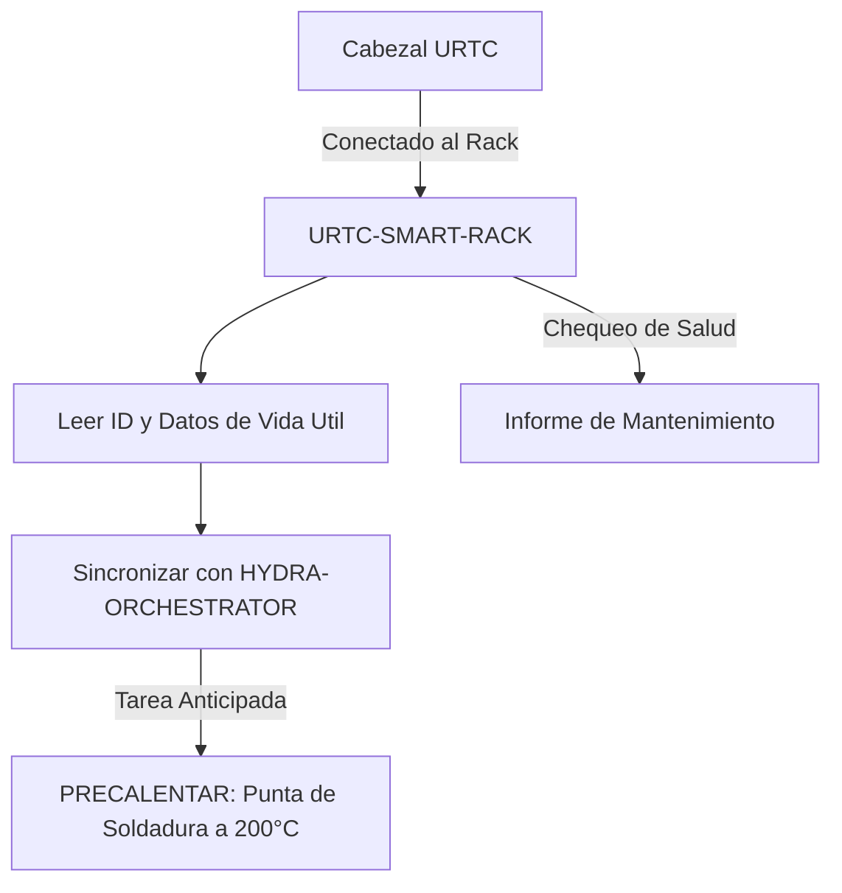

<p align="center">
  
</p>

# 🗄️ URTC-SMART-RACK

<p align="center"><a href="README.md">🇺🇸 English</a> | 🇪🇸 <b>Español</b> | <a href="README_fra.md">🇫🇷 Français</a> | <a href="README_ita.md">🇮🇹 Italiano</a> | <a href="README_deu.md">🇩🇪 Deutsch</a> | <a href="README_zho.md">🇨🇳 简体中文</a> | <a href="README_jpn.md">🇯🇵 日本語</a> | <a href="README_por.md">🇵🇹 Português</a></p>

### 🤖 Gestión Inteligente de Cabezales con Seguimiento de Vida Útil y Térmico

<p align="center">
  
  
  
  
  
</p>

---

**Comprobación de honestidad - lo que realmente funciona hoy:** `tool_id.c`, `lifecycle.c`, `preheat.c`, `protocol.c`, `rack_command.c`, `link_watchdog.c`, `tool_limits.c`, `rack_app.c`, `rack_link.c`, `rack_deframer.c`, `rack_can.c`, `preheat_limit.c` y `rack_inventory.c` son C real y puro, respaldado por 467 comprobaciones `TEST_ASSERT` que pasan (`tests/test_*.c`, compiladas y ejecutadas con el propio compilador C del host, no `arm-none-eabi-gcc`) - confirmado compilando y ejecutando exactamente esa suite de tests de host. Eso cubre la decodificación de ID, el seguimiento de uso/vida útil, la activación de precalentamiento y la temperatura objetivo, el parseo de protocolo con framing CRC8, la validación de rango de comandos, el manejo de timeout de enlace/idempotencia, y el seguimiento del inventario multi-slot (qué herramienta está guardada en qué slot, una herramienta real nunca en dos slots a la vez) - todo lógica, nada de hardware. Como ya dice la propia introducción del README: todavía no existe PCB/esquemático para esta placa, así que nada de esto ha manejado nunca un pin GPIO real, un chip F-RAM, un calentador o un transceptor CAN reales - `main.c`/`startup_stm32g4_minimal.c` solo demuestran que la compilación cruzada y el enlazado para Cortex-M4F funcionan contra un linker script de relleno, no que nada de esto corra en silicio real. Consulta `CHANGELOG.md` para ver exactamente qué se ha entregado hasta ahora. También se prueba la línea serie: 19 flujos de bytes con la hora de llegada de cada trozo (una trama en pedazos, ruido, un CRC malo, una versión o una longitud que no encaja, un silencio justo en el límite del tiempo de espera, la vuelta del reloj de milisegundos) pasan por el deframer real, y las tramas que salen y sus contadores son los del modelo de URTC-COMMON.

---

> **Estado de seguridad física y de ciberseguridad:** este ecosistema no es un sistema de seguridad certificado y todavía no existe ninguna placa URTC poblada. Los bootloaders comprueban las imágenes de firmware con CRC32 y un HMAC-SHA256 de clave compartida, no con una firma asimétrica (prevista); las imágenes de aplicación publicadas están firmadas con la clave pública de desarrollo (`signing_key_kind: dev`), así que cualquiera puede producir una imagen que el bootloader acepte; no se ha transmitido nada a una placa real. Lee la [línea base de seguridad](https://github.com/JuanenRac/URTC-DOCS/blob/main/docs/SECURITY_BASELINE.md) y el [modelo de amenazas](https://github.com/JuanenRac/URTC-DOCS/blob/main/docs/THREAT_MODEL.md) antes de fiarte de cualquier afirmación de aquí para la seguridad de una persona.

## 📋 De un vistazo

| | |
|---|---|
| Versión | `0.2.1` |
| Madurez | Funcional |
| Tests | 467 |
| Tecnología | C / STM32G4 / arm-none-eabi-gcc |
| Destino | Una placa con microcontrolador (el firmware); se compila en un PC |
| En hardware real | Todavía no: no consta ninguna ejecución en hardware real para esta versión |

**Ir a:** [Resumen](#-resumen) · [Arquitectura](#-arquitectura) · [Seguridad](#-seguridad-y-protección) · [Interfaces](#-interfaces) · [Inicio rápido](#-inicio-rápido) · [Pruebas](#-pruebas) · [Estructura](#-estructura-del-repositorio) · [Relacionados](#-proyectos-relacionados)

<!-- urtc-section:status_smart_rack -->
## 🚦 Estado del proyecto

🟢 hecho y verificado · 🟡 funciona, con límites conocidos · 🟠 a medias o sin verificar · 🔴 sin hacer o sin funcionar. Nada es verde si nunca corrió en hardware real.

| Parte | Estado | Lo que el repositorio puede demostrar |
| --- | :---: | --- |
| Software | 🟡 | Funciona en un PC y contra el simulador; nunca se ha usado con una placa real. |
| Pruebas | 🟢 | La batería de pruebas pasa en la CI en cada subida. |
| Hardware real | 🟠 | Aún no se ha ejecutado con una placa real: la prueba de banco sigue pendiente. |
| Documentación | 🟡 | README en ocho idiomas y documentos de referencia; las traducciones no las ha revisado ningún hablante nativo. |

<!-- /urtc-section:status_smart_rack -->

## 🎯 Resumen

**URTC-SMART-RACK** es un sistema de almacenamiento inteligente para cabezales de herramienta dentro del ecosistema HYDRA-UMC. Basado en el microcontrolador STM32G4, monitoriza y prepara las herramientas mientras no están acopladas a un robot.

Habilita modos "Smart Idle", como precalentar puntas de soldadura T12 justo antes de un cambio de herramienta, y registra el ID electrónico y los ciclos totales de uso de cada cabezal URTC (leer la versión de firmware de cada cabezal está planificado, no implementado), garantizando un mantenimiento óptimo y un despliegue de cero segundos.

Todavía no existe PCB/esquemático para esta placa (ver `hardware/`), así que nada de lo de abajo puede manejar GPIO/F-RAM/CAN real - pero la *lógica* en la que se reducen esas características (decodificar un ID, registrar el uso, decidir cuándo precalentar y a qué temperatura) es real, C puro, con tests hoy mismo.

### Características Clave:
* ✅ **Real v0 - lógica de ID, vida útil y precalentamiento:** `tool_id.c` decodifica una lectura de ID de 5 bits en una identidad de herramienta; `lifecycle.c` registra ciclos/tiempo de uso y marca cuando hace falta mantenimiento; `preheat.c` decide cuándo debe empezar el precalentamiento Smart Idle y a qué temperatura objetivo. 467 aserciones de test con el propio compilador C del host - no hace falta PCB, driver de GPIO ni F-RAM para ejecutar ni testear nada de esto. También real: un deframer de flujo para el enlace serie (`rack_deframer.c`: busca el byte de inicio, se resincroniza tras un byte perdido y descarta media trama tras un tiempo de espera), la forma CAN del comando (`rack_can.c`: ocho bytes de datos, temperatura en big-endian; todavía ninguna placa la lleva) y un límite del tiempo que un precalentamiento puede durar sin cambio de herramienta (`preheat_limit.c`: 10 minutos por defecto, configurable).
* ✅ **Cabezales como unidades, comprobación térmica y precalentamiento predictivo (probado en el host):** `rack_inventory.c` puede identificar un hueco por el tipo más el número de serie del cabezal, y `rack_units.c` guarda el uso, el tiempo de calentador y los fallos térmicos de cada cabezal físico (de sus propios contadores, `0x1AA` / `0x1AB`), de modo que el desgaste sigue al cabezal y no al tipo; `slot_verify.c` dice qué significa una lectura térmica de un hueco para el precalentamiento ordenado (alcanzado, demasiado lento, sobrepasado, un calentador encendido en un hueco vacío); `preheat_plan.c` convierte la cola de trabajos en órdenes de precalentamiento, apagado por defecto. La lectura y la cola vienen de otros programas, nada de esto ha funcionado en una placa y los tiempos de calentamiento son estimaciones.
* 🗄️ **Seguimiento de Herramientas** — identificación automática de cabezales URTC vía jumpers de ID de 5 bits o F-RAM. *(la lógica de decodificación de ID en sí es real - ver arriba; leer jumpers/F-RAM reales necesita el PCB.)*
* 🗂️ **Inventario Multi-Slot** — `rack_inventory.c` registra qué herramienta está guardada en qué slot, mantiene una herramienta real en exactamente un slot a la vez (moverla a otro slot vacía el anterior en vez de afirmar que está en dos sitios a la vez), y un objetivo de precalentamiento por slot, referenciado por la identidad de la herramienta. Al arrancar, `rack_inventory_reconcile()` lo contrasta con un sensor de presencia por ranura: una herramienta retirada con el rack apagado se borra (con su objetivo de precalentamiento) y una colocada a mano se marca para identificarla. *(la lógica del inventario en sí es real - ver arriba; conectarla a sensores de presencia reales por slot necesita el PCB.)*
* 🌡️ **Lógica de Precalentamiento** — gestión térmica inteligente para herramientas de soldadura y aire caliente. *(la decisión de activación y las temperaturas objetivo son reales - ver arriba; accionar un calentador real necesita el PCB.)*
* 📈 **Registros de Vida Útil** — registra ciclos totales de actuación y horas de uso en la F-RAM de la herramienta. *(los contadores y la lógica de mantenimiento debido son reales - ver arriba; persistirlos en F-RAM real necesita el PCB.)*
* 📡 **Integración CAN** — pensada para comunicarse con el Cerebro Cinemático de HYDRA-UMC para un ATC coordinado (Cambio Automático de Herramienta); esto nunca se ha ejecutado, porque no existe ningún driver CAN ni placa. *(el protocolo en sí - framing, CRC, validación de comandos - es real y está probado en el host, ver más abajo; todavía hace falta un transceptor CAN real para transportarlo.)*
* 🔒 **Comprobaciones de Rango del Protocolo** — framing versionado con suma de verificación CRC8, validación del rango de actuación y un watchdog de timeout de enlace/idempotencia con un estado seguro definido. Trama en versión 2: todo valor de varios bytes es big-endian, como el bus, y una trama de la versión 1 se rechaza. *(implementado como C puro y probado solo en un PC; nunca se ha ejecutado en una placa, y no es una función de seguridad certificada)*
* ✅ **Toolchain de firmware Cortex-M4F** — una imagen bare-metal real (startup + linker + `main.c`) que compila y enlaza de verdad con `arm-none-eabi-gcc`, el mismo toolchain que usa el repositorio hermano URTC. *(implementado — ver COMPILACIÓN abajo)*

## 🧩 Papel en URTC

URTC-SMART-RACK es la placa que guarda los cabezales de herramienta, no un cabezal: un soporte que identifica cada cabezal que contiene (el ID de herramienta de 5 bits que usa URTC), lleva el uso y los fallos térmicos de cada cabezal físico, sabe qué herramienta está en cada hueco y precalienta una herramienta de soldadura o de aire caliente justo antes de un cambio de herramienta (Smart Idle). Comparte los ID de herramienta y las convenciones de firmware de URTC, pero es una herramienta complementaria, no hija de URTC, y está pensada para que la maneje el controlador de robot HYDRA-UMC. Todavía no existe ninguna placa: lo real hoy es la lógica y el protocolo del rack, probados en un ordenador.

## 🏛️ Arquitectura

<p align="center">
  
</p>

Cómo encajan las partes de este repositorio: quién lo usa, qué contiene y de qué depende. La imagen se dibuja desde `docs/architecture.json` y se comprueba contra el código.

<details>
<summary>Versión en texto del diagrama (Mermaid)</summary>



</details>

### ARQUITECTURA Y DECISIONES DE DISEÑO

* **Por qué esta placa aún no tiene un pinout/ID de hardware real definido.** Todavía no existe una PCB para esta placa - `src/firmware_common.h` lleva una identidad de versión sin ID de hardware, y los archivos de arranque/enlazado están escritos a mano como marcadores de posición sustituyendo al propio arranque CMSIS/HAL de ST hasta que se fije una pieza STM32G4 real.
* **Por qué no es un hijo del propio URTC.** URTC-SMART-RACK es una Herramienta Complementaria, no un hijo de la familia URTC - es una placa física separada (un rack de almacenamiento de herramientas, no un cabezal de herramienta) que comparte el espacio de IDs de herramienta y las convenciones de firmware de URTC, pero no su jerarquía de integración.
* **Por qué `bump_version.py` es una copia literal del de URTC.** El mismo formato de cabecera de firmware: reutilizar el script exacto en lugar de reinventarlo mantiene a los dos sincronizados por construcción.
* **Por qué `tool_id.c`/`lifecycle.c`/`preheat.c` se implementan antes que cualquier driver de GPIO/F-RAM/CAN.** Decodificar un ID, acumular uso y decidir cuándo precalentar son funciones puras de datos que ya se tienen en mano - no necesitan PCB para escribirse ni testearse, así que el v0 implementa primero esa lógica, testeada con el propio compilador C de la máquina en vez de `arm-none-eabi-gcc`. Los drivers que de verdad obtendrían esos datos de hardware real llegan cuando exista el PCB.
* **Cómo encaja en el resto del ecosistema.** Usa el propio ecosistema de herramientas de URTC (los mismos IDs de herramienta; las tramas del rack todavía no son tramas CAN, ver `docs/OPERATIONS.md`), y forma pareja natural con HYDRA-UMC-DETECTION-HEF para reconocer visualmente qué herramienta está realmente en el rack.
* **Por qué el protocolo, la validación de comandos y el watchdog de enlace son tres módulos separados.** `protocol.c` sólo conoce bytes, framing y un CRC - no tiene idea de qué es una temperatura "segura". `rack_command.c` es dueño de ese juicio, decodificando y verificando el rango de un comando real sin importarle cómo llegó por el cable. `link_watchdog.c` rastrea el timeout/idempotencia independientemente de ambos - una trama corrupta nunca debe siquiera llegar hasta él (ver la propia aserción real de `test_rack_link_scenarios.c` de que una trama con CRC incorrecto nunca revive el watchdog). Mantenerlos separados es lo que hace que cada uno sea testeable de forma independiente en el host, y mantiene delgado a un futuro manejador de recepción CAN - llama a cada capa en orden, no reimplementa el juicio de ninguna de ellas.
* **Limitador de tasa de órdenes.** Una avalancha de órdenes para una misma herramienta se frena con un intervalo mínimo entre órdenes aceptadas (20 ms por defecto, 0 lo desactiva; `link_watchdog_set_command_interval()`). Una orden retenida no cambia nada y no recibe acuse, pero cuenta como enlace vivo; un estado seguro o una retransmisión nunca se retienen. El intervalo se puede ajustar en el banco simulado del rack de URTC-WEB-STUDIO.
* **Por qué un enlace no verificado se trata exactamente igual que uno muerto.** `link_watchdog_is_link_lost()` es verdadero tanto después de un timeout real COMO antes de que haya llegado la primerísima trama - las propias notas de diagnóstico lo llaman "estado seguro al arrancar". Un rack que se enciende sin que todavía haya un host conectado debe arrancar en el estado seguro, no asumir en silencio que "está bien" hasta que se demuestre lo contrario.

## 🔒 Seguridad y protección

| Amenaza | Defensa |
|---|---|
| Una orden fuera de rango a una herramienta | `rack_command.c` decodifica y comprueba el rango de cada orden sin importarle cómo llegó; `protocol.c` solo conoce bytes, tramas y un CRC; `tool_limits.c` guarda el límite de cada perfil de herramienta |
| Una trama corrupta o antigua | Una trama versionada con CRC-8; en la versión 2 todo valor de varios bytes es big-endian como el bus y una trama de versión 1 se rechaza |
| Una avalancha de órdenes | Un intervalo mínimo entre órdenes aceptadas (20 ms por defecto, 0 lo desactiva); una orden retenida no cambia nada y no recibe confirmación, pero cuenta como enlace vivo; un estado seguro o una retransmisión nunca se retiene |
| Un enlace perdido o no probado | `link_watchdog_is_link_lost()` es verdadero tras un timeout real y también antes de que llegue la primera trama: un rack que enciende sin host arranca en estado seguro |
| Precalentar demasiado tiempo o demasiado | `preheat_limit.c` limita cuánto puede durar un precalentamiento sin cambio de herramienta (10 minutos por defecto, configurable) y `tool_limits.c` el objetivo más alto de cada perfil de herramienta |
| Una herramienta en dos huecos | `rack_inventory.c` mantiene una herramienta real en exactamente un hueco; al guardarla en otro se limpia el anterior |

Todo esto es C puro probado en un ordenador; nunca se ha ejecutado en una placa y no es una función de seguridad certificada.

## 🔌 Interfaces

* **La trama serie del rack:** versión 2, big-endian como el bus, con el CRC-8 que aporta URTC-COMMON (`src/urtc_crc8.h`, `src/urtc_frame.h`); `protocol.c` la interpreta y la codifica, `rack_deframer.c` encuentra tramas en un flujo de bytes (resincronización tras un byte perdido, media trama descartada tras un timeout) y `rack_link.c` decide qué hacer con cada trama. Los formatos están en [docs/OPERATIONS.md](docs/OPERATIONS.md).
* **La forma CAN de la orden:** `rack_can.c` (ocho bytes de datos, temperatura big-endian). Ninguna placa la lleva todavía: las tramas del rack aún no son tramas CAN.
* **Compartido con URTC:** el ID de herramienta de 5 bits (`tool_id.c`) y los contadores `0x1AA` / `0x1AB` que llevan el uso de cada cabezal físico (`rack_units.c`). Los vectores que debe reproducir la capa de tramas son los de URTC-COMMON (`conformance/rack_vectors.json`).

## 🚀 Inicio rápido

Requiere el ARM GNU Toolchain (`arm-none-eabi-gcc`, `arm-none-eabi-objcopy`, `arm-none-eabi-size`) y Python 3.

```bash
# Linux/macOS
chmod +x build_firmware.sh   # una sola vez
./build_firmware.sh

# Windows
build_firmware.bat
```

Ejemplo real - los tests del lado del host también se ejecutan solos, útil para comprobar la lógica sin un build de firmware completo:

```bash
cc -std=c11 -Wall -Wextra -Isrc -Itests -o build/host_tests \
  tests/test_main.c tests/test_tool_id.c tests/test_lifecycle.c tests/test_preheat.c \
  tests/test_protocol.c tests/test_rack_command.c tests/test_link_watchdog.c tests/test_rack_link_scenarios.c \
  tests/test_rack_inventory.c tests/test_robustness.c tests/test_rack_app.c \
  tests/test_rack_deframer.c tests/test_rack_can.c tests/test_preheat_limit.c \
  src/tool_id.c src/tool_limits.c src/lifecycle.c src/preheat.c src/protocol.c src/rack_command.c src/link_watchdog.c src/rack_link.c \
  src/rack_inventory.c src/rack_app.c src/rack_deframer.c src/rack_can.c src/preheat_limit.c
./build/host_tests
# All tests passed.
```

<!-- urtc-section:compatibility -->
### Requisitos y compatibilidad

Qué versiones de los programas de URTC funcionan juntas, y qué versión del protocolo habla cada una, figura en la tabla de compatibilidad que genera URTC-COMMON: [docs/COMPATIBILITY.md](https://github.com/JuanenRac/URTC/blob/main/docs/COMPATIBILITY.md).
<!-- /urtc-section:compatibility -->

## 🧪 Pruebas

Las pruebas de host son programas en C en `tests/` (467 comprobaciones `TEST_ASSERT` en 16 archivos) compilados y ejecutados con el compilador de C del propio equipo, nunca con `arm-none-eabi-gcc`: ID de herramienta, límites de herramienta, ciclo de vida, precalentamiento, la trama, la comprobación de órdenes, el perro guardián del enlace, escenarios completos del enlace, el inventario, la robustez ante entradas erróneas, la capa de aplicación, el desenmarcador (19 flujos de bytes con el tiempo en que llegó cada trozo: una trama en trozos, ruido, un CRC erróneo, una versión o longitud incorrecta, un silencio en el límite del timeout, una vuelta del reloj de milisegundos), la forma CAN, el límite de precalentamiento y las unidades de cada cabezal; los vectores son los de URTC-COMMON. Cinco archivos de prueba en Python (25 pruebas) comprueban que los scripts de compilación, los activos de la release, los archivos de versión y la cifra de pruebas publicada concuerdan. La CI compila las pruebas en C con AddressSanitizer y UBSan y falla por debajo de un mínimo de cobertura de las líneas ejecutadas de `src/` (`tools/gcov_floor.py`). `bash build_firmware.sh` las ejecuta antes de compilar de forma cruzada y falla la compilación si una aserción falla.

## 🏗️ Compilación y publicación

La compilación primero compila y ejecuta `tests/` con el compilador de C *del propio equipo* (nunca `arm-none-eabi-gcc`: son pruebas de lógica pura, sin tocar registros del MCU) y falla por completo si alguna aserción falla. Solo entonces compila `main.c` y `startup_stm32g4_minimal.c` para Cortex-M4F, los enlaza con el mapa de memoria provisional `STM32G4_MINIMAL.ld` y publica archivos `.elf`/`.bin`/`.hex` con versión en `firmware/`. Compilar nunca cambia la versión.

Cada módulo de `src/` se compila también para Cortex-M4F y todos se enlazan juntos como comprobación (no hay biblioteca C en el destino), aunque hoy la imagen solo contiene `main.c` y el archivo de arranque. Con `URTC_CI=1` no se toca ningún archivo versionado.

Las imágenes de firmware (`.bin`, `.hex`, `.elf`) no se versionan en git: un build de release escribe `firmware/URTC_SMART_RACK_FIRMWARE_v<versión>.*` (ignorado por git; `build/firmware` en modo CI, `URTC_CI=1`) y se publican solo como assets de la release de GitHub de cada versión. `python tools/publish_release_assets.py` comprueba los ficheros, escribe el fichero `.sha256` que falte e imprime el comando `gh release create` exacto con los ficheros a adjuntar.

Todavía no hay nada que flashear a hardware real - no existe PCB que confirme la pieza STM32G4 objetivo, el pinout, o sus tamaños reales de flash/RAM. El mapa de memoria del linker script es un placeholder conservador (documentado en su propia cabecera) que se reemplazará cuando exista hardware real, el mismo momento en que la tabla de vectores escrita a mano de `startup_stm32g4_minimal.c` se reemplazará por el código de arranque CMSIS/HAL propio de ST (siguiendo el patrón del repositorio hermano URTC en `src/F303-master/` para sus placas STM32F303).

Consulta [`CHANGELOG.md`](CHANGELOG.md) para el historial completo de versiones; cada versión tiene allí su propia entrada.

## 📂 Estructura del repositorio

<p align="center">
  
</p>

<details>
<summary>Versión en texto del árbol</summary>

```text
URTC-SMART-RACK/
├── src/                                               el firmware: lógica en C puro, las copias comprobadas de URTC-COMMON, el punto de entrada y el script de enlazado provisional
├── tests/                                             pruebas de host en C (467 comprobaciones) y comprobaciones en Python de los scripts de compilación
├── docs/                                              OPERATIONS.md: qué hace la lógica, qué rechaza y qué queda sin verificar
├── hardware/                                          notas: todavía sin esquema ni PCB
├── tools/                                             comprobación de compilación, mínimo de cobertura, activos de la release y herramientas compartidas de CI e imágenes
├── images/                                            banner e imágenes de este README
├── .github/                                           flujo de CI y plantillas de issues y pull requests
├── build-test.sh build-test.bat                       scripts de compilación y pruebas que no cambian nada en el repositorio
├── test.sh test.bat                                   ejecutan las pruebas
├── urtc.project.json                                  manifiesto: versión, papel, madurez y comando de compilación
├── CHANGELOG.md                                       qué cambió en cada versión
├── SECURITY.md SUPPORT.md LICENSE                     política de seguridad, soporte y licencia
├── CONTRIBUTING.md CODE_OF_CONDUCT.md                 cómo contribuir y código de conducta
├── .gitattributes .gitignore                          ajustes de Git
├── build_firmware.sh build_firmware.bat               pruebas de host, compilación cruzada, enlace y publicación de las imágenes
├── bump.py bump_version.py bump_manifest_version.py   scripts que suben la versión
└── LICENSE.md ruff.toml                               licencia de la documentación y ajustes de lint
```

</details>

## 🗺️ Hoja de ruta y límites conocidos

**Límites conocidos hoy**

* Todavía no existe PCB ni esquema para esta placa (véase `hardware/`): nada de esto ha movido nunca un pin GPIO real, una F-RAM, un calentador o un transceptor CAN. `main.c` y el archivo de arranque solo demuestran que la compilación cruzada y el enlace para Cortex-M4F funcionan con un script de enlazado provisional.
* Leer la versión de firmware de cada cabezal está planeado, no implementado.
* La forma CAN de la orden nunca se ha ejecutado: no existe ni un controlador CAN ni una placa, y las tramas del rack aún no son tramas CAN.
* Los tiempos de calentamiento del precalentamiento predictivo son estimaciones y su interruptor está apagado por defecto.

**Siguiente**

* Diseñar la placa, fijar la pieza STM32G4 y sustituir el script de enlazado y el archivo de arranque provisionales por los de ST; escribir los controladores de GPIO, F-RAM y CAN que dan los datos a la lógica.

## 🌍 Idiomas

El README y los textos existen en inglés, español, francés, italiano, alemán, chino, japonés y portugués de Portugal.

## 🔗 Proyectos relacionados

Este proyecto es parte del ecosistema de robótica HYDRA-UMC del mismo autor (JuanenRac / Electro Hobby 3D). Vale la pena conocerlo, ya que una petición podría en realidad ser sobre alguno de estos en vez de sobre este repositorio.

**Directamente Relacionados**
- **[URTC](https://github.com/JuanenRac/URTC)** — firmware para la placa física del Universal Robot Tool Controller, más de 25 perfiles de herramienta por bus CAN — el mismo ecosistema de herramientas, sobre el mismo bus CAN.
- **[HYDRA-UMC-DETECTION-HEF](https://github.com/JuanenRac/HYDRA-UMC-DETECTION-HEF)** — registro real de modelos compilados con verificación de carga segura por arquitectura Hailo/checksum — proporciona el reconocimiento visual de las herramientas que almacena este rack.

**También Forma Parte del Ecosistema**

*Hardware y Plataforma Base*
- **[HYDRA-UMC](https://github.com/JuanenRac/HYDRA-UMC)** — el diseño de la placa madre del brazo robótico: host CM5 + coprocesador STM32H745 de doble núcleo, pensado para coordinar hasta 8 brazos herramienta por CAN-OTA/SPI-OTA (firmware en fase temprana; todavía no hay ninguna placa poblada).
- **[HYDRA-UMC-OS](https://github.com/JuanenRac/HYDRA-UMC-OS)** — capa de producto reproducible sobre Raspberry Pi OS para el CM5: agente de solo lectura, config/perfiles validados, aprovisionamiento WiFi de primer contacto.
- **[HYDRA-UMC-SDK](https://github.com/JuanenRac/HYDRA-UMC-SDK)** — el contrato JSON-Schema compartido y la barrera de software de puerta de trabajos contra la que cada bridge valida sus comandos (no es una función de seguridad certificada).
- **[HYDRA-UMC-CONNECTOR-HUB](https://github.com/JuanenRac/HYDRA-UMC-CONNECTOR-HUB)** — registro declarativo y validador de manifiestos de adaptador para conectores de máquinas externas; extiende la propia idea de contrato del SDK a máquinas externas sin sustituir a los proyectos de pasarela industrial.

*Backend Central y Clientes*
- **[HYDRA-UMC-SERVER](https://github.com/JuanenRac/HYDRA-UMC-SERVER)** — el backend headless real (REST/WebSocket) con el que habla de verdad cada cliente de control.
- **[HYDRA-UMC-STUDIO](https://github.com/JuanenRac/HYDRA-UMC-STUDIO)** — panel de control web con visualización 3D multi-robot en tiempo real.
- **[HYDRA-UMC-SUITE](https://github.com/JuanenRac/HYDRA-UMC-SUITE)** — centro de mando de enjambre de escritorio (PySide6) para varios servidores a la vez, empaquetado como ejecutable independiente.
- **[HYDRA-UMC-ANDROID-CONTROL](https://github.com/JuanenRac/HYDRA-UMC-ANDROID-CONTROL)** — app nativa de control para Android con inicio de sesión biométrico y un compañero Wear OS emparejado.
- **[HYDRA-UMC-IOS-CONTROL](https://github.com/JuanenRac/HYDRA-UMC-IOS-CONTROL)** — app de control para iOS/iPadOS (Flutter) con sincronización en tiempo real por WebSocket.
- **[HYDRA-UMC-DSI](https://github.com/JuanenRac/HYDRA-UMC-DSI)** — interfaz táctil nativa para la pantalla táctil DSI de 7" a bordo, embebida en el propio CM5.
- **[HYDRA-UMC-EDITOR-URDF](https://github.com/JuanenRac/HYDRA-UMC-EDITOR-URDF)** — creador/editor gráfico de URDF de escritorio que envía los modelos terminados al propio catálogo de STUDIO.
- **[HYDRA-UMC-EDITOR-STL](https://github.com/JuanenRac/HYDRA-UMC-EDITOR-STL)** — editor de escritorio de modelos STL, que transforma/reemplaza/quita/añade piezas reales en el mismo catálogo de modelos que también edita HYDRA-UMC-EDITOR-URDF.
- **[HYDRA-UMC-BRIDGE-AMR](https://github.com/JuanenRac/HYDRA-UMC-BRIDGE-AMR)** — barrera de coordinación para flotas AGV/AMR mediante un publicador MQTT VDA 5050 (probado solo contra una flota emulada).
- **[HYDRA-UMC-BRIDGE-CNC](https://github.com/JuanenRac/HYDRA-UMC-BRIDGE-CNC)** — coordinador de alto nivel para celdas CNC con acceso a estado/bytes de control GRBL (probado solo contra un emulador).
- **[HYDRA-UMC-BRIDGE-DROIDS](https://github.com/JuanenRac/HYDRA-UMC-BRIDGE-DROIDS)** — barrera de coordinación para droides con patas/humanoides, con un emisor de comandos para Boston Dynamics Spot (probado solo contra un emulador).
- **[HYDRA-UMC-BRIDGE-LASER](https://github.com/JuanenRac/HYDRA-UMC-BRIDGE-LASER)** — coordinador de celdas láser que lee 3 señales GPIO de llave/carcasa/enclavamiento (probado solo contra un chip simulado; no puede armar ni disparar un láser).
- **[HYDRA-UMC-BRIDGE-OPENPNP](https://github.com/JuanenRac/HYDRA-UMC-BRIDGE-OPENPNP)** — coordinador de alto nivel seguro para el flujo de placas de pick-and-place OpenPnP.
- **[HYDRA-UMC-BRIDGE-PRINTER3D](https://github.com/JuanenRac/HYDRA-UMC-BRIDGE-PRINTER3D)** — barrera de coordinación segura para impresoras 3D Moonraker/Klipper, con comandos de trabajo reales y controlados.
- **[HYDRA-UMC-BRIDGE-ROS2](https://github.com/JuanenRac/HYDRA-UMC-BRIDGE-ROS2)** — coordinador con un transporte ROS 2 rclpy importado de forma perezosa (todavía no ejecutado contra una instalación de ROS 2).
- **[HYDRA-UMC-BRIDGE-UAV](https://github.com/JuanenRac/HYDRA-UMC-BRIDGE-UAV)** — barrera de coordinación para UAV equipados con cámara, con un emisor de comandos MAVLink (probado solo contra un emulador).

*Plataforma de Herramientas URTC*
- **[URTC-FLASHER](https://github.com/JuanenRac/URTC-FLASHER)** — herramienta de escritorio con GUI para flashear placas URTC, CAN-OTA más SWD/JTAG de chip completo.
- **[URTC-COMMON](https://github.com/JuanenRac/URTC-COMMON)** — el protocolo CAN escrito una sola vez como datos (especificación, tablas generadas, vectores de conformidad) y el código que comparten los programas; este repositorio lleva copias de las partes que usa.
- **[URTC-GATEWAY](https://github.com/JuanenRac/URTC-GATEWAY)** — una pasarela delante del bus CAN que solo deja pasar identificadores de una lista, limita su tasa y pide una clave de sesión.
- **[URTC-TESTER](https://github.com/JuanenRac/URTC-TESTER)** — herramienta de escritorio de diagnóstico CAN-bus en vivo para placas URTC, un panel por perfil de herramienta.
- **[URTC-WEB-STUDIO](https://github.com/JuanenRac/URTC-WEB-STUDIO)** — alternativa basada en navegador a URTC-TESTER mediante la Web Serial API, sin instalación local.

*Nodo IA de Visión (Hailo-8)*
- **[HYDRA-UMC-VISION-NODE](https://github.com/JuanenRac/HYDRA-UMC-VISION-NODE)** — nodo de integración para el pipeline de visión Hailo-8, con una comprobación real de disponibilidad de hardware por etapa.
- **[HYDRA-UMC-VISION-STREAMER](https://github.com/JuanenRac/HYDRA-UMC-VISION-STREAMER)** — generador real de pipeline GStreamer + config MediaMTX, con una frontera de integración HailoRT real.
- **[HYDRA-UMC-VISUAL-SERVOING-API](https://github.com/JuanenRac/HYDRA-UMC-VISUAL-SERVOING-API)** — ley de corrección Position-Based Visual Servoing con autorización condicionada al estado de zona; todavía sin estimación de pose por cámara.
- **[HYDRA-UMC-SAFETY-ZONES](https://github.com/JuanenRac/HYDRA-UMC-SAFETY-ZONES)** — lógica v0 de invasión de zona, vigencia de calibración y solicitud de E-STOP que toma las posiciones de los objetos de un fichero; ningún detector la alimenta y todavía no hay un E-STOP físico conectado.

*Nodo IA Cognitivo (Hailo-10)*
- **[HYDRA-UMC-COGNITIVE-NODE](https://github.com/JuanenRac/HYDRA-UMC-COGNITIVE-NODE)** — nodo de integración para el pipeline cognitivo Hailo-10 (orquestación de LLM/VLA/voz).
- **[HYDRA-UMC-VLA-ENGINE](https://github.com/JuanenRac/HYDRA-UMC-VLA-ENGINE)** — codificación/decodificación real de tokens de acción y generación de trayectoria para un modelo Vision-Language-Action.
- **[HYDRA-UMC-VOICE-UI](https://github.com/JuanenRac/HYDRA-UMC-VOICE-UI)** — front-end de voz real (VAD + analizador de intención) con un relé a Watch acotado y con confirmación.
- **[HYDRA-UMC-SEMANTIC-PLANNER](https://github.com/JuanenRac/HYDRA-UMC-SEMANTIC-PLANNER)** — descomposición real de tareas basada en reglas y recuperación semántica de errores sobre códigos de error del MCU.
- **[HYDRA-UMC-DOCS-QA](https://github.com/JuanenRac/HYDRA-UMC-DOCS-QA)** — búsqueda real de documentos TF-IDF (solo librería estándar) sobre los propios documentos Markdown de este ecosistema.
- **[HYDRA-UMC-LOCAL-TECHNICIAN](https://github.com/JuanenRac/HYDRA-UMC-LOCAL-TECHNICIAN)** — técnico de mantenimiento con IA local y con puertas de política para el propio ecosistema - observa, diagnostica y propone arreglos; los dos niveles de riesgo más altos están deliberadamente sin implementar todavía.

*Orquestación y Enjambre*
- **[HYDRA-UMC-ORCHESTRATOR](https://github.com/JuanenRac/HYDRA-UMC-ORCHESTRATOR)** — nodo de integración con un contrato real de informe de salud gRPC/Protobuf y una máquina de estados de misión.
- **[HYDRA-UMC-JOB-DISPATCHER](https://github.com/JuanenRac/HYDRA-UMC-JOB-DISPATCHER)** — cola de trabajos real basada en prioridad con deduplicación, sobre una API HTTP real.
- **[HYDRA-UMC-NODE-HEALING](https://github.com/JuanenRac/HYDRA-UMC-NODE-HEALING)** — watchdog de salud de flota real basado en gRPC, con reintento/backoff y detección de discrepancia de identidad.
- **[HYDRA-UMC-PATH-PLANNER-3D](https://github.com/JuanenRac/HYDRA-UMC-PATH-PLANNER-3D)** — planificador de rutas 3D real basado en RRT, con validación real de colisión de obstáculos/espacio de trabajo.
- **[HYDRA-UMC-SWARM-SYNC](https://github.com/JuanenRac/HYDRA-UMC-SWARM-SYNC)** — sincronización de estado real mediante CRDT LWW-Element-Map, con pruebas de propiedades para convergencia multi-celda.

*Gemelo Digital y Simulación*
- **[HYDRA-UMC-TWIN](https://github.com/JuanenRac/HYDRA-UMC-TWIN)** — nodo de integración para el motor de gemelo digital, con un contrato real de sincronización por compatibilidad de versión.
- **[HYDRA-UMC-HIL-BRIDGE](https://github.com/JuanenRac/HYDRA-UMC-HIL-BRIDGE)** — enrutador hardware-in-the-loop con un enclavamiento de software por colisión entre simulación y hardware real (probado sin hardware real).
- **[HYDRA-UMC-PHYSICS-REPLICA](https://github.com/JuanenRac/HYDRA-UMC-PHYSICS-REPLICA)** — cinemática directa real y validación de límites articulares sobre un subconjunto real de URDF.
- **[HYDRA-UMC-SYNTHETIC-DATA-GEN](https://github.com/JuanenRac/HYDRA-UMC-SYNTHETIC-DATA-GEN)** — generador real de escenas 2D procedurales con exportación de anotaciones YOLO/COCO.

*Datos y Analítica*
- **[HYDRA-UMC-DATALAKE](https://github.com/JuanenRac/HYDRA-UMC-DATALAKE)** — almacén de series temporales real respaldado por sqlite3, con una API HTTP real de ingesta/consulta.
- **[HYDRA-UMC-ANOMALY-DETECTOR](https://github.com/JuanenRac/HYDRA-UMC-ANOMALY-DETECTOR)** — detector de anomalías real basado en FFT + línea base estadística, con monitorización de deriva.
- **[HYDRA-UMC-PRODUCTION-REPORTS](https://github.com/JuanenRac/HYDRA-UMC-PRODUCTION-REPORTS)** — cálculo real de OEE/disponibilidad sobre el histórico de DATALAKE, con exportación CSV reproducible.
- **[HYDRA-UMC-TELEMETRY-COLLECTOR](https://github.com/JuanenRac/HYDRA-UMC-TELEMETRY-COLLECTOR)** — pipeline real de ingesta CAN/WebSocket hacia DATALAKE, con deduplicación por secuencia.

*Pasarela Industrial*
- **[HYDRA-UMC-GATEWAY-INDUSTRIAL](https://github.com/JuanenRac/HYDRA-UMC-GATEWAY-INDUSTRIAL)** — nodo de integración que retransmite a protocolos industriales, con una capa real de lista blanca de comandos/contrapresión.
- **[HYDRA-UMC-OPCUA-SERVER](https://github.com/JuanenRac/HYDRA-UMC-OPCUA-SERVER)** — espacio de direcciones OPC-UA real, verificado con una sesión de cliente real del protocolo binario.
- **[HYDRA-UMC-MQTT-BROKER](https://github.com/JuanenRac/HYDRA-UMC-MQTT-BROKER)** — broker MQTT real con autenticación por cliente opcional y ACL de tópicos.
- **[HYDRA-UMC-MTCONNECT-ADAPTER](https://github.com/JuanenRac/HYDRA-UMC-MTCONNECT-ADAPTER)** — endpoints XML reales `/probe` y `/current` de MTConnect, con salida en modo degradado.

*Herramientas Complementarias y Operaciones del Ecosistema*
- **[HYDRA-UMC-DASHBOARD-AI](https://github.com/JuanenRac/HYDRA-UMC-DASHBOARD-AI)** — paneles de Resúmenes Inteligentes y Resaltado de Anomalías sobre DATALAKE/ANOMALY-DETECTOR, con un respaldo estadístico honesto.
- **[HYDRA-UMC-TOOL-CLI](https://github.com/JuanenRac/HYDRA-UMC-TOOL-CLI)** — CLI de flota con un contrato real y estable de códigos de salida, cliente real y en vivo de la propia API de HYDRA-UMC-SERVER.
- **[HYDRA-UMC-WATCH](https://github.com/JuanenRac/HYDRA-UMC-WATCH)** — app compañera de WearOS con patrones de alerta háptica y un relé de voz al teléfono emparejado (todavía no ejecutada en un reloj físico).
- **[URTC-VISION-TOOL](https://github.com/JuanenRac/URTC-VISION-TOOL)** — firmware más un compañero de visión real en Python para un cabezal de inspección térmica/RGB.
- **[URTC-UPDATER](https://github.com/JuanenRac/URTC-UPDATER)** — herramienta de escritorio que detecta, instala y actualiza los repositorios de la familia URTC, con una acción explícita cada vez.
- **[HYDRA-UMC-UPDATER](https://github.com/JuanenRac/HYDRA-UMC-UPDATER)** — herramienta administrativa de escritorio que descubre, clona y actualiza cada repositorio de este ecosistema.
- **[HYDRA-UMC-OS-REBUILDER](https://github.com/JuanenRac/HYDRA-UMC-OS-REBUILDER)** — herramienta de escritorio Windows/Linux que construye una imagen de la CM5 lista para grabar, precargada con las versiones más actuales del ecosistema, con configuración de primer arranque de Wi-Fi/usuario/SSH al estilo de Raspberry Pi Imager.
- **[HYDRA-UMC-OPS-AGENT](https://github.com/JuanenRac/HYDRA-UMC-OPS-AGENT)** — coordinador de incidencias de mantenimiento: un rol edge de bajo privilegio recopila un snapshot de inventario/salud saneado, un rol control-plane lo renderiza de solo lectura y pide a un proveedor de IA que sugiera un diagnóstico - nunca aplica un parche ni despliega nada.
- **[HYDRA-UMC-DEV-SERVER](https://github.com/JuanenRac/HYDRA-UMC-DEV-SERVER)** — host de desarrollo reproducible (Raspberry Pi 5 / CM5) que almacena el código del ecosistema y ejecuta tareas acotadas de compilación/pruebas bajo una cola duradera; un rol de desarrollo dedicado, explícitamente distinto de un CM5 operativo.

## 📚 Documentación

- **[CONTRIBUTING.md](CONTRIBUTING.md)** — stack tecnológico y pautas de codificación para un pull request.
- **[CODE_OF_CONDUCT.md](CODE_OF_CONDUCT.md)** — los estándares de comportamiento esperados en esta comunidad.
- **[SECURITY.md](SECURITY.md)** — cómo reportar una vulnerabilidad, y las áreas reales de enfoque en seguridad de este proyecto.
- **[SUPPORT.md](SUPPORT.md)** — dónde hacer preguntas y reportar errores.
- **[LICENSE.md](LICENSE.md)** — la licencia propia de este proyecto.

## 🤝 Contribuir y comunidad

* Antes de una pull request ejecuta `URTC_CI=1 python tools/ci_validate.py`: debe pasar. Consulta [CONTRIBUTING.md](CONTRIBUTING.md) y el [código de conducta](CODE_OF_CONDUCT.md).
* El README existe en ocho idiomas: un cambio en el texto se hace en los ocho archivos, y las secciones compartidas con otros repositorios las escribe `tools/readme_sections.py` de URTC-COMMON.
* Un cambio en el protocolo CAN empieza en URTC-COMMON (`spec/can_protocol.json`) y llega a este repositorio mediante la copia comprobada.
* No describas como funcionando en una placa lo que solo se ha compilado.
* Informa de una vulnerabilidad en privado: [SECURITY.md](SECURITY.md). Preguntas, ideas e informes: electrohobby3d@gmail.com ([SUPPORT.md](SUPPORT.md)).

## 👤 AUTOR

**JuanenRac** (Electro Hobby 3D)
📧 electrohobby3d@gmail.com
📺 [youtube.com/@electrohobby3d](https://youtube.com/@electrohobby3d)

## 📜 LICENCIA

GPL-3.0-or-later - Ver LICENSE para más detalles.
