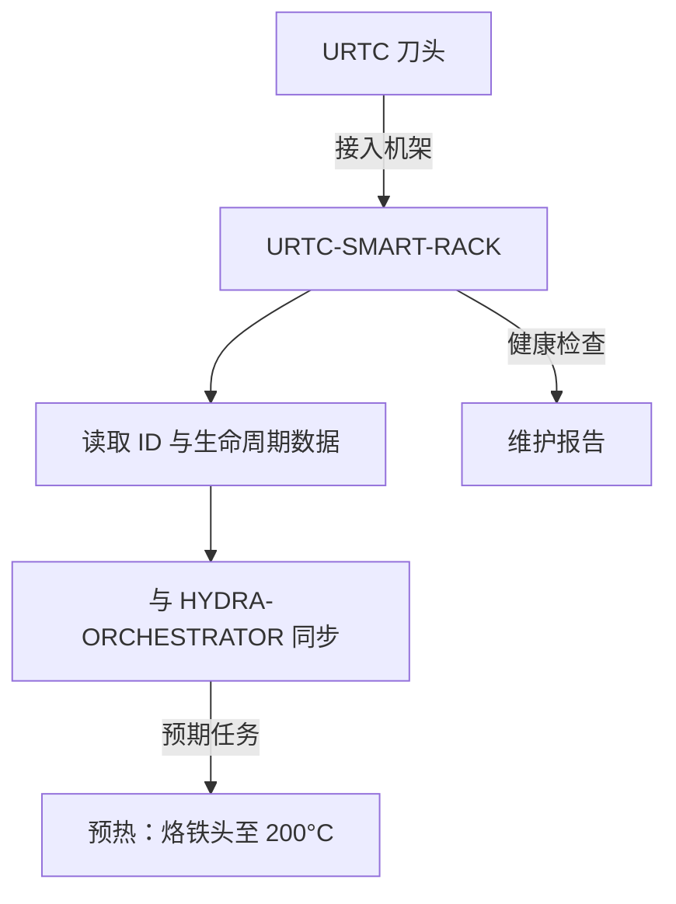

<p align="center">
  
</p>

# 🗄️ URTC-SMART-RACK

<p align="center"><a href="README.md">🇺🇸 English</a> | <a href="README_spa.md">🇪🇸 Español</a> | <a href="README_fra.md">🇫🇷 Français</a> | <a href="README_ita.md">🇮🇹 Italiano</a> | <a href="README_deu.md">🇩🇪 Deutsch</a> | 🇨🇳 <b>简体中文</b> | <a href="README_jpn.md">🇯🇵 日本語</a> | <a href="README_por.md">🇵🇹 Português</a></p>

### 🤖 具备生命周期与热管理追踪的智能末端执行器管理系统

<p align="center">
  
  
  
  
  
</p>

---

**诚实核查 - 今天真正能运行的部分：** `tool_id.c`、`lifecycle.c`、`preheat.c`、`protocol.c`、`rack_command.c`、`link_watchdog.c`、`tool_limits.c`、`rack_app.c`、`rack_link.c`、`rack_deframer.c`、`rack_can.c`、`preheat_limit.c` 和 `rack_inventory.c` 都是真实、纯粹的 C 代码，由 571 个通过的 `TEST_ASSERT` 检查支撑（`tests/test_*.c`，使用宿主机自身的 C 编译器而非 `arm-none-eabi-gcc` 编译并运行）——通过实际编译并运行这套宿主测试套件加以确认。这覆盖了 ID 解码、使用/生命周期跟踪、预热激活与目标温度、CRC8 分帧协议解析、命令范围校验、链路超时/幂等性处理，以及多槽位工具库存跟踪(哪个工具放在哪个槽位、同一把真实工具绝不会同时出现在两个槽位)——全部都是逻辑，没有任何硬件。正如 README 自己的介绍已经说明的那样：这块板子目前还没有 PCB/原理图，所以这里的任何代码都从未驱动过真实的 GPIO 引脚、F-RAM 芯片、加热元件或 CAN 收发器——`main.c`/`startup_stm32g4_minimal.c` 只是证明了针对 Cortex-M4F 的交叉编译和链接能够在一个占位链接脚本上成功完成，并不能证明其中任何部分真的运行在真实芯片上。具体已经交付了什么，请参见 `CHANGELOG.md`。 串行线路也会测试：19 条带有每段到达时间的字节流（分段的帧、噪声、错误的 CRC、不匹配的版本或长度、恰在超时界限上的静默、毫秒时钟回绕）经过真实的解帧器，输出的帧及其计数器与 URTC-COMMON 的模型一致。

---

> **安全与安防现状:**本生态系统不是经认证的安全系统,目前也不存在已组装的 URTC 电路板。引导程序使用 CRC32 和共享密钥的 HMAC-SHA256 校验固件映像,而非非对称签名(计划中);已发布的应用映像使用公开的开发密钥签名(`signing_key_kind: dev`),因此任何人都可以生成引导程序接受的映像;尚未向任何真实电路板发送过任何内容。在依赖此处任何说法来保障人身安全之前,请先阅读[安全基线](https://github.com/JuanenRac/URTC-DOCS/blob/main/docs/SECURITY_BASELINE.md)和[威胁模型](https://github.com/JuanenRac/URTC-DOCS/blob/main/docs/THREAT_MODEL.md)。

## 📋 速览

| | |
|---|---|
| 版本 | `0.2.2` |
| 成熟度 | 可用 |
| 测试 | 571 |
| 技术栈 | C / STM32G4 / arm-none-eabi-gcc |
| 目标 | 微控制器板（固件）；在电脑上构建 |
| 真实硬件 | 尚未：此版本没有在真实硬件上运行的记录 |

**跳转到：** [概述](#-概述) · [架构](#-架构) · [安全](#-安全与防护) · [接口](#-接口) · [快速开始](#-快速开始) · [测试](#-测试) · [结构](#-仓库结构) · [相关项目](#-相关项目)

<!-- urtc-section:status_smart_rack -->
## 🚦 项目状态

🟢 已完成并已验证 · 🟡 可用，但有已知限制 · 🟠 做了一半或未验证 · 🔴 未完成或不能用。从未在真实硬件上运行过的内容不会是绿色。

| 部分 | 状态 | 仓库能够证明的内容 |
| --- | :---: | --- |
| 软件 | 🟡 | 可在电脑上和模拟器上运行；从未在真实板子上运行过。 |
| 测试 | 🟢 | 每次推送时测试套件都会在 CI 中通过。 |
| 真实硬件 | 🟠 | 尚未在真实板子上运行：台架测试仍待进行。 |
| 文档 | 🟡 | 提供八种语言的 README 和参考文档；翻译未经母语者审阅。 |

<!-- /urtc-section:status_smart_rack -->

## 🎯 概述

**URTC-SMART-RACK** 是 URTC 生态系统内用于末端执行器的智能存储系统。
基于 STM32G4 微控制器，它在工具未安装到机器人上时对其进行监控和预处理。

它支持"智能待机"模式，例如在换刀前预热 T12 烙铁头，并跟踪每个 URTC
刀头的电子 ID 和总使用周期数（读取每个刀头的固件版本已列入计划，尚未实现），确保最佳维护和零延迟部署。

该板卡目前尚不存在 PCB/原理图（见 `hardware/`），因此下面的功能都无法驱动
真实的 GPIO/F-RAM/CAN 硬件——但这些功能所归结的*逻辑*（解码 ID、追踪使用
情况、决定何时以及以何种温度预热）是真实的、纯 C 编写的，并且今天已经过
单元测试。

### 关键特性：
* ✅ **真实 v0 —— ID、生命周期与预热逻辑：** `tool_id.c` 将原始 5 位 ID 读数解码为工具身份；`lifecycle.c` 追踪使用周期/时间并标记到期维护；`preheat.c` 决定智能待机预热应何时启动以及目标温度。使用宿主机自身的 C 编译器完成 571 个测试断言——无需 PCB、GPIO 驱动或 F-RAM 即可运行或测试这一切。同样已实现：串行链路的流式拆帧器（`rack_deframer.c`：查找起始字节，丢字节后重新同步，超时后丢弃半帧）、命令的 CAN 形式（`rack_can.c`：八个数据字节，温度为大端序；目前还没有板子承载它）以及预热在不换工具时可持续时间的上限（`preheat_limit.c`：默认 10 分钟，可配置）。
* ✅ **把工具头当作单个个体、热检查与预测性预热（已在主机上测试）：** `rack_inventory.c` 可以用类型加工具头序列号来标识一个槽位，`rack_units.c` 记录每个实体工具头的使用次数、加热时间和热故障（来自其自身计数器，`0x1AA` / `0x1AB`），因此磨损跟随工具头而不是类型；`slot_verify.c` 说明槽位的热读数对已下达的预热意味着什么（已达到、太慢、过冲、空槽位中有加热器在工作）；`preheat_plan.c` 把作业队列转换为预热指令，默认关闭。读数和队列来自其他程序，这些都没有在电路板上运行过，加热时间只是估计值。
* 🗄️ **工具追踪** —— 通过 5 位 ID 跳线或 F-RAM 自动识别 URTC 刀头。*（ID 解码逻辑本身是真实的——见上文；读取真实跳线/F-RAM 需要 PCB。）*
* 🗂️ **多槽位库存** —— `rack_inventory.c` 跟踪哪个工具放在哪个槽位，确保同一把真实工具始终只处于一个槽位(把它移到别的槽位会自动清空原槽位，而不是同时声称它在两个地方)，并按工具身份维护每个槽位各自的预热目标。启动时，`rack_inventory_reconcile()` 会将其与每个槽位的在位传感器核对：机架断电期间被取走的工具会被清除（包括预热目标），手动放入的工具会被标记为待识别。 *（库存逻辑本身是真实的——见上文；接入真实的按槽位在位传感器需要 PCB。）*
* 🌡️ **预热逻辑** —— 针对焊接和热风工具的智能热管理。*（激活决策和目标温度是真实的——见上文；驱动真实加热器需要 PCB。）*
* 📈 **生命周期日志** —— 将总致动周期数和使用小时数记录到工具的 F-RAM 中。*（计数器和到期维护逻辑是真实的——见上文；将其持久化到真实 F-RAM 需要 PCB。）*
* 📡 **CAN 集成** —— 计划与 HYDRA-UMC 运动学大脑通信，实现协调的 ATC（自动换刀）；由于既没有 CAN 驱动也没有板卡，这从未运行过。*（线路协议本身——帧格式、CRC、命令验证——是真实的，并已在主机上测试，见下文；仍需要真实的 CAN 收发器才能真正承载它。）*
* 🔒 **协议范围检查** —— 版本化帧格式与 CRC8 校验和、执行范围验证，以及带有明确安全状态的链路超时/幂等性看门狗。帧版本 2：所有多字节数值均与总线一样采用大端序，版本 1 的帧会被拒绝。*（以纯 C 实现，仅在 PC 上测试过；从未在板卡上运行过，也不是经过认证的安全功能）*
* ✅ **Cortex-M4F 固件工具链** —— 一个真实的裸机镜像（启动文件 + 链接脚本 + `main.c`），使用与兄弟仓库 URTC 相同的工具链，通过 `arm-none-eabi-gcc` 交叉编译并链接。*（已实现——见下方"构建"）*

## 🧩 在 URTC 中的角色

URTC-SMART-RACK 是存放工具头的板子，而不是工具头：一个机架，它识别所容纳的每个头（URTC 使用的 5 位工具 ID），记录每个实体头的使用情况和热故障，知道哪个工具在哪个槽位，并在换刀前不久为焊接或热风工具预热（Smart Idle）。它与 URTC 共用工具 ID 和固件约定，但属于互补工具而非 URTC 的子项目，设计上由 HYDRA-UMC 机器人控制器驱动。目前还没有板子：现在真实存在的是逻辑和机架协议，已在计算机上测试。

## 🏛️ 架构

<p align="center">
  
</p>

本仓库各部分如何协作：谁在使用它、它包含什么、它依赖什么。图片由 `docs/architecture.json` 绘制，并与代码核对。

<details>
<summary>图表的文本版 (Mermaid)</summary>



</details>

### 架构与设计决策

* **为什么该板卡尚未定义真实的引脚布局/硬件 ID。** 该板卡目前尚无 PCB——`src/firmware_common.h` 携带一个没有硬件 ID 的版本标识，启动文件/链接脚本是手写的占位符，暂时代替 ST 自身的 CMSIS/HAL 启动代码，直到确定真实的 STM32G4 型号。
* **为什么它不是 URTC 自身的子项目。** URTC-SMART-RACK 是一个配套工具，而非 URTC 系列的子项目——它是一块独立的物理板卡（工具存储架，而非刀头本身），恰好共享 URTC 自身的工具 ID 空间和固件惯例，而非其集成层级结构。
* **为什么 `bump_version.py` 是 URTC 同名脚本的原样副本。** 固件头格式相同——复用同一个脚本而不是重新发明，从构造上保证两者同步。
* **为什么 `tool_id.c`/`lifecycle.c`/`preheat.c` 先于任何 GPIO/F-RAM/CAN 驱动交付。** 解码 ID、累积使用情况、决定何时预热，都是对已有数据的纯函数运算——无需 PCB 即可编写或测试，因此 v0 首先交付这部分逻辑，使用宿主机自身的 C 编译器而非 `arm-none-eabi-gcc` 进行宿主测试。真正从真实硬件获取这些数据的驱动程序，将在 PCB 存在后到来。
* **这如何融入生态系统的其余部分。** 使用 URTC 自身的工具生态系统（相同的工具 ID；机架的帧目前还不是 CAN 帧，见 `docs/OPERATIONS.md`），并与 HYDRA-UMC-DETECTION-HEF 自然搭配，用于视觉识别实际存放在架上的工具。
* **为什么协议、命令验证与链路看门狗是三个独立的模块。** `protocol.c` 只了解字节、帧格式和 CRC，它并不知道什么样的温度才算“安全”。`rack_command.c` 拥有那份判断，它解码并对一个真实的命令进行范围检查，而不关心它是如何在总线上到达的。`link_watchdog.c` 独立于二者追踪超时/幂等性——一个损坏的帧甚至不应该到达它（参见 `test_rack_link_scenarios.c` 自身的真实断言：一个 CRC 错误的帧永远不会让看门狗复活）。保持它们分离使得每一个都能在宿主机上独立测试，并让未来的 CAN 接收处理函数保持精简——它只需按顺序调用每一层，而不需要重新实现它们任何一个的判断。
* **命令速率限制器。** 针对同一工具的大量命令会被已接受命令之间的最小间隔所限制（默认 20 毫秒，0 表示关闭；`link_watchdog_set_command_interval()`）。被暂缓的命令不会改变任何状态，也不会收到确认，但仍视为链路存活；安全状态和重传绝不会被暂缓。该间隔可在 URTC-WEB-STUDIO 的模拟机架试验台中调整。
* **为什么未经验证的链路会被当作已断开的链路处理。** `link_watchdog_is_link_lost()` 在真正超时之后为真，在第一个帧还从未到达之前也为真——正如诊断笔记自身所说的“estado seguro al arrancar”。一个开机时还没有主机连接的机架，必须以安全状态启动，而不是在未经证实之前默默假定“没问题”。

## 🔒 安全与防护

| 威胁 | 防御 |
|---|---|
| 发给某个工具的超范围命令 | `rack_command.c` 对每条命令解码并检查范围，不关心它如何到达；`protocol.c` 只认识字节、帧和 CRC；`tool_limits.c` 保存每个工具配置的限值 |
| 损坏或过时的帧 | 带版本号的帧和 CRC-8；版本 2 中所有多字节数值都与总线一样采用大端序，版本 1 的帧会被拒绝 |
| 命令洪泛 | 已接受命令之间的最小间隔（默认 20 毫秒，0 为关闭）；被扣留的命令不会改变任何东西也没有确认，但算作链路仍然存活；安全状态或重传永远不会被扣留 |
| 丢失或未经证明的链路 | `link_watchdog_is_link_lost()` 在真正超时后以及第一帧到达之前都为真：没有主机就上电的机架会从安全状态启动 |
| 预热过久或过热 | `preheat_limit.c` 限制没有换刀时预热可持续的时间（默认 10 分钟，可配置），`tool_limits.c` 限制每个工具配置的最高目标值 |
| 一个工具出现在两个槽位 | `rack_inventory.c` 让一个真实工具只在一个槽位；把它放到别处会清除原来的槽位 |

这一切都是在计算机上测试的纯 C；从未在板子上运行过，也不是经过认证的安全功能。

## 🔌 接口

* **机架的串行帧：** 版本 2，与总线一样采用大端序，使用 URTC-COMMON 提供的 CRC-8（`src/urtc_crc8.h`、`src/urtc_frame.h`）；`protocol.c` 负责解析和编码，`rack_deframer.c` 在字节流中找出帧（丢字节后重新同步，超时后丢弃半个帧），`rack_link.c` 决定如何处理每一帧。格式见 [docs/OPERATIONS.md](docs/OPERATIONS.md)。
* **命令的 CAN 形式：** `rack_can.c`（八个数据字节，温度为大端序）。目前还没有板子承载它：机架的帧还不是 CAN 帧。
* **与 URTC 共用：** 5 位工具 ID（`tool_id.c`）以及记录每个实体头使用情况的计数器 `0x1AA` / `0x1AB`（`rack_units.c`）。帧层必须复现的向量来自 URTC-COMMON（`conformance/rack_vectors.json`）。

## 🚀 快速开始

需要 ARM GNU 工具链（`arm-none-eabi-gcc`、`arm-none-eabi-objcopy`、
`arm-none-eabi-size`）以及 Python 3。

```bash
# Linux/macOS
chmod +x build_firmware.sh   # 仅需一次
./build_firmware.sh

# Windows
build_firmware.bat
```

真实示例——宿主机侧测试也可以独立运行，便于在不进行完整固件构建的情况下
检查逻辑：

```bash
cc -std=c11 -Wall -Wextra -Isrc -Itests -o build/host_tests \
  tests/test_main.c tests/test_tool_id.c tests/test_lifecycle.c tests/test_preheat.c \
  tests/test_protocol.c tests/test_rack_command.c tests/test_link_watchdog.c tests/test_rack_link_scenarios.c \
  tests/test_rack_inventory.c tests/test_robustness.c tests/test_rack_app.c \
  tests/test_rack_deframer.c tests/test_rack_can.c tests/test_preheat_limit.c \
  src/tool_id.c src/tool_limits.c src/lifecycle.c src/preheat.c src/protocol.c src/rack_command.c src/link_watchdog.c src/rack_link.c \
  src/rack_inventory.c src/rack_app.c src/rack_deframer.c src/rack_can.c src/preheat_limit.c
./build/host_tests
# All tests passed.
```

<!-- urtc-section:compatibility -->
### 要求与兼容性

哪些版本的 URTC 程序可以配合使用、各自使用哪个协议版本，列在 URTC-COMMON 生成的兼容性表中：[docs/COMPATIBILITY.md](https://github.com/JuanenRac/URTC/blob/main/docs/COMPATIBILITY.md)。
<!-- /urtc-section:compatibility -->

## 🧪 测试

主机测试是 `tests/` 中的 C 程序（18 个文件中的 571 个 `TEST_ASSERT` 检查），用电脑自己的 C 编译器编译运行，从不使用 `arm-none-eabi-gcc`：工具 ID、工具限值、生命周期、预热、帧、命令检查、链路看门狗、完整的链路场景、库存、对错误输入的鲁棒性、应用层、帧拆分器（19 个字节流，带有每一块到达的时间：分块的帧、噪声、错误的 CRC、错误的版本或长度、恰在超时边界的静默、毫秒时钟回绕）、CAN 形式、预热限制和每个头的单元；向量来自 URTC-COMMON。五个 Python 测试文件（25 个测试）检查构建脚本、发布资源、版本文件和公布的测试数量是否一致。CI 用 AddressSanitizer 和 UBSan 构建 C 测试，并在 `src/` 已执行行的覆盖率低于下限时失败（`tools/gcov_floor.py`）。`bash build_firmware.sh` 在交叉编译前运行它们，任何断言失败则构建失败。接收中断填充的字节环（`rack_ring.c`）以及生命周期和库存的双份存储（`rack_persist.c`，在一次保存的每个字节处断电进行测试）同样是纯逻辑；存储背后的存储芯片尚未选定。

## 🏗️ 构建与发布

构建首先用*电脑自己的* C 编译器编译并运行 `tests/`（从不使用 `arm-none-eabi-gcc`：这些是纯逻辑测试，不接触 MCU 寄存器），任何断言失败整个构建就失败。之后才为 Cortex-M4F 编译 `main.c` 和 `startup_stm32g4_minimal.c`，与占位的 `STM32G4_MINIMAL.ld` 内存映射链接，并把带版本号的 `.elf`/`.bin`/`.hex` 文件发布到 `firmware/`。构建从不改变版本。

`src/` 下的每个模块也会为 Cortex-M4F 编译，并作为检查全部链接在一起（目标上没有 C 库），尽管目前镜像里只有 `main.c` 和启动文件。设置 `URTC_CI=1` 时不会改动任何受版本控制的文件。

固件映像（`.bin`、`.hex`、`.elf`）不纳入 git 版本管理：发布构建会写入 `firmware/URTC_SMART_RACK_FIRMWARE_v<版本>.*`（已被 git 忽略；CI 模式即 `URTC_CI=1` 时写入 `build/firmware`），它们仅作为每个版本的 GitHub 发布资源发布。`python tools/publish_release_assets.py` 会检查这些文件、补写缺失的 `.sha256` 文件，并输出带有待附加文件的准确 `gh release create` 命令。

目前尚无内容可刷写到真实硬件——因为没有 PCB 可以确认目标 STM32G4 型号、
引脚布局或其真实的 flash/RAM 容量。链接脚本的内存映射是一个保守的占位符
（在其自身的文件头注释中有说明），一旦真实硬件问世将被替换，届时
`startup_stm32g4_minimal.c` 手写的向量表也会被 ST 自身的 CMSIS/HAL 启动
代码取代（对应兄弟仓库 URTC 中针对 STM32F303 板卡的 `src/F303-master/`）。

完整的版本历史见 [`CHANGELOG.md`](CHANGELOG.md)，每个版本在其中都有自己的条目。

## 📂 仓库结构

<p align="center">
  
</p>

<details>
<summary>目录树的文本版</summary>

```text
URTC-SMART-RACK/
├── src/                                               固件：纯 C 逻辑、URTC-COMMON 的核对副本、入口点和占位链接脚本
├── tests/                                             C 主机测试（571 项检查）和构建脚本的 Python 检查
├── docs/                                              OPERATIONS.md：逻辑做什么、拒绝什么、哪些尚未验证
├── hardware/                                          说明：目前没有原理图和 PCB
├── tools/                                             构建检查、覆盖率下限、发布资源以及共用的 CI 和图片工具
├── images/                                            横幅和本 README 的图片
├── .github/                                           CI 工作流以及 Issue 和 Pull Request 模板
├── build-test.sh build-test.bat                       构建并测试的脚本，不会修改仓库内容
├── test.sh test.bat                                   运行测试
├── urtc.project.json                                  清单：版本、角色、成熟度和构建命令
├── CHANGELOG.md                                       每个版本的变更
├── SECURITY.md SUPPORT.md LICENSE                     安全政策、支持和许可证
├── CONTRIBUTING.md CODE_OF_CONDUCT.md                 如何参与贡献和行为准则
├── .gitattributes .gitignore                          Git 设置
├── build_firmware.sh build_firmware.bat               主机测试、交叉编译、链接并发布镜像
├── bump.py bump_version.py bump_manifest_version.py   提升版本号的脚本
└── LICENSE.md ruff.toml                               文档许可证和 lint 设置
```

</details>

每个源文件的带注释清单（每个文件一行）见 [docs/SOURCE_MAP.md](docs/SOURCE_MAP.md)。

## 🗺️ 路线图与已知限制

**目前已知的限制**

* 这块板子还没有 PCB 或原理图（见 `hardware/`）：这里的一切从未驱动过真实的 GPIO 引脚、F-RAM 芯片、加热器或 CAN 收发器。`main.c` 和启动文件只证明了用占位链接脚本为 Cortex-M4F 交叉编译并链接是成功的。
* 读取每个头的固件版本是计划中的，尚未实现。
* 命令的 CAN 形式从未运行过：既没有 CAN 驱动也没有板子，机架的帧还不是 CAN 帧。
* 预测性预热的加热时间是估计值，其开关默认关闭。

**下一步**

* 设计板子，确定 STM32G4 型号，并用 ST 自己的链接脚本和启动文件替换占位文件；编写为逻辑提供数据的 GPIO、F-RAM 和 CAN 驱动。

## 🌍 语言

README 和文本提供英语、西班牙语、法语、意大利语、德语、汉语、日语和欧洲葡萄牙语版本。

## 🔗 相关项目

URTC 由相互独立的仓库组成，每个仓库都有自己的版本、测试和 README。以下是按组划分的家族：

* **URTC Tool Platform:**
  * [URTC](https://github.com/JuanenRac/URTC) - 工具头电路板的固件(25 个工具配置、CAN 引导程序)以及 CAN 协议参考。
  * [URTC-COMMON](https://github.com/JuanenRac/URTC-COMMON) - 只写一次的 CAN 协议数据(规范、生成的表格、一致性向量)以及各程序共享的代码。
  * [URTC-FLASHER](https://github.com/JuanenRac/URTC-FLASHER) - 通过 CAN 或 SWD/JTAG 更新电路板固件的桌面工具。
  * [URTC-GATEWAY](https://github.com/JuanenRac/URTC-GATEWAY) - 位于 CAN 总线前的网关:只放行列表中的标识符,限制其速率,并要求会话密钥。
  * **URTC-SMART-RACK** (本仓库) - 用于带预热和生命周期跟踪的工具架的、与硬件无关的 C 逻辑和命令协议。
  * [URTC-TESTER](https://github.com/JuanenRac/URTC-TESTER) - 桌面实时 CAN 总线测试器,显示电路板所报告工具配置的控件和遥测。
  * [URTC-VISION-TOOL](https://github.com/JuanenRac/URTC-VISION-TOOL) - C 语言的传感器帧协议,以及用于检测工具头的 Python 热成像/RGB 配套程序。
  * [URTC-WEB-STUDIO](https://github.com/JuanenRac/URTC-WEB-STUDIO) - 通过 Web Serial 和 SLCAN 烧录并测试电路板的浏览器应用,无需安装。
* **Ecosystem Operations:**
  * [URTC-DOCS](https://github.com/JuanenRac/URTC-DOCS) - 生态系统的架构、接口、安全基线和生成的目录,以及比较所有仓库的工具。
  * [URTC-UPDATER](https://github.com/JuanenRac/URTC-UPDATER) - 检测、安装并更新 URTC 家族仓库的桌面工具,每次只执行一个明确的操作。

**姊妹项目（相互独立，共用同一基础和工具）：**

* **[HYDRA-UMC-DOCS](https://github.com/JuanenRac/HYDRA-UMC-DOCS)** - 姊妹项目：HYDRA-UMC 的文档中心，一个独立的生态，与本生态共用基础和工具
* **[ARMOR-DOCS](https://github.com/JuanenRac/ARMOR-DOCS)** - 姊妹项目：A.R.M.O.R. 安全生态的文档中心，同样独立，建立在同一基础上
* **[JuanenRac](https://github.com/JuanenRac/JuanenRac)** - 所有生态的个人主页和状态面板

## 📚 文档

- **[CONTRIBUTING.md](CONTRIBUTING.md)** —— 提交 Pull Request 所需的技术栈和编码规范。
- **[CODE_OF_CONDUCT.md](CODE_OF_CONDUCT.md)** —— 本社区所期望的行为准则。
- **[SECURITY.md](SECURITY.md)** —— 如何报告漏洞，以及本项目真实的安全关注重点。
- **[SUPPORT.md](SUPPORT.md)** —— 在哪里提问和报告缺陷。
- **[LICENSE.md](LICENSE.md)** —— 本项目自身的许可证。

## 🤝 参与贡献与社区

* 提交 Pull Request 之前请运行 `URTC_CI=1 python tools/ci_validate.py`：必须通过。参见 [CONTRIBUTING.md](CONTRIBUTING.md) 和[行为准则](CODE_OF_CONDUCT.md)。
* README 有八种语言：修改文字时要同步修改全部八个文件，与其他仓库共用的章节由 URTC-COMMON 的 `tools/readme_sections.py` 写入。
* 对 CAN 协议的修改从 URTC-COMMON（`spec/can_protocol.json`）开始，并通过经过核对的副本进入本仓库。
* 不要把仅仅构建过的东西描述为已在板子上运行。
* 请私下报告漏洞：[SECURITY.md](SECURITY.md)。问题、想法和报告：electrohobby3d@gmail.com（[SUPPORT.md](SUPPORT.md)）。

## 👤 作者

**JuanenRac** (Electro Hobby 3D)
📧 electrohobby3d@gmail.com
📺 [youtube.com/@electrohobby3d](https://youtube.com/@electrohobby3d)

## 📜 许可证

GPL-3.0-or-later —— 详见 LICENSE。
